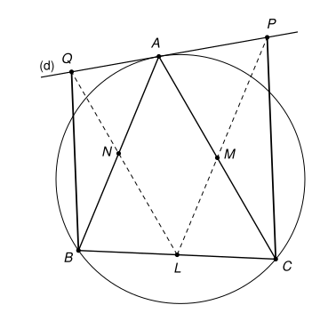

## Statement

Soit $ABC$ un triangle. On note $L$, $M$ et $N$ les milieux des côtés $[BC]$, $[CA]$ et $[AB]$.
Soit $(d)$ la tangente en $A$ au cercle circonscrit au triangle $ABC$.

La droite $(LM)$ coupe $(d)$ en un point $P$, et la droite $(LN)$ coupe $(d)$ en un point $Q$.

Montrer que les droites $(CP)$ et $(BQ)$ sont parallèles.

## Hints

1. Les droites $(LM)$ et $(LN)$ sont parallèles à deux côtés du triangle. Lesquels ?
2. Refais la figure en remplaçant la tangente par une autre droite passant par $A$. Que
   constates-tu ? La tangente sert seulement à garantir que les points $P$ et $Q$ existent.
3. Place-toi dans le repère d'origine $A$ dans lequel $B$ a pour coordonnées $(1 ; 0)$ et $C$ a
   pour coordonnées $(0 ; 1)$. Quelles sont les équations des droites $(LM)$ et $(LN)$ ?
4. Une droite passant par $A$, autre que $(AB)$ et $(AC)$, est formée des points $(x ; kx)$ pour
   un certain nombre $k \neq 0$. Calcule les coordonnées de $P$ et de $Q$, puis compare les
   vecteurs $\overrightarrow{CP}$ et $\overrightarrow{BQ}$.

## Solution

### Étape 1 : deux droites des milieux

Dans un triangle, la droite qui joint les milieux de deux côtés est parallèle au troisième côté.
Donc $(LM)$ est parallèle à $(AB)$, et $(LN)$ est parallèle à $(AC)$.

### Étape 2 : à quoi sert la tangente ?

La tangente $(d)$ ne touche le cercle qu'au point $A$. Elle n'est donc pas la droite $(AB)$, qui
recoupe le cercle en $B$, ni la droite $(AC)$. Or la seule droite passant par $A$ et parallèle à
$(AB)$ est $(AB)$ elle-même. Donc $(d)$ n'est pas parallèle à $(AB)$, ni donc à $(LM)$ : ces deux
droites se coupent bien en un seul point $P$. De même, le point $Q$ existe.

C'est le **seul** endroit où la tangente intervient. La suite de la preuve marche pour n'importe
quelle droite $(d)$ passant par $A$, à condition que ce ne soit ni $(AB)$ ni $(AC)$.

### Étape 3 : un repère bien choisi

Les vecteurs $\overrightarrow{AB}$ et $\overrightarrow{AC}$ ne sont pas colinéaires, donc on peut
prendre le repère d'origine $A$ avec ces deux vecteurs. Ce repère n'est pas orthonormé, mais cela
ne gêne pas : on va seulement calculer des coordonnées de points et de vecteurs, et ces calculs
marchent dans n'importe quel repère.

Dans ce repère,
$$A(0 ; 0), \quad B(1 ; 0), \quad C(0 ; 1), \quad L\left(\tfrac{1}{2} ; \tfrac{1}{2}\right), \quad M\left(0 ; \tfrac{1}{2}\right), \quad N\left(\tfrac{1}{2} ; 0\right).$$
Les points $L$ et $M$ ont la même ordonnée $\frac{1}{2}$, donc la droite $(LM)$ a pour équation
$y = \frac{1}{2}$. De même, $(LN)$ a pour équation $x = \frac{1}{2}$.

Prenons un point $D(\alpha ; \beta)$ de $(d)$, autre que $A$. On a $\alpha \neq 0$, sinon $D$ serait
sur l'axe des ordonnées, qui est la droite $(AC)$. De même $\beta \neq 0$. Posons
$k = \dfrac{\beta}{\alpha} \neq 0$. Comme $\overrightarrow{AD} = \alpha \, (1 ; k)$, la droite $(d)$ est
formée des points de coordonnées $(x ; kx)$.

### Étape 4 : les points $P$ et $Q$

Le point $P$ est sur $(d)$ et sur la droite d'équation $y = \frac{1}{2}$, donc $kx = \frac{1}{2}$ :
$$P\left(\frac{1}{2k} ; \frac{1}{2}\right).$$
Le point $Q$ est sur $(d)$ et sur la droite d'équation $x = \frac{1}{2}$ :
$$Q\left(\frac{1}{2} ; \frac{k}{2}\right).$$

### Étape 5 : les deux vecteurs

On calcule
$$\overrightarrow{CP}\left(\frac{1}{2k} ; -\frac{1}{2}\right) \qquad \text{et} \qquad \overrightarrow{BQ}\left(-\frac{1}{2} ; \frac{k}{2}\right).$$
En multipliant les coordonnées de $\overrightarrow{CP}$ par $-k$, on obtient
$\left(-\frac{1}{2} ; \frac{k}{2}\right)$, c'est-à-dire exactement celles de $\overrightarrow{BQ}$ :
$$\overrightarrow{BQ} = -k \, \overrightarrow{CP}.$$
Ces deux vecteurs sont non nuls (le point $P$ a pour ordonnée $\frac{1}{2}$, donc $P \neq C$ ; de
même $Q \neq B$) et colinéaires.

**Les droites $(CP)$ et $(BQ)$ sont donc parallèles.**

## Going further

1. Le corrigé officiel utilise des angles : il montre que les points $A$, $Q$, $B$, $L$ sont sur
   un même cercle, ainsi que $A$, $P$, $C$, $M$. Si tu connais l'angle entre une tangente et une
   corde, essaie de retrouver cette preuve. Remarque qu'elle utilise vraiment la tangente, alors
   que la preuve ci-dessus montre qu'on peut s'en passer.
2. On suppose maintenant $AB = AC$. Montrer que la tangente $(d)$ est alors parallèle à $(BC)$, et
   que le quadrilatère $BQPC$ est un parallélogramme.
