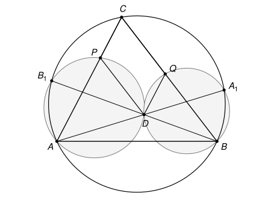

## Statement

Soit $ABC$ un triangle dont les trois angles sont aigus, et soit $D$ un point situé à l'intérieur du triangle $ABC$.

Les droites $(AD)$ et $(BD)$ recoupent le cercle circonscrit au triangle $ABC$ en des points $A_1$ et $B_1$ respectivement. Le cercle circonscrit au triangle $B_1DA$ recoupe la droite $(AC)$ en un point $P$. Le cercle circonscrit au triangle $A_1BD$ recoupe la droite $(BC)$ en un point $Q$.

Démontrer que le quadrilatère $CPDQ$ est un parallélogramme.

## Hints

1. Sur la figure, quelles droites semblent parallèles ? Il suffit de démontrer deux parallélismes.
2. Pour montrer que $(PD)$ est parallèle à $(BC)$, compare les angles $\widehat{APD}$ et $\widehat{ACB}$.
3. Le point $B_1$ est sur deux cercles à la fois. Dans chacun d'eux, quel angle inscrit en $B_1$ peux-tu utiliser ?
4. Avant d'utiliser le théorème de l'angle inscrit, vérifie que les deux points d'où l'on regarde la corde sont bien du même côté de celle-ci. Le point $X$ où la droite $(BD)$ coupe $(AC)$ aide beaucoup.

## Solution

**L'outil : le théorème de l'angle inscrit.** Si $U$ et $V$ sont deux points d'un cercle, et $M$, $N$ deux autres points du cercle situés du même côté de la droite $(UV)$, alors $\widehat{UMV} = \widehat{UNV}$. En effet, chacun de ces angles vaut la moitié de l'angle au centre qui intercepte le même arc $UV$.

Il faut bien vérifier que $M$ et $N$ sont du même côté de $(UV)$ : sinon, les deux angles sont supplémentaires et non égaux. C'est pourquoi on commence par placer les points.

**Étape 1 : la position des points.** Le point $D$ est à l'intérieur du triangle, donc la demi-droite $[BD)$ sort du triangle en traversant le côté $[AC]$, en un point $X$ situé strictement entre $A$ et $C$. Le point $D$ est strictement entre $B$ et $X$.

Le point $X$ est sur la corde $[AC]$, donc à l'intérieur du cercle circonscrit. La droite $(BX)$ ressort donc du disque de l'autre côté de $X$ : le point $B_1$ est tel que $X$ est strictement entre $B$ et $B_1$. Sur la droite $(BB_1)$, les points se suivent donc dans l'ordre
$$B, \quad D, \quad X, \quad B_1.$$

On en tire deux remarques.

- *$B_1$ et $C$ sont du même côté de $(AB)$.* La droite $(BB_1)$ ne coupe $(AB)$ qu'en $B$, et $B$ n'est pas sur le segment $[XB_1]$. Donc $X$ et $B_1$ sont du même côté de $(AB)$. Or $X$, qui est sur $]AC[$, est du même côté que $C$.
- *$B_1$ et $C$ sont du même côté de $(AD)$.* La droite $(BB_1)$ ne coupe $(AD)$ qu'en $D$, et $D$ n'est pas sur le segment $[XB_1]$. Donc $B_1$ est du même côté de $(AD)$ que $X$, donc que $C$. Plus généralement, la droite $(AD)$ ne coupe $(AC)$ qu'en $A$, donc tous les points de la demi-droite $[AC)$ autres que $A$ sont du côté de $C$.

Enfin, notons $\omega$ le cercle circonscrit au triangle $B_1DA$. Le point $X$ est sur la corde $[DB_1]$ de $\omega$, donc à l'intérieur de $\omega$. La droite $(AC)$ passe par $X$ et coupe $\omega$ en $A$ et en $P$, donc $X$ est strictement entre $A$ et $P$. En particulier, $P$ est sur la demi-droite $[AC)$ et $P \neq A$.

**Étape 2 : deux angles égaux à $\widehat{ACB}$.**

- Dans le cercle circonscrit à $ABC$, les points $B_1$ et $C$ regardent la corde $[AB]$ du même côté. Donc $\widehat{AB_1B} = \widehat{ACB}$. Comme $D$ est sur le segment $[B_1B]$, on a $\widehat{AB_1D} = \widehat{AB_1B}$, d'où
$$\widehat{AB_1D} = \widehat{ACB}.$$
- Dans le cercle $\omega$, les points $P$ et $B_1$ regardent la corde $[AD]$. Ils sont tous les deux du côté de $C$ par rapport à $(AD)$, d'après l'étape 1. Donc
$$\widehat{APD} = \widehat{AB_1D} = \widehat{ACB}.$$

**Étape 3 : $(PD)$ est parallèle à $(BC)$.** Les points $P$ et $C$ sont sur la demi-droite $[AC)$, et les points $D$ et $B$ sont du même côté de la droite $(AC)$. Les angles $\widehat{APD}$ et $\widehat{ACB}$ sont donc des angles correspondants, et ils sont égaux. Si l'on avait $P = C$, on aurait $\widehat{ACD} = \widehat{ACB}$, et $D$ serait sur la droite $(CB)$, ce qui est faux. Donc $P \neq C$, et les droites $(PD)$ et $(CB)$ sont parallèles.

**Étape 4 : $(QD)$ est parallèle à $(AC)$.** L'énoncé ne change pas si l'on échange les rôles de $A$ et $B$ : alors $A_1$ et $B_1$ s'échangent, ainsi que $P$ et $Q$. Le même raisonnement montre donc que $Q \neq C$ et que les droites $(QD)$ et $(CA)$ sont parallèles.

**Conclusion.** Dans le quadrilatère $CPDQ$, le côté $[CP]$ est porté par $(AC)$, parallèle à $(QD)$, et le côté $[CQ]$ est porté par $(BC)$, parallèle à $(PD)$. Les points $C$, $P$, $D$ ne sont pas alignés, car $D$ n'est pas sur $(AC)$. Un quadrilatère dont les côtés opposés sont parallèles deux à deux est un parallélogramme : **$CPDQ$ est un parallélogramme.**

## Going further

- Le corrigé officiel tient en deux lignes, grâce aux *angles orientés de droites* : avec eux, le théorème de l'angle inscrit s'applique sans se soucier de la position des points. Sans eux, il faut faire le travail de l'étape 1.
- On a appris en chemin que $P$ est l'intersection de $(AC)$ avec la parallèle à $(BC)$ passant par $D$. Il est donc toujours strictement entre $A$ et $C$, quelle que soit la position de $D$ à l'intérieur du triangle.
- La preuve n'utilise nulle part que les angles du triangle sont aigus. Le résultat reste vrai pour n'importe quel triangle, pourvu que $D$ soit à l'intérieur. Relis la solution pour t'en convaincre.
