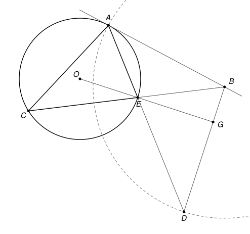

## Statement

Soit $ACE$ un triangle tel que $AE < AC$. On note $\Omega$ son cercle circonscrit et $O$ le centre de $\Omega$.

- La tangente à $\Omega$ au point $A$ coupe la droite $(CE)$ en un point $B$.
- Le cercle de centre $B$ qui passe par $A$ recoupe la droite $(AE)$ en un point $D$.
- Les droites $(OE)$ et $(BD)$ se coupent en un point $G$.

Montrer que les points $A$, $B$, $G$ et $O$ sont sur un même cercle.

## Hints

1. Que vaut l'angle $\widehat{OAB}$ ? Repérez ensuite deux triangles isocèles sur la figure.
2. Il suffit de montrer que l'angle $\widehat{OGB}$ est droit. Pourquoi ?
3. Dans le triangle $EGD$, exprimez les angles en $E$ et en $D$ à l'aide d'angles de sommet $A$.

## Solution

### Ce qu'il suffit de montrer

La droite $(AB)$ est tangente en $A$ au cercle $\Omega$ de centre $O$, donc elle est perpendiculaire au rayon $[OA]$ : $\widehat{OAB} = 90^\circ$. Le point $A$ est donc sur le cercle de diamètre $[OB]$.

On va montrer que $\widehat{OGB} = 90^\circ$ aussi. Le point $G$ sera alors, lui aussi, sur le cercle de diamètre $[OB]$, et les quatre points $A$, $B$, $G$ et $O$ seront sur ce cercle.

### Deux triangles isocèles

- On a $OA = OE$, rayons de $\Omega$ : le triangle $OAE$ est isocèle en $O$, et $\widehat{OEA} = \widehat{OAE}$.
- On a $BA = BD$, rayons du cercle de centre $B$ : le triangle $BAD$ est isocèle en $B$, et $\widehat{BDA} = \widehat{BAD}$.

### Les angles en A

Sur la figure, le point $E$ est entre $A$ et $D$, et la demi-droite $[AE)$ est à l'intérieur de l'angle $\widehat{OAB}$. Donc $\widehat{BAD} = \widehat{BAE}$ et

$$\widehat{OAE} + \widehat{BAD} = \widehat{OAE} + \widehat{EAB} = \widehat{OAB} = 90^\circ.$$

### L'angle en G

Sur la figure, le point $E$ est entre $O$ et $G$, et le point $G$ est sur le segment $[DB]$. On regarde le triangle $EGD$.

- Les droites $(OG)$ et $(AD)$ se coupent en $E$, donc les angles $\widehat{GED}$ et $\widehat{OEA}$ sont opposés par le sommet : $\widehat{GED} = \widehat{OEA} = \widehat{OAE}$.
- Comme $E$ est sur $[DA]$ et $G$ sur $[DB]$, on a $\widehat{EDG} = \widehat{ADB} = \widehat{BAD}$.

La somme des angles du triangle $EGD$ vaut $180^\circ$, donc

$$\widehat{EGD} = 180^\circ - \widehat{OAE} - \widehat{BAD} = 180^\circ - 90^\circ = 90^\circ.$$

Les droites $(OG)$ et $(BD)$ sont donc perpendiculaires, et $\widehat{OGB} = 90^\circ$.

### Conclusion

Les triangles $OAB$ et $OGB$ sont rectangles en $A$ et en $G$. Les points $A$ et $G$ sont donc tous les deux sur le cercle de diamètre $[OB]$. **Les points $A$, $B$, $G$ et $O$ sont sur un même cercle.**

### Une autre preuve, qui ne dépend pas de la figure

La preuve ci-dessus lit plusieurs positions sur la figure (quel point est entre quels autres). Voici une preuve par le calcul qui s'en passe. On se place dans un repère orthonormé d'origine $A$, dont l'axe des abscisses est la droite $(AE)$. On note $O(p\,;q)$ et $B(b\,;c)$.

- Le point $E$ est sur l'axe des abscisses, et $OA = OE$, donc $O$ est sur la médiatrice de $[AE]$. Cette médiatrice est la droite verticale qui passe par le milieu de $[AE]$, donc ce milieu a pour abscisse $p$, et $E(2p\,;0)$.
- De même, $BA = BD$ et $D$ est sur l'axe des abscisses, donc $D(2b\,;0)$.

On en déduit les coordonnées de quatre vecteurs :

$$\overrightarrow{AO}(p\,;q), \qquad \overrightarrow{OE}(p\,;-q), \qquad \overrightarrow{AB}(b\,;c), \qquad \overrightarrow{BD}(b\,;-c).$$

La symétrie par rapport à l'axe des abscisses change le vecteur de coordonnées $(x\,;y)$ en celui de coordonnées $(x\,;-y)$. Elle envoie donc $\overrightarrow{AO}$ sur $\overrightarrow{OE}$, et $\overrightarrow{AB}$ sur $\overrightarrow{BD}$. Une symétrie conserve les angles. Comme les droites $(AO)$ et $(AB)$ sont perpendiculaires, les droites $(OE)$ et $(BD)$ le sont aussi, quelle que soit la figure. On conclut comme plus haut.

## Going further

1. Montrez que l'angle entre la tangente $(AB)$ et la corde $[AE]$ est égal à l'angle inscrit $\widehat{ACE}$ : $\widehat{BAE} = \widehat{ACE}$. (Utilisez le triangle isocèle $OAE$ et l'angle au centre $\widehat{AOE}$.)
2. Déduisez-en que $\widehat{BDA} = \widehat{BCA}$, puis que les points $A$, $B$, $C$ et $D$ sont, eux aussi, sur un même cercle.
