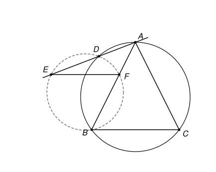

## Statement

Soit $ABC$ un triangle isocèle en $A$ ($AB = AC$), et soit $\Gamma$ son cercle circonscrit.

- On prend un point $D$ sur le petit arc de $\Gamma$ qui joint $A$ à $B$ (celui qui ne passe pas par $C$).
- On prend un point $E$ sur la droite $(AD)$, au-delà de $D$ (les points $A$, $D$, $E$ sont alignés dans cet ordre), et du même côté de la droite $(BC)$ que $A$.
- Le cercle qui passe par $B$, $D$ et $E$ recoupe la droite $(AB)$ en un point $F$.

Montrer que les droites $(EF)$ et $(BC)$ sont parallèles.

## Hints

1. Repère sur la figure les deux groupes de quatre points situés sur un même cercle : $A$, $B$, $C$, $D$ d'un côté, et $B$, $D$, $E$, $F$ de l'autre.
2. Pour montrer que $(EF)$ et $(BC)$ sont parallèles, il suffit de trouver deux angles alternes-internes égaux. Avec la sécante $(AB)$, lesquels ?
3. On veut donc montrer que $\widehat{EFB} = \widehat{FBC}$. Sur le cercle qui passe par $B$, $D$, $E$, $F$, quel autre angle « voit » la corde $[EB]$ sous le même angle que $F$ ?
4. Les angles $\widehat{EDB}$ et $\widehat{ADB}$ sont supplémentaires, car $A$, $D$, $E$ sont alignés. Et $ADBC$ est un quadrilatère inscrit dans $\Gamma$.

## Solution

**Rappel : deux propriétés des angles inscrits.** Soient $P$ et $Q$ deux points d'un cercle, et $R$, $S$ deux autres points de ce cercle.

- Si $R$ et $S$ sont **du même côté** de la droite $(PQ)$, alors $\widehat{PRQ} = \widehat{PSQ}$ : la corde $[PQ]$ est vue sous le même angle depuis tous les points d'un même arc.
- Si $R$ et $S$ sont **de part et d'autre** de la droite $(PQ)$, alors $\widehat{PRQ} + \widehat{PSQ} = 180^\circ$. Autrement dit, dans un quadrilatère inscrit dans un cercle, deux angles opposés sont supplémentaires.

Les deux viennent du théorème de l'angle inscrit : un angle inscrit vaut la moitié de l'angle au centre qui intercepte le même arc. Dans le premier cas, les deux angles interceptent le même arc. Dans le second, ils interceptent les deux arcs complémentaires, dont les angles au centre font $360^\circ$ à eux deux, donc les angles inscrits font $180^\circ$.

**La configuration.** Le point $D$ est sur le petit arc $AB$, donc $D$ et $C$ sont de part et d'autre de la droite $(AB)$. Le point $E$ est sur la demi-droite $[AD)$, donc du même côté de $(AB)$ que $D$ : ainsi $E$ et $C$ sont de part et d'autre de $(AB)$. Les hypothèses sur la position de $E$ (au-delà de $D$, mais pas au-delà de la droite $(BC)$) font tomber $F$ sur le segment $[AB]$, comme sur la figure. Nous l'admettons ici.

**La chaîne d'angles.** On part de l'angle $\widehat{EFB}$.

1. Les points $B$, $D$, $E$, $F$ sont sur un même cercle, et $D$, $F$ sont du même côté de la corde $[EB]$. Par la première propriété :
$$\widehat{EFB} = \widehat{EDB}.$$
2. Les points $A$, $D$, $E$ sont alignés dans cet ordre, donc les angles $\widehat{EDB}$ et $\widehat{ADB}$ sont supplémentaires :
$$\widehat{EDB} = 180^\circ - \widehat{ADB}.$$
3. Le quadrilatère $ADBC$ est inscrit dans $\Gamma$, et $D$, $C$ sont de part et d'autre de $(AB)$. Par la seconde propriété, $\widehat{ADB} + \widehat{ACB} = 180^\circ$, donc
$$180^\circ - \widehat{ADB} = \widehat{ACB}.$$
4. Le triangle $ABC$ est isocèle en $A$, donc ses angles à la base sont égaux :
$$\widehat{ACB} = \widehat{ABC}.$$
5. Enfin $F$ est sur le segment $[AB]$, donc la demi-droite $[BF)$ est la demi-droite $[BA)$, et
$$\widehat{ABC} = \widehat{FBC}.$$

En mettant bout à bout ces cinq égalités :
$$\widehat{EFB} = \widehat{FBC}.$$

**Conclusion.** Les droites $(EF)$ et $(BC)$ sont coupées par la sécante $(BF)$, les points $E$ et $C$ sont de part et d'autre de cette sécante, et les deux angles alternes-internes $\widehat{EFB}$ et $\widehat{FBC}$ sont égaux. Donc **les droites $(EF)$ et $(BC)$ sont parallèles.**

## Going further

1. L'énoncé original autorisait aussi un point $E$ placé sur la droite $(AD)$ de l'autre côté, au-delà de $A$ (dans l'ordre $E$, $A$, $D$). Le cercle $BDE$ recoupe alors $(AB)$ en un point $F$ situé au-delà de $A$. Faire la figure, et montrer qu'on a encore $(EF) \parallel (BC)$. Quels angles de la chaîne changent ?
2. Où a-t-on utilisé que le triangle $ABC$ est isocèle ? Que devient la droite $(EF)$ quand $ABC$ n'est pas isocèle ? (On pourra comparer sa direction avec celle de la tangente à $\Gamma$ en $A$.)
