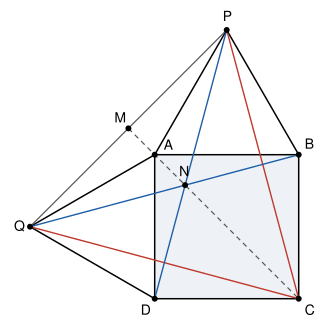

## Statement

Soit $ABCD$ un carré. Soient $P$ et $Q$ les deux points situés à l'extérieur du carré tels que les triangles $ABP$ et $DAQ$ sont équilatéraux.

On note $M$ le milieu du segment $[PQ]$, et $N$ le point d'intersection des droites $(BQ)$ et $(DP)$.

Calculer le rapport $\frac{NM}{NC}$.

## Hints

1. Fais une figure soignée, avec les triangles équilatéraux bien à l'extérieur du carré. Calcule les angles des triangles $PBC$ et $QDC$.
2. Montre que le triangle $CPQ$ est équilatéral.
3. Que représentent les droites $(PD)$ et $(QB)$ pour le triangle $CPQ$ ? Qu'est-ce que le point $N$ pour ce triangle ?
4. Montre que $C$, $N$ et $M$ sont alignés. Dans le triangle $NMP$, que vaut l'angle en $P$ ?

## Solution

On note $c$ le côté du carré.

**Étape 1 : deux triangles isocèles.** Dans le triangle $PBC$, on a $BP = BA = c$ et $BC = c$, donc il est isocèle en $B$. Son angle en $B$ vaut $\widehat{PBC} = \widehat{PBA} + \widehat{ABC} = 60^\circ + 90^\circ = 150^\circ$. Ses deux angles à la base valent donc chacun $\frac{180^\circ - 150^\circ}{2} = 15^\circ$ ; en particulier $\widehat{BCP} = 15^\circ$.

De la même façon, le triangle $QDC$ est isocèle en $D$ ($DQ = DA = c$ et $DC = c$), avec $\widehat{QDC} = 150^\circ$, donc $\widehat{DCQ} = 15^\circ$.

**Étape 2 : le triangle $CPQ$ est équilatéral.**

- Les triangles $CBP$ et $CDQ$ ont chacun un angle de $150^\circ$ compris entre deux côtés de longueur $c$. Ils sont superposables, donc $CP = CQ$.
- L'angle en $C$ vaut $\widehat{PCQ} = \widehat{BCD} - \widehat{BCP} - \widehat{DCQ} = 90^\circ - 15^\circ - 15^\circ = 60^\circ$.

Le triangle $CPQ$ est isocèle en $C$ avec un angle de $60^\circ$ en $C$. Ses deux autres angles valent $\frac{180^\circ - 60^\circ}{2} = 60^\circ$ : il est équilatéral.

**Étape 3 : $N$ est le centre du cercle circonscrit à $CPQ$.**

- On a $PC = PQ$ (étape 2) et $DC = DQ = c$. Les points $P$ et $D$ sont donc tous les deux à la même distance de $C$ et de $Q$ : ils sont sur la médiatrice de $[CQ]$, et la droite $(PD)$ est cette médiatrice.
- De même, $QP = QC$ et $BP = BC = c$, donc la droite $(QB)$ est la médiatrice de $[PC]$.

Le point $N$ est sur ces deux médiatrices. Il est donc à la même distance de $C$, de $Q$ et de $P$ : $NC = NP = NQ$.

**Étape 4 : $C$, $N$ et $M$ sont alignés.** Les points $N$ et $C$ sont chacun à la même distance de $P$ et de $Q$, donc ils sont sur la médiatrice de $[PQ]$. Cette médiatrice passe par le milieu $M$ de $[PQ]$ et elle est perpendiculaire à $(PQ)$. Donc $C$, $N$ et $M$ sont alignés, et le triangle $NMP$ est rectangle en $M$. Le point $N$, centre du triangle équilatéral, est à l'intérieur de celui-ci, donc entre $M$ et $C$.

**Étape 5 : on calcule $NM$.** La droite $(PN)$ est la médiatrice de $[CQ]$. Dans le triangle $PQC$, isocèle en $P$, la médiatrice de la base est aussi la bissectrice de l'angle au sommet. Donc $\widehat{MPN} = \widehat{QPN} = \frac{60^\circ}{2} = 30^\circ$.

Soit $N'$ le symétrique de $N$ par rapport à la droite $(PQ)$. Comme $(NM)$ est perpendiculaire à $(PQ)$, le point $M$ est le milieu de $[NN']$. Par symétrie, $PN' = PN$ et $\widehat{MPN'} = \widehat{MPN} = 30^\circ$, donc $\widehat{NPN'} = 60^\circ$. Le triangle $PNN'$ est isocèle en $P$ avec un angle de $60^\circ$ : il est équilatéral. Donc $NN' = NP$, et

$$NM = \frac{NN'}{2} = \frac{NP}{2} = \frac{NC}{2}.$$

**Conclusion.**

$$\frac{NM}{NC} = \frac{1}{2}.$$

*Une autre façon de finir.* Dans un triangle équilatéral, le centre du cercle circonscrit est aussi le centre de gravité, qui se trouve aux deux tiers de chaque médiane en partant du sommet. Ici $[CM]$ est une médiane, donc $CN = \frac{2}{3}\,CM$ et $NM = \frac{1}{3}\,CM$, ce qui redonne $\frac{NM}{NC} = \frac{1}{2}$.

*Attention à un piège.* On peut montrer que l'angle $\widehat{NPA}$ vaut $15^\circ$, la moitié de $\widehat{MPN} = 30^\circ$. Cela ne permet pas de dire que $MN = 2\,NA$ : un rapport entre deux angles ne donne pas le même rapport entre deux longueurs.

## Going further

1. Montrer que le sommet $A$ du carré est lui aussi sur la droite $(MC)$.
2. On prend un carré de côté $1$ et un repère d'origine $D$ dans lequel $C$ a pour coordonnées $(1\,;\,0)$ et $A$ a pour coordonnées $(0\,;\,1)$. Calculer les coordonnées de $P$, puis $CP^2$. En déduire la longueur $NC$.
