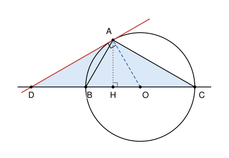

## Statement

Soit $ABC$ un triangle rectangle en $A$, dont l'hypoténuse $[BC]$ mesure $4$ cm. La tangente en $A$ au cercle circonscrit au triangle $ABC$ coupe la droite $(BC)$ en un point $D$. On suppose que $BA = BD$.

On note $S$ l'aire du triangle $ACD$, en centimètres carrés. Calculer $S^2$.

## Hints

1. Où se trouve le centre $O$ du cercle circonscrit à un triangle rectangle ? Que vaut son rayon ?
2. Une tangente est perpendiculaire au rayon qui aboutit au point de contact. Quel triangle rectangle voit-on apparaître ?
3. Le point $D$ est-il du côté de $B$ ou du côté de $C$ ? Compare $BA$ avec l'hypoténuse $BC$.
4. Dans un triangle rectangle, le milieu de l'hypoténuse est à la même distance des trois sommets. Montre que $B$ est le milieu de $[OD]$.

## Solution

Toutes les longueurs sont en centimètres.

**Le cercle circonscrit.** Le triangle $ABC$ est rectangle en $A$, donc le centre $O$ de son cercle circonscrit est le milieu de l'hypoténuse $[BC]$, et son rayon vaut $\frac{BC}{2} = 2$. Ainsi $OA = OB = OC = 2$.

**Le triangle $OAD$ est rectangle en $A$.** La tangente en $A$ est perpendiculaire au rayon $[OA]$. Le point $D$ est sur cette tangente, donc l'angle $\widehat{OAD}$ est droit.

**Le point $D$ est au-delà de $B$.** Dans le triangle $OAD$ rectangle en $A$, l'hypoténuse $[OD]$ est plus longue que le côté $[OA]$ : $OD > 2$. Si $D$ était du côté de $C$, on aurait $BD = BO + OD > 2 + 2 = 4$. Or $BA < BC = 4$, car l'hypoténuse est le plus long côté du triangle rectangle $ABC$. On aurait donc $BD > BA$, ce qui est exclu. Donc $D$ est du côté de $B$, et comme $OD > OB$, le point $B$ est sur le segment $[OD]$, entre $O$ et $D$.

**Le point $B$ est le milieu de $[OD]$.** Notons $M$ le milieu de $[OD]$. Dans le triangle $OAD$ rectangle en $A$, le milieu de l'hypoténuse est à la même distance des trois sommets : $MA = MD = MO$.

Les deux points $B$ et $M$ sont donc chacun à la même distance de $A$ et de $D$ : ils sont tous les deux sur la médiatrice de $[AD]$. Ils sont aussi tous les deux sur la droite $(OD)$. Or la droite $(OD)$ passe par $D$ et la médiatrice de $[AD]$ ne passe pas par $D$ : ce sont deux droites différentes, qui ont au plus un point commun. Donc $B = M$.

**Le triangle $OAB$ est équilatéral.** Comme $B$ est le milieu de $[OD]$, on a $BA = BO = 2$, d'après $MA = MO$. Avec $OA = OB = 2$, les trois côtés du triangle $OAB$ mesurent $2$ : il est équilatéral. On en tire aussi $BD = BA = 2$.

**La hauteur issue de $A$.** Soit $H$ le pied de la hauteur issue de $A$ dans le triangle $ABC$. C'est aussi la hauteur du triangle équilatéral $OAB$, qui tombe au milieu de $[OB]$, donc $OH = 1$. Le théorème de Pythagore dans le triangle $AHO$, rectangle en $H$, donne

$$AH^2 = OA^2 - OH^2 = 4 - 1 = 3, \qquad \text{donc} \qquad AH = \sqrt{3} .$$

**L'aire de $ACD$.** La base $[DC]$ est sur la droite $(BC)$, et $DC = DB + BC = 2 + 4 = 6$. La hauteur correspondante est $AH = \sqrt{3}$. Donc

$$S = \frac{DC \times AH}{2} = \frac{6\sqrt{3}}{2} = 3\sqrt{3}, \qquad S^2 = 9 \times 3 = 27 .$$

**Conclusion.** L'aire du triangle $ACD$ vaut $3\sqrt{3}$ cm², et $S^2 = 27$.

## Going further

1. Calculer la longueur $AD$ et la mesure de l'angle $\widehat{ADC}$.
2. Montrer que, dans cette figure, $DA^2 = DB \times DC$.
