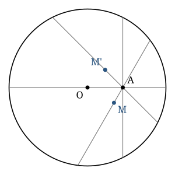

## Statement

Soit un cercle de centre $O$ et soit $A$ un point situé à l'intérieur de ce cercle, différent
de $O$.

On trace toutes les cordes du cercle qui passent par $A$, et pour chacune on marque son
milieu.

Décrire l'ensemble de tous ces milieux, et démontrer la réponse.

## Hints

1. Commence par dessiner une dizaine de cordes passant par $A$ et place leurs milieux à vue. Quelle courbe se dessine ?
2. Deux cordes sont particulières : celle qui passe par $O$, et celle qui est perpendiculaire à $(OA)$. Où sont leurs milieux ?
3. Rappelle-toi une propriété du cercle : si $M$ est le milieu d'une corde $[PQ]$ et que $M \ne O$, que peut-on dire de la droite $(OM)$ ?
4. Tu obtiens $\widehat{OMA} = 90°$. Quel est l'ensemble des points $M$ d'où l'on voit le segment $[OA]$ sous un angle droit ?

## Solution

**La réponse : l'ensemble cherché est le cercle de diamètre $[OA]$, en entier.**

**Étape 1. Tout milieu est sur le cercle de diamètre $[OA]$.**

Soit $[PQ]$ une corde passant par $A$, et $M$ son milieu.

*Premier cas : $M = O$.* C'est le cas de la corde qui passe par $O$, c'est-à-dire du diamètre
passant par $A$. Le point $O$ appartient bien au cercle de diamètre $[OA]$.

*Deuxième cas : $M \ne O$.* Le triangle $OPQ$ est isocèle en $O$ (car $OP = OQ = R$, le rayon),
et $M$ est le milieu de sa base $[PQ]$ : la droite $(OM)$ est donc la médiatrice de $[PQ]$, en
particulier
$$(OM) \perp (PQ) .$$

Comme $A$ appartient à la droite $(PQ)$, on en déduit que $(OM) \perp (MA)$ lorsque
$A \ne M$, c'est-à-dire $\widehat{OMA} = 90°$. Le point $M$ voit donc le segment $[OA]$ sous un
angle droit : il appartient au cercle de diamètre $[OA]$.

*Et si $A = M$ ?* Cela arrive pour la corde perpendiculaire à $(OA)$ passant par $A$. Le point
$A$ appartient évidemment au cercle de diamètre $[OA]$.

**Dans tous les cas, $M$ appartient au cercle de diamètre $[OA]$.**

**Étape 2. Réciproquement, tout point du cercle de diamètre $[OA]$ est un tel milieu.**

Soit $M$ un point du cercle de diamètre $[OA]$. Montrons que $M$ est le milieu d'une corde
passant par $A$.

*Si $M = O$ :* $M$ est le milieu du diamètre passant par $A$. ✔

*Si $M = A$ :* $M$ est le milieu de la corde perpendiculaire à $(OA)$ passant par $A$, car
pour cette corde la droite joignant $O$ au milieu est perpendiculaire à la corde, donc c'est
$(OA)$ elle-même. ✔

*Sinon :* le point $M$ est sur le cercle de diamètre $[OA]$ et différent de $O$ et de $A$, donc
$\widehat{OMA} = 90°$.

Remarquons d'abord que $M$ est à l'intérieur du grand cercle : $M$ appartient au cercle de
diamètre $[OA]$, donc $OM \le OA < R$.

Traçons la corde $[PQ]$ du grand cercle qui passe par $M$ et qui est **perpendiculaire** à
$(OM)$. Comme $(OM)$ est perpendiculaire à $(PQ)$ et passe par le centre, c'est la médiatrice
de $[PQ]$, donc $M$ est bien le milieu de $[PQ]$.

Enfin, cette corde passe par $A$ : en effet, $\widehat{OMA} = 90°$ signifie que $(MA)$ est
perpendiculaire à $(OM)$ ; or la perpendiculaire à $(OM)$ passant par $M$ est unique, c'est la
droite $(PQ)$. Donc $A \in (PQ)$. ✔

**Conclusion.**

L'ensemble des milieux des cordes passant par $A$ est exactement le **cercle de diamètre
$[OA]$** : c'est le cercle de centre le milieu de $[OA]$ et de rayon $\dfrac{OA}{2}$.

## Going further

Ce raisonnement en deux temps (« tout milieu est sur la courbe », puis « tout point de la
courbe est un milieu ») est la méthode standard pour déterminer un **lieu géométrique**. Sauter
la deuxième moitié est l'erreur classique : on démontre alors que le lieu est *contenu* dans
le cercle, sans montrer qu'il le remplit.

Que se passe-t-il si $A$ est sur le cercle ? Le cercle de diamètre $[OA]$ convient encore, mais
il est tangent au grand cercle en $A$. Et si $A$ est à l'extérieur ? Alors seules certaines
droites passant par $A$ coupent le cercle, et le lieu n'est plus qu'un **arc** du cercle de
diamètre $[OA]$ : celui qui est à l'intérieur du grand cercle.
