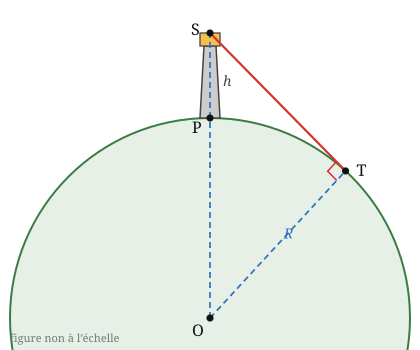

## Statement

On suppose que la Terre est une boule parfaitement ronde, de rayon $R$, et que la mer est parfaitement lisse.

Un observateur se tient au sommet d'un phare, à une hauteur $h$ au-dessus du niveau de la mer. Au-delà d'une certaine distance, la courbure de la Terre lui cache les bateaux : c'est la ligne d'horizon.

1. Montrer que la distance $d$ entre l'observateur et le point de l'horizon qu'il voit est donnée par

$$d = \sqrt{2Rh + h^2}.$$

2. Le phare de Kilauea, sur l'île hawaïenne de Kauai, culmine à $h = 16$ mètres au-dessus de la mer. En prenant $R = 6400$ km, à quelle distance maximale peut-on y repérer un bateau ? Donner le résultat en kilomètres, arrondi au dixième.

3. Vérifier que, pour une hauteur $h$ de quelques dizaines de mètres, le terme $h^2$ est complètement négligeable devant $2Rh$. En déduire la formule simplifiée $d \approx \sqrt{2Rh}$.

## Hints

1. Fais une coupe : la Terre devient un cercle de centre $O$ et de rayon $R$, et l'observateur est un point $S$ à l'extérieur de ce cercle.
2. Le rayon visuel qui atteint l'horizon est la droite qui frôle la Terre : elle est **tangente** au cercle.
3. Une tangente à un cercle est perpendiculaire au rayon qui aboutit au point de contact. Quel triangle rectangle apparaît alors ?
4. Quelle est la longueur $OS$ ? Attention, ce n'est pas $R$.
5. Pour la question 3, compare simplement les deux nombres $2Rh$ et $h^2$ en les calculant tous les deux.

## Solution

**1. La formule.**

Faisons une coupe de la situation par le plan qui contient le centre de la Terre et l'observateur. La Terre devient un cercle de centre $O$ et de rayon $R$. Notons $P$ le pied du phare, sur le cercle, et $S$ le sommet du phare, où se tient l'observateur. Notons enfin $T$ le point de l'horizon qu'il voit.

Le rayon visuel $(ST)$ est la dernière droite issue de $S$ qui touche encore la mer : c'est la **tangente** au cercle au point $T$. Or une tangente à un cercle est perpendiculaire au rayon qui aboutit au point de contact, donc

$$(OT) \perp (ST) .$$

Le triangle $OTS$ est donc rectangle en $T$. Ses côtés sont :

- $OT = R$ (c'est un rayon de la Terre) ;
- $OS = OP + PS = R + h$ (l'observateur est à la hauteur $h$ au-dessus du sol) ;
- $TS = d$, la longueur cherchée.

Le théorème de Pythagore dans ce triangle rectangle, où l'hypoténuse est $[OS]$, donne

$$OT^2 + TS^2 = OS^2, \qquad \text{c'est-à-dire} \qquad R^2 + d^2 = (R+h)^2 .$$

Donc

$$d^2 = (R+h)^2 - R^2 = R^2 + 2Rh + h^2 - R^2 = 2Rh + h^2,$$

et comme $d$ est une longueur, elle est positive :

$$d = \sqrt{2Rh + h^2}.$$

**2. Le phare de Kilauea.**

Il faut d'abord mettre les deux longueurs dans la même unité. Avec le kilomètre :

$$R = 6400 \ \text{km}, \qquad h = 16 \ \text{m} = \text{0,016} \ \text{km}.$$

Alors

$$2Rh = 2 \times 6400 \times \text{0,016} = \text{204,8}, \qquad h^2 = \text{0,016}^2 = \text{0,000256}.$$

Donc

$$d = \sqrt{\text{204,8} + \text{0,000256}} = \sqrt{\text{204,800256}} \approx \text{14,3} \ \text{km}.$$

**Conclusion.** Depuis le sommet du phare de Kilauea, on peut repérer un bateau jusqu'à environ $\text{14,3}$ kilomètres.

**3. Le terme négligeable.**

Comparons les deux termes sous la racine :

$$2Rh = \text{204,8} \qquad \text{et} \qquad h^2 = \text{0,000256}.$$

Le second est presque un million de fois plus petit que le premier. L'ajouter ne change aucun des chiffres affichés par la calculatrice avant la septième décimale. On peut donc écrire sans scrupule

$$d \approx \sqrt{2Rh}.$$

La raison est simple : $2Rh$ et $h^2$ sont dans le rapport $\dfrac{2R}{h}$, et ici $\dfrac{2 \times 6400}{\text{0,016}} = 800\,000$. Tant que la hauteur de l'observateur est minuscule devant le rayon de la Terre, le terme $h^2$ ne compte pas.

**Remarque.** $d$ est la distance **en ligne droite** de l'observateur à l'horizon, pas la longueur du trajet sur la mer. Comme le triangle est extrêmement aplati, les deux valeurs diffèrent ici de moins d'un mètre.

**Ce qu'il faut retenir.** La formule $d \approx \sqrt{2Rh}$ dit que la distance de visibilité croît comme la **racine carrée** de la hauteur. Doubler la hauteur du phare ne double pas la portée : il faut le multiplier par quatre pour cela.

## Going further

1. Un marin de $\text{1,8}$ m, debout sur la plage, voit l'horizon à quelle distance ?
2. À quelle altitude faudrait-il monter pour voir à $100$ km ?
3. Deux phares de $16$ m chacun se font face sur une mer plate. À quelle distance maximale le gardien de l'un peut-il voir la lanterne de l'autre ? (Attention : ce n'est pas la réponse de la question 2 du problème.)
4. Un bateau de $20$ m de haut est repéré depuis le phare de Kilauea. À quelle distance peut-on voir le haut de son mât ?
