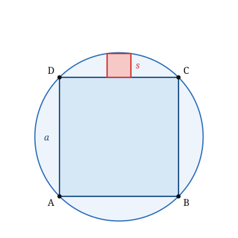

## Statement

Un carré $ABCD$ de côté $a$ est inscrit dans un cercle. Ses quatre côtés découpent, entre le carré et le cercle, quatre petites zones en forme de croissant.

On veut inscrire un second carré dans l'un de ces croissants : deux de ses sommets sont sur un côté du grand carré, les deux autres sont sur le cercle.

Quelle est la longueur du côté de ce petit carré ?

## Hints

1. Place un repère au centre du cercle, avec les axes parallèles aux côtés du grand carré.
2. Commence par le rayon du cercle : la diagonale du grand carré est un diamètre.
3. Le petit carré est symétrique par rapport à la médiatrice du côté sur lequel il s'appuie : ses deux sommets du haut ont donc des abscisses opposées.
4. Écris que l'un de ces deux sommets est sur le cercle. Tu obtiens une équation du second degré en $s$, le côté cherché.

## Solution

**Le repère.**

Prenons pour origine $O$ le centre du cercle, et des axes parallèles aux côtés du grand carré. Les quatre sommets du grand carré sont alors

$$\left(\pm\frac{a}{2},\ \pm\frac{a}{2}\right),$$

et le côté du haut est porté par la droite d'équation $y = \dfrac{a}{2}$.

**Le rayon du cercle.**

Le cercle passe par les sommets du carré, donc

$$R = \sqrt{\left(\frac a2\right)^2 + \left(\frac a2\right)^2} = \frac{a}{2}\sqrt2, \qquad \text{d'où} \qquad R^2 = \frac{a^2}{2}.$$

Le cercle a donc pour équation $x^2 + y^2 = \dfrac{a^2}{2}$.

**Le petit carré.**

Notons $s$ son côté. Il s'appuie sur le côté du haut du grand carré, et le dessin est symétrique par rapport à l'axe des ordonnées. Ses deux sommets du bas sont donc

$$\left(-\frac{s}{2},\ \frac{a}{2}\right) \qquad \text{et} \qquad \left(\frac{s}{2},\ \frac{a}{2}\right),$$

et ses deux sommets du haut, obtenus en montant de $s$, sont

$$\left(-\frac{s}{2},\ \frac{a}{2} + s\right) \qquad \text{et} \qquad \left(\frac{s}{2},\ \frac{a}{2} + s\right).$$

**L'équation.**

Le sommet $\left(\dfrac{s}{2},\ \dfrac{a}{2} + s\right)$ est sur le cercle :

$$\left(\frac{s}{2}\right)^2 + \left(\frac{a}{2} + s\right)^2 = \frac{a^2}{2}.$$

Développons :

$$\frac{s^2}{4} + \frac{a^2}{4} + as + s^2 = \frac{a^2}{2}.$$

Multiplions tout par $4$ :

$$s^2 + a^2 + 4as + 4s^2 = 2a^2,$$

soit

$$5s^2 + 4as - a^2 = 0 .$$

**On résout, en $s$.**

C'est une équation du second degré en $s$, où $a$ joue le rôle d'un paramètre. Son discriminant vaut

$$\Delta = (4a)^2 - 4 \times 5 \times (-a^2) = 16a^2 + 20a^2 = 36a^2, \qquad \sqrt{\Delta} = 6a \quad (\text{car } a > 0).$$

Les deux racines sont

$$s = \frac{-4a - 6a}{10} = -a \qquad \text{et} \qquad s = \frac{-4a + 6a}{10} = \frac{a}{5}.$$

La première est négative : elle ne convient pas pour une longueur. Il reste

$$s = \frac{a}{5}.$$

**Conclusion.** Le petit carré a pour côté le **cinquième** du côté du grand carré.

**Vérification.** Avec $a = 5$, on trouve $s = 1$. Le sommet du haut est alors le point $\left(\dfrac12,\ \dfrac52 + 1\right) = (\text{0,5}\,;\,\text{3,5})$, et

$$\text{0,5}^2 + \text{3,5}^2 = \text{0,25} + \text{12,25} = \text{12,5} = \frac{25}{2} = \frac{a^2}{2}. \quad \checkmark$$

**Une conséquence amusante.** Le petit carré a pour côté $\dfrac a5$, donc pour aire $\dfrac{a^2}{25}$ : son aire est **vingt-cinq fois** plus petite que celle du grand carré, alors qu'il n'a pas du tout l'air si petit sur le dessin.

## Going further

1. Reprendre le problème avec un **triangle équilatéral** inscrit dans le cercle, et un carré posé dans l'un des trois croissants.
2. Dans le même croissant que celui de l'énoncé, quel est le plus grand **rectangle** que l'on puisse inscrire, deux sommets sur le côté du carré et deux sur l'arc ?
3. Quelle est l'aire d'un des quatre croissants ? Comparer avec l'aire du petit carré.
