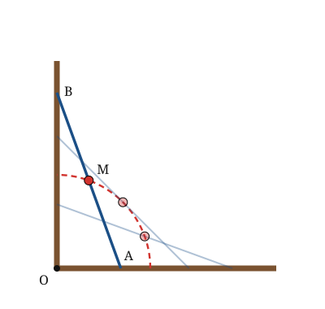

## Statement

Une échelle de longueur $L$ est posée contre un mur vertical, son pied sur le sol horizontal. Elle se met à glisser : le pied s'éloigne du mur pendant que le haut descend le long du mur, jusqu'à ce que l'échelle soit à plat sur le sol.

Un chaton très calme est assis exactement au **milieu** de l'échelle et ne bouge pas pendant toute la glissade.

Quelle trajectoire le chaton décrit-il ?

## Hints

1. Appelle $O$ le coin formé par le mur et le sol, $A$ le pied de l'échelle et $B$ son sommet. Que peut-on dire du triangle $OAB$ ?
2. Le chaton est au milieu $M$ de $[AB]$. Quelle longueur reste la même pendant toute la glissade ?
3. Calcule $OM$. Souviens-toi que $[OM]$ est une médiane du triangle $OAB$, et que ce triangle est rectangle.
4. Si tu préfères les coordonnées : place un repère en $O$, note $A(x\,;\,0)$ et $B(0\,;\,y)$, et écris ce que valent $x^2 + y^2$ et les coordonnées de $M$.

## Solution

**La mise en place.**

Notons $O$ le coin où le mur rencontre le sol, $A$ le pied de l'échelle (sur le sol) et $B$ son sommet (contre le mur). Le mur est perpendiculaire au sol, donc le triangle $OAB$ est **rectangle en $O$**, et son hypoténuse $[AB]$ est l'échelle elle-même :

$$AB = L \quad \text{pendant toute la glissade.}$$

Le chaton est au point $M$, milieu de $[AB]$.

**Première solution : la médiane d'un triangle rectangle.**

Dans un triangle rectangle, la médiane issue du sommet de l'angle droit mesure la moitié de l'hypoténuse. (On le voit bien ainsi : le milieu de l'hypoténuse est le centre du cercle circonscrit, et ce cercle passe par les trois sommets, donc par $O$.)

Ici, $[OM]$ est justement la médiane issue de $O$ dans le triangle $OAB$ rectangle en $O$. Donc

$$OM = \frac{AB}{2} = \frac{L}{2}.$$

Or $L$ ne change pas pendant la glissade : **la distance $OM$ reste constamment égale à $\dfrac L2$.**

Le chaton reste donc toujours à la même distance du coin $O$ : il se déplace sur un **cercle de centre $O$ et de rayon $\dfrac L2$**.

**Deuxième solution : avec des coordonnées.**

Plaçons un repère orthonormé d'origine $O$, l'axe des abscisses le long du sol et l'axe des ordonnées le long du mur. À un instant donné, notons

$$A(x\,;\,0) \qquad \text{et} \qquad B(0\,;\,y), \qquad \text{avec } x \geqslant 0 \text{ et } y \geqslant 0 .$$

Le théorème de Pythagore dans le triangle $OAB$ donne, à chaque instant,

$$x^2 + y^2 = L^2 .$$

Le milieu $M$ de $[AB]$ a pour coordonnées $\left(\dfrac{x}{2}\,;\,\dfrac{y}{2}\right)$. Sa distance à l'origine vérifie

$$OM^2 = \left(\frac x2\right)^2 + \left(\frac y2\right)^2 = \frac{x^2 + y^2}{4} = \frac{L^2}{4},$$

donc $OM = \dfrac L2$, et on retrouve le même résultat.

**La portion réellement décrite.**

Pendant la glissade, $x$ va de $0$ (échelle verticale) à $L$ (échelle à plat), et $M$ reste dans le quart de plan où $x \geqslant 0$ et $y \geqslant 0$. Le chaton ne parcourt donc pas tout le cercle, mais exactement le **quart de cercle** de rayon $\dfrac L2$ situé dans ce quart de plan : il part du point $\left(0\,;\,\dfrac L2\right)$, à mi-hauteur contre le mur, et arrive au point $\left(\dfrac L2\,;\,0\right)$, sur le sol.

**Conclusion.** Le chaton décrit un quart de cercle de centre le coin $O$ et de rayon la moitié de la longueur de l'échelle.

**Ce qu'il faut retenir.** Une trajectoire se détermine en cherchant une quantité qui **ne varie pas**. Ici, tout bouge sauf une chose : la distance du chaton au coin du mur.

## Going further

1. Et si le chaton n'était pas au milieu, mais au tiers de l'échelle en partant du pied ? Quelle courbe décrirait-il alors ? (Indication : écrire ses coordonnées en fonction de $x$ et $y$, puis utiliser $x^2 + y^2 = L^2$.)
2. Le pied de l'échelle s'éloigne à vitesse constante. Le chaton se déplace-t-il, lui aussi, à vitesse constante ?
3. On considère maintenant toutes les positions possibles de l'échelle, et on regarde la région du quart de plan balayée par l'échelle. Quelle est la forme de sa frontière ?
