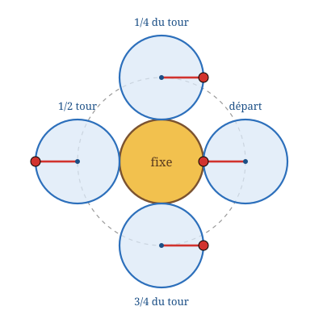

## Statement

Deux pièces de monnaie identiques, de rayon $r$, sont posées sur une table, côte à côte et en contact.

On maintient la première immobile, et on fait rouler la seconde tout autour d'elle, sans glisser, jusqu'à ce qu'elle revienne à sa position de départ.

Pendant ce voyage, **combien de tours sur elle-même la pièce mobile a-t-elle faits ?**

1. Réponds d'abord d'instinct, sans calculer, puis note ta réponse.
2. Fais l'expérience avec deux pièces de monnaie identiques, en marquant un point sur le bord de la pièce mobile.
3. Explique le résultat.

## Hints

1. La réponse d'instinct est presque toujours « un tour ». Elle est fausse : l'expérience donne autre chose.
2. Rouler sans glisser signifie que l'arc parcouru sur la pièce fixe et l'arc déroulé sur la pièce mobile ont la même longueur.
3. Suis le centre de la pièce mobile. Sur quelle courbe se déplace-t-il ? Quel est son rayon ?
4. Pour une pièce qui roule sur une droite, le nombre de tours vaut (longueur parcourue par le centre) $\div$ (périmètre de la pièce). Applique cette idée au trajet du centre.
5. Deuxième explication, plus fine : sépare la rotation vue depuis la droite qui joint les deux centres, et la rotation de cette droite elle-même.

## Solution

**La réponse : deux tours.**

C'est le résultat que donne l'expérience, et il surprend presque tout le monde. Après avoir parcouru seulement **la moitié** du voyage, la pièce mobile a déjà fait un tour complet : le repère tracé sur son bord pointe de nouveau dans la même direction qu'au départ.

**Première explication : le trajet du centre.**

Le centre de la pièce mobile reste toujours à la distance $r + r = 2r$ du centre de la pièce fixe, puisque les deux pièces restent en contact. Il décrit donc un cercle de rayon $2r$, dont la longueur vaut

$$2\pi \times 2r = 4\pi r .$$

Or, pour une pièce qui roule sans glisser, le nombre de tours qu'elle fait est égal à la distance parcourue par son centre divisée par son propre périmètre. Ici :

$$\frac{4\pi r}{2\pi r} = 2 .$$

**La pièce fait donc deux tours sur elle-même.**

**Deuxième explication : d'où vient le tour supplémentaire.**

L'erreur habituelle consiste à raisonner ainsi : « la pièce mobile a roulé le long du bord de la pièce fixe, qui mesure $2\pi r$, donc elle a déroulé $2\pi r$ de son propre bord, donc elle a fait un tour ». Ce calcul n'est pas faux, mais il ne mesure pas la bonne chose.

Ce qu'il mesure, c'est la rotation de la pièce **vue depuis la droite qui joint les deux centres**. Par rapport à cette droite, la pièce fait bien exactement un tour.

Seulement, cette droite n'est pas fixe : pendant le voyage, elle tourne elle aussi d'un tour complet autour du centre de la pièce fixe. Vue depuis la table, la pièce subit donc les deux rotations à la fois :

$$\underbrace{1 \text{ tour}}_{\text{par rapport à la droite des centres}} + \underbrace{1 \text{ tour}}_{\text{de la droite des centres}} = 2 \text{ tours}.$$

C'est la même chose que pour la Lune : elle présente toujours la même face à la Terre, donc elle ne tourne pas par rapport à la droite Terre-Lune, mais vue depuis les étoiles elle fait bien un tour sur elle-même par révolution.

**Le cas général.**

Si la pièce fixe a pour rayon $R$ et la pièce mobile pour rayon $r$, le centre de la pièce mobile décrit un cercle de rayon $R + r$, de longueur $2\pi(R+r)$, et le nombre de tours vaut

$$\frac{2\pi(R + r)}{2\pi r} = \frac{R + r}{r} = \frac{R}{r} + 1 .$$

On retrouve $2$ quand $R = r$. Le « $+1$ » est exactement le tour supplémentaire expliqué ci-dessus : il est toujours là, quelle que soit la taille des deux pièces.

**Conclusion.** La pièce mobile fait **deux** tours sur elle-même.

## Going further

1. Une pièce de $1$ cm de rayon roule autour d'une pièce de $3$ cm de rayon. Combien de tours fait-elle ?
2. Et si la petite pièce roulait à l'**intérieur** d'un grand anneau de rayon $R$ ? Reprendre le raisonnement : cette fois les deux rotations se retranchent au lieu de s'ajouter. Combien de tours ?
3. Une pièce roule sans glisser le long du bord extérieur d'un carré dont chaque côté mesure $10$ cm, en contournant les quatre coins. Combien de tours fait-elle si son rayon est de $1$ cm ? (Indication : suivre de nouveau le trajet du centre.)
