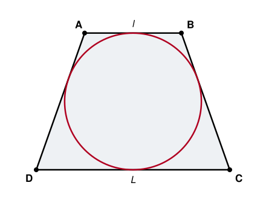

## Statement

$ABCD$ est un trapèze **isocèle** : ses côtés $[AB]$ et $[DC]$ sont parallèles, et ses deux autres côtés ont la même longueur, $BC = AD$.

On sait de plus qu'un cercle peut être tracé à l'intérieur du trapèze en touchant les quatre côtés : on dit qu'il est **inscrit** dans le trapèze.

On pose $AB = \ell$ et $DC = L$.

Quelle est la longueur des deux autres côtés ?

## Hints

1. Le cercle touche chacun des quatre côtés en un point. Place ces quatre points de contact sur la figure.
2. Depuis un point extérieur à un cercle, on peut mener exactement deux tangentes, et les deux segments qui joignent ce point aux points de contact ont la même longueur. C'est le seul outil dont tu as besoin.
3. Chaque sommet du trapèze est le point de départ de deux côtés, donc de deux tangentes. Appelle $p$, $q$, $r$, $s$ les quatre longueurs obtenues aux quatre sommets.
4. Exprime les quatre côtés du trapèze à l'aide de $p$, $q$, $r$, $s$, puis calcule $AB + DC$ et $BC + AD$.
5. N'oublie pas la dernière donnée, celle qui n'a pas encore servi : le trapèze est isocèle.

## Solution

**L'outil : les deux tangentes issues d'un même point.**

Si d'un point $M$ extérieur à un cercle on mène les deux tangentes, et si $T$ et $T'$ sont les points de contact, alors $MT = MT'$. En effet, en notant $O$ le centre du cercle, les triangles $OTM$ et $OT'M$ sont rectangles en $T$ et en $T'$ (le rayon est perpendiculaire à la tangente au point de contact), ils ont la même hypoténuse $[OM]$ et deux côtés égaux $OT = OT' = r$. Le théorème de Pythagore donne alors
$$MT = \sqrt{OM^2 - r^2} = MT' .$$

**Application au trapèze.**

Notons les quatre points de contact : $P$ sur $[AB]$, $Q$ sur $[BC]$, $R$ sur $[CD]$ et $S$ sur $[DA]$. D'après ce qui précède, les deux tangentes issues d'un même sommet ont la même longueur. Posons
$$p = AP = AS, \qquad q = BP = BQ, \qquad r = CQ = CR, \qquad s = DR = DS .$$

Les quatre côtés s'écrivent alors
$$AB = p + q, \qquad BC = q + r, \qquad CD = r + s, \qquad DA = s + p .$$

En additionnant les deux côtés parallèles, puis les deux autres :
$$AB + CD = p + q + r + s \qquad \text{et} \qquad BC + DA = q + r + s + p .$$

**Ces deux sommes sont égales !** C'est vrai pour n'importe quel quadrilatère dans lequel on peut inscrire un cercle : la somme de deux côtés opposés est égale à la somme des deux autres.

**La conclusion.**

Ici, le trapèze est isocèle, donc $BC = DA$. L'égalité devient
$$\ell + L = 2 \, BC ,$$
d'où
$$\boxed{\,BC = DA = \frac{\ell + L}{2}\,.}$$

Les deux côtés obliques mesurent la **moyenne des deux bases**.

**Vérification sur un exemple.** Prenons $\ell = 4$ et $L = 8$. La formule annonce $BC = 6$. La hauteur du trapèze vaut alors, par le théorème de Pythagore appliqué au petit triangle rectangle de la figure, $\sqrt{6^2 - 2^2} = \sqrt{32}$, et le rayon du cercle inscrit est la moitié de cette hauteur, soit $\dfrac{\sqrt{32}}{2}$. Tout est cohérent : la figure de l'énoncé est dessinée avec ces valeurs.

**Une remarque.** La réponse ne dépend que de $\ell$ et $L$ : dès que les deux bases sont fixées, il n'y a **qu'un seul** trapèze isocèle dans lequel on peut inscrire un cercle. Si on allonge les côtés obliques, le trapèze devient trop haut et le cercle ne touche plus les deux bases en même temps ; si on les raccourcit, il ne touche plus les côtés obliques.

## Going further

1. Le périmètre de ce trapèze vaut $2(\ell + L)$. Exprime son aire en fonction de $\ell$ et $L$.
2. Montre que la hauteur du trapèze vaut $\sqrt{\ell L}$, et donc que le rayon du cercle inscrit vaut $\dfrac{\sqrt{\ell L}}{2}$.
3. Un parallélogramme dans lequel on peut inscrire un cercle : que peut-on en dire ?
