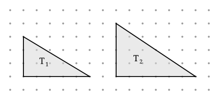

## Statement

On appelle **nœud** un point du plan dont les deux coordonnées sont des entiers. Pour un
polygone dont tous les sommets sont des nœuds, on note $A$ son aire, $I$ son nombre de nœuds
strictement intérieurs et $B$ son nombre de nœuds situés sur son bord.

Le **théorème de Pick** affirme que $A = I + \dfrac{B}{2} - 1$. On l'a déjà démontré pour les
rectangles du quadrillage. On passe ici aux triangles rectangles.

Soit $T$ un triangle rectangle dont les deux côtés de l'angle droit suivent le quadrillage et
mesurent $m$ et $n$ carreaux, avec $m$ et $n$ entiers strictement positifs.

Le nombre de nœuds posés sur l'hypoténuse, lui, change d'un triangle à l'autre : sur le
triangle $T_1$ du dessin, l'hypoténuse ne passe par aucun nœud entre ses extrémités, alors que
sur $T_2$ elle en rencontre un. On appelle $k$ ce nombre de nœuds situés **strictement entre
les deux extrémités de l'hypoténuse**.

1. Exprime $B$ en fonction de $m$, $n$ et $k$.
2. Exprime $I$ en fonction de $m$, $n$ et $k$. *(Indication : complète le triangle en un
   rectangle.)*
3. Calcule $I + \dfrac{B}{2} - 1$ et montre que l'on retrouve $\dfrac{mn}{2}$, quelle que soit
   la valeur de $k$.

## Hints

1. Commence par les deux triangles du dessin : compte $B$, $I$ et $k$ sur chacun, et garde ces
   nombres pour vérifier tes formules à la fin.
2. Pour $B$ : le bord est fait des deux côtés de l'angle droit et de l'hypoténuse. Compte les
   nœuds des deux côtés droits sans oublier que le sommet de l'angle droit leur est commun,
   puis ajoute les $k$ nœuds de l'hypoténuse.
3. Pour $I$ : le triangle est la moitié d'un rectangle $m \times n$ coupé par une diagonale.
   Tu connais déjà le nombre de nœuds intérieurs de ce rectangle.
4. Parmi les nœuds intérieurs du rectangle, certains tombent sur la diagonale : ce sont
   exactement les $k$ nœuds de l'hypoténuse. Les autres se répartissent entre les deux moitiés
   du rectangle. Pourquoi y en a-t-il autant d'un côté que de l'autre ?
5. Dans le calcul final, mets tout au même dénominateur $2$ et regarde ce qui se simplifie. Le
   $k$ doit disparaître.

## Solution

**1. Les nœuds du bord.**

Plaçons le sommet de l'angle droit à l'origine, le côté horizontal de longueur $m$ et le côté
vertical de longueur $n$.

- Le côté horizontal porte $m+1$ nœuds ;
- le côté vertical porte $n+1$ nœuds ;
- ces deux côtés ont un nœud commun, le sommet de l'angle droit.

Les deux côtés de l'angle droit portent donc $(m+1) + (n+1) - 1 = m + n + 1$ nœuds, ce qui
inclut les trois sommets du triangle. L'hypoténuse apporte en plus ses $k$ nœuds
intermédiaires, et rien d'autre puisque ses deux extrémités sont déjà comptées. Ainsi

$$\boxed{B = m + n + 1 + k}$$

*Vérification.* $T_1$ : $m = 5$, $n = 3$, $k = 0$, donc $B = 9$. $T_2$ : $m = 6$, $n = 4$,
$k = 1$, donc $B = 12$. C'est bien ce que l'on compte sur le dessin.

**2. Les nœuds intérieurs.**

Complétons le triangle en un rectangle $R$ de $m$ sur $n$ : le triangle $T$ est l'une des deux
moitiés découpées par une diagonale $d$, l'autre moitié $T'$ étant son image par le demi-tour
de centre le milieu de $d$.

Le rectangle $R$ possède $(m-1)(n-1)$ nœuds intérieurs. Chacun d'eux est dans l'un des trois
cas suivants :

- il est sur la diagonale $d$ : il y en a $k$ ;
- il est strictement à l'intérieur de $T$ : il y en a $I$ ;
- il est strictement à l'intérieur de $T'$ : il y en a $I'$.

Le demi-tour qui échange $T$ et $T'$ envoie les nœuds sur des nœuds, car il transforme le
point de coordonnées $(x, y)$ en un point dont les coordonnées sont $m - x$ et $n - y$, deux
entiers dès que $x$ et $y$ le sont. Il met donc en correspondance un à un les nœuds intérieurs
de $T$ et ceux de $T'$ : $I = I'$. D'où

$$(m-1)(n-1) = k + 2I, \qquad \text{c'est-à-dire} \qquad \boxed{I = \frac{(m-1)(n-1) - k}{2}}$$

*Vérification.* $T_1$ : $I = \dfrac{4 \times 2 - 0}{2} = 4$. $T_2$ : $I = \dfrac{5 \times 3 - 1}{2} = 7$.

**3. Le calcul final.**

$$I + \frac{B}{2} - 1 = \frac{(m-1)(n-1) - k}{2} + \frac{m + n + 1 + k}{2} - 1 .$$

Les deux fractions ont le même dénominateur, on additionne les numérateurs :

$$\frac{(mn - m - n + 1) - k + m + n + 1 + k}{2} - 1 = \frac{mn + 2}{2} - 1 = \frac{mn}{2} + 1 - 1 = \frac{mn}{2} .$$

Or $\dfrac{mn}{2}$ est exactement l'aire du triangle rectangle de côtés $m$ et $n$. Donc

$$\boxed{A = I + \frac{B}{2} - 1}$$

**Ce qui est remarquable ici**, c'est que $k$ s'élimine tout seul. On n'a jamais eu besoin de
savoir combien de nœuds l'hypoténuse rencontre : ce nombre apparaît une fois en moins dans $I$
et une fois en plus dans $B$, et les deux se compensent exactement parce que $B$ est divisé
par deux et que $I$ contenait déjà une division par deux.

*Vérification.* $T_1$ : $4 + \dfrac{9}{2} - 1 = \text{7,5} = \dfrac{5 \times 3}{2}$.
$T_2$ : $7 + 6 - 1 = 12 = \dfrac{6 \times 4}{2}$.

## Going further

1. Montre que $k = \mathrm{PGCD}(m, n) - 1$. *(Indication : les nœuds de l'hypoténuse sont les
   points obtenus en partant d'un sommet et en avançant d'un même pas répété.)*
2. À partir des rectangles et des triangles rectangles, démontre la formule de Pick pour un
   triangle quelconque dont les trois sommets sont des nœuds. *(Indication : enferme-le dans
   un rectangle du quadrillage ; il reste au plus trois triangles rectangles à retirer.)*
3. Une fois les triangles acquis, comment passer à un polygone quelconque ?
