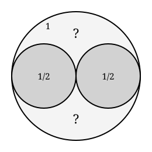

## Statement

Dans un cercle de rayon $1$, on a placé deux cercles de rayon $\dfrac{1}{2}$ : chacun touche le
grand cercle de l'intérieur, et les deux se touchent l'un l'autre.

Il reste deux creux, en haut et en bas. On veut glisser dans le creux du haut un cercle qui
touche à la fois les deux petits cercles et le grand cercle.

Quel est le rayon de ce cercle ?

## Hints

1. Place un repère dont l'origine est le centre du grand cercle. Où sont les centres des deux
   cercles de rayon $\dfrac{1}{2}$ ?
2. La figure est symétrique par rapport à l'axe vertical. Où se trouve donc le centre du
   cercle cherché ?
3. Deux cercles sont tangents **extérieurement** lorsque la distance de leurs centres vaut la
   somme de leurs rayons. Ils sont tangents **intérieurement**, le petit étant dans le grand,
   lorsque cette distance vaut la différence des rayons. Écris ces deux conditions.
4. Note $r$ le rayon cherché. La tangence intérieure avec le grand cercle te donne
   immédiatement l'ordonnée du centre en fonction de $r$.
5. Écris ensuite la tangence avec un des deux petits cercles à l'aide du théorème de Pythagore,
   puis remplace. Les $r^2$ vont disparaître.

## Solution

**Le repère.**

Prenons pour origine $O$ le centre du grand cercle, l'axe des abscisses passant par les
centres des deux petits cercles.

Le petit cercle de droite a pour rayon $\dfrac{1}{2}$ et touche le grand cercle de
l'intérieur : la distance de son centre à $O$ vaut $1 - \dfrac{1}{2} = \dfrac{1}{2}$. Son
centre est donc le point $B(\dfrac{1}{2} ; 0)$, et celui de gauche le point
$A(-\dfrac{1}{2} ; 0)$.

*Vérification :* $AB = 1 = \dfrac{1}{2} + \dfrac{1}{2}$, les deux petits cercles sont bien
tangents entre eux, au point $O$.

**Le cercle cherché.**

Notons $r$ son rayon et $C$ son centre. La figure est symétrique par rapport à l'axe des
ordonnées, et le cercle cherché doit l'être aussi puisqu'il touche les deux petits cercles de
la même façon. Son centre est donc sur cet axe :

$$C(0 ; y), \qquad \text{avec } y > 0 .$$

*Première condition : tangence intérieure au grand cercle.* Le cercle cherché est à
l'intérieur du grand cercle et le touche, donc

$$OC = 1 - r, \qquad \text{c'est-à-dire} \qquad y = 1 - r .$$

*Deuxième condition : tangence extérieure au petit cercle de droite.* Les deux cercles se
touchent sans que l'un contienne l'autre, donc

$$CB = r + \frac{1}{2} .$$

Or, par le théorème de Pythagore dans le triangle rectangle de sommets $C(0 ; y)$,
$O(0 ; 0)$ et $B(\dfrac{1}{2} ; 0)$, rectangle en $O$ :

$$CB^2 = OB^2 + OC^2 = \frac{1}{4} + y^2 .$$

**L'équation.**

On reporte $y = 1 - r$ :

$$(r + \frac{1}{2})^2 = \frac{1}{4} + (1 - r)^2 .$$

On développe les deux membres :

$$r^2 + r + \frac{1}{4} = \frac{1}{4} + 1 - 2r + r^2 .$$

Les $r^2$ se simplifient, les $\dfrac{1}{4}$ aussi :

$$r = 1 - 2r, \qquad \text{donc} \qquad 3r = 1 .$$

$$\boxed{r = \frac{1}{3}}$$

Le centre est alors en $(0 ; \dfrac{2}{3})$.

**Vérification.** $OC = \dfrac{2}{3}$ et $1 - r = 1 - \dfrac{1}{3} = \dfrac{2}{3}$ : la
tangence intérieure est bonne. Et

$$CB^2 = \frac{1}{4} + \frac{4}{9} = \frac{9 + 16}{36} = \frac{25}{36}, \qquad CB = \frac{5}{6} ,$$

tandis que $r + \dfrac{1}{2} = \dfrac{1}{3} + \dfrac{1}{2} = \dfrac{5}{6}$. Les deux
coïncident : la tangence extérieure est bonne aussi.

Par symétrie, le creux du bas reçoit un cercle identique, de rayon $\dfrac{1}{3}$ lui aussi.
**Il y a donc deux solutions, symétriques l'une de l'autre.**

## Going further

1. Il reste maintenant des creux plus petits, par exemple entre le grand cercle, le petit
   cercle de droite et le cercle de rayon $\dfrac{1}{3}$ que l'on vient de placer. Montre par
   la même méthode que le cercle qui s'y glisse a pour rayon $\dfrac{1}{6}$, puis que le
   suivant a pour rayon $\dfrac{1}{11}$.
2. En continuant indéfiniment, on obtient un **tamis d'Apollonius**. Les nombres
   $2, 3, 6, 11, \ldots$ qui apparaissent sont les inverses des rayons, appelés
   **courbures**. Descartes a découvert en 1643, dans une lettre à la princesse Élisabeth de
   Bohême, que quatre cercles tangents deux à deux ont des courbures $k_1$, $k_2$, $k_3$,
   $k_4$ liées par
   $$(k_1 + k_2 + k_3 + k_4)^2 = 2(k_1^2 + k_2^2 + k_3^2 + k_4^2) .$$
   Vérifie-la sur les quatre premiers cercles, en prenant $k = -1$ pour le grand cercle (la
   courbure est comptée négativement quand la tangence est intérieure) puis $2$, $2$ et $3$.
3. Retrouve avec la formule de Descartes que le cercle suivant a bien pour courbure $6$.
