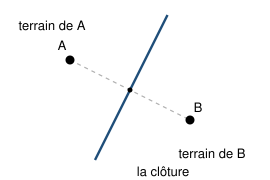

## Statement

Des fermes sont posées sur une plaine. Les fermiers se partagent la terre selon une règle simple, qui ne demande aucune négociation : **chaque point de la plaine appartient à la ferme la plus proche de lui**.

On appelle **terrain** d'une ferme l'ensemble des points qui sont plus proches d'elle que de toutes les autres, et **clôture** une frontière entre deux terrains. Un **carrefour** est un point où trois clôtures ou plus se rejoignent.

On travaille dans un repère orthonormé.

1. Il n'y a que deux fermes, $A$ et $B$. Montrer que la clôture est la médiatrice du segment $[AB]$.
2. Les quatre fermes sont maintenant
$$A(-1\,;\,1), \qquad B(1\,;\,1), \qquad C(1\,;\,-1), \qquad D(-1\,;\,-1),$$
c'est-à-dire les quatre sommets d'un carré. Décrire le partage. Combien y a-t-il de carrefours ?
3. On éloigne la ferme $D$ du centre : elle passe en $D'(-2\,;\,-2)$. Les trois autres ne bougent pas.
   - a) Vérifier que $O(0\,;\,0)$ est à égale distance de $A$, $B$, $C$, et strictement plus loin de $D'$.
   - b) Vérifier que $V\left(-\dfrac{3}{4}\,;\,-\dfrac{3}{4}\right)$ est à égale distance de $A$, $C$, $D'$, et strictement plus loin de $B$.
   - c) Il y a donc maintenant **deux** carrefours. Vérifier qu'au point $\left(-\dfrac{2}{5}\,;\,-\dfrac{2}{5}\right)$, situé entre les deux, les fermes les plus proches sont $A$ et $C$. Entre quelles deux fermes une nouvelle clôture est-elle apparue ?
4. On rapproche au contraire la ferme $D$ du centre : elle passe en $D''\left(-\dfrac{1}{2}\,;\,-\dfrac{1}{2}\right)$. Les deux carrefours sont alors $\left(0\,;\,\dfrac{1}{2}\right)$ et $\left(\dfrac{1}{2}\,;\,0\right)$. Le vérifier, puis dire entre quelles deux fermes la nouvelle clôture est apparue cette fois.

## Hints

1. Un point appartient à la clôture entre $A$ et $B$ exactement quand il est à la même distance de $A$ et de $B$.
2. Pour la question 2, regarde d'abord la clôture entre $A$ et $B$ tout seuls, puis entre $B$ et $C$ tout seuls, et ainsi de suite. Les quatre médiatrices passent-elles toutes par un même point ?
3. Pour les vérifications, compare les **carrés** des distances : cela évite toutes les racines carrées.
4. Dans le carré de départ, les fermes $A$ et $C$ se touchent seulement en un point. Que leur arrive-t-il quand $D$ s'éloigne ?
5. Compare tes réponses aux questions 3 et 4 : ce ne sont pas les mêmes deux fermes qui deviennent voisines.

## Solution

**Question 1.** Un point $M$ est à la frontière entre les terrains de $A$ et de $B$ exactement quand il n'est ni plus proche de $A$ ni plus proche de $B$, c'est-à-dire quand

$$AM = BM .$$

C'est la définition même de la médiatrice de $[AB]$. La clôture est donc cette médiatrice, tout entière, et le terrain de $A$ est le demi-plan qui contient $A$.

**Question 2.** Les quatre fermes sont les sommets du carré de centre $O$ et de côté $2$.

- La médiatrice de $[AB]$ est l'axe des ordonnées ;
- celle de $[BC]$ est l'axe des abscisses ;
- celle de $[CD]$ est l'axe des ordonnées à nouveau ;
- celle de $[DA]$ est l'axe des abscisses.

Les deux axes découpent le plan en quatre quarts, et chaque ferme reçoit le quart qui la contient. Par exemple, le terrain de $A$ est le quart $x < 0$ et $y > 0$.

Il y a donc **un seul carrefour**, l'origine $O$, et c'est un carrefour particulier : **quatre** clôtures s'y rejoignent. La raison est que les quatre fermes sont sur un même cercle de centre $O$, donc $O$ est à égale distance des quatre.

Les fermes $A$ et $C$, elles, n'ont pas de clôture commune : leurs terrains ne se touchent qu'en $O$. Idem pour $B$ et $D$.

**Question 3.** Les fermes sont $A(-1\,;\,1)$, $B(1\,;\,1)$, $C(1\,;\,-1)$ et $D'(-2\,;\,-2)$.

**a)** Distances au carré depuis $O(0\,;\,0)$ :

$$OA^2 = 1 + 1 = 2, \qquad OB^2 = 1 + 1 = 2, \qquad OC^2 = 1 + 1 = 2, \qquad OD'^2 = 4 + 4 = 8 .$$

Donc $O$ est bien à égale distance de $A$, $B$, $C$, et strictement plus loin de $D'$. C'est donc un carrefour, où les terrains de $A$, $B$ et $C$ se rejoignent.

**b)** Distances au carré depuis $V\left(-\dfrac{3}{4}\,;\,-\dfrac{3}{4}\right)$ :

$$VA^2 = \left(\frac{1}{4}\right)^2 + \left(\frac{7}{4}\right)^2 = \frac{1 + 49}{16} = \frac{25}{8},$$

$$VC^2 = \left(\frac{7}{4}\right)^2 + \left(\frac{1}{4}\right)^2 = \frac{25}{8}, \qquad VD'^2 = \left(\frac{5}{4}\right)^2 + \left(\frac{5}{4}\right)^2 = \frac{50}{16} = \frac{25}{8},$$

$$VB^2 = \left(\frac{7}{4}\right)^2 + \left(\frac{7}{4}\right)^2 = \frac{98}{16} = \frac{49}{8} .$$

Donc $V$ est à égale distance de $A$, $C$ et $D'$, et strictement plus loin de $B$. C'est un second carrefour, où les terrains de $A$, $C$ et $D'$ se rejoignent.

**c)** Au point $W\left(-\dfrac{2}{5}\,;\,-\dfrac{2}{5}\right)$ :

$$WA^2 = \left(\frac{3}{5}\right)^2 + \left(\frac{7}{5}\right)^2 = \frac{58}{25}, \qquad WC^2 = \left(\frac{7}{5}\right)^2 + \left(\frac{3}{5}\right)^2 = \frac{58}{25},$$

$$WB^2 = \left(\frac{7}{5}\right)^2 + \left(\frac{7}{5}\right)^2 = \frac{98}{25}, \qquad WD'^2 = \left(\frac{8}{5}\right)^2 + \left(\frac{8}{5}\right)^2 = \frac{128}{25} .$$

Les deux fermes les plus proches sont $A$ et $C$, à égale distance. Le point $W$ est donc sur la clôture entre $A$ et $C$.

**Conclusion de la question 3.** Le carrefour unique s'est coupé en deux, $O$ et $V$, et entre les deux est apparue une **nouvelle clôture entre $A$ et $C$**, portée par la droite d'équation $y = x$. Les fermes $A$ et $C$, qui ne se touchaient qu'en un point, sont devenues de vraies voisines, alors qu'on n'a déplacé ni l'une ni l'autre.

**Question 4.** Les fermes sont $A(-1\,;\,1)$, $B(1\,;\,1)$, $C(1\,;\,-1)$ et $D''\left(-\dfrac{1}{2}\,;\,-\dfrac{1}{2}\right)$.

Au point $P\left(0\,;\,\dfrac{1}{2}\right)$ :

$$PA^2 = 1 + \frac{1}{4} = \frac{5}{4}, \qquad PB^2 = 1 + \frac{1}{4} = \frac{5}{4}, \qquad PD''^2 = \frac{1}{4} + 1 = \frac{5}{4}, \qquad PC^2 = 1 + \frac{9}{4} = \frac{13}{4} .$$

C'est bien un carrefour, où se rejoignent $A$, $B$ et $D''$. Par symétrie par rapport à la droite $y = x$, le point $Q\left(\dfrac{1}{2}\,;\,0\right)$ est l'autre carrefour, où se rejoignent $B$, $C$ et $D''$.

Regardons enfin le milieu $\left(\dfrac{1}{4}\,;\,\dfrac{1}{4}\right)$ :

$$\text{distance}^2 \ \text{à} \ B = \left(\frac{3}{4}\right)^2 + \left(\frac{3}{4}\right)^2 = \frac{9}{8}, \qquad \text{à} \ D'' = \left(\frac{3}{4}\right)^2 + \left(\frac{3}{4}\right)^2 = \frac{9}{8},$$

$$\text{à} \ A = \left(\frac{5}{4}\right)^2 + \left(\frac{3}{4}\right)^2 = \frac{17}{8}, \qquad \text{à} \ C = \frac{17}{8} .$$

Les deux plus proches sont $B$ et $D''$. La nouvelle clôture est donc **entre $B$ et $D''$**.

**Conclusion générale.** Partant du carré, où quatre clôtures se rejoignaient en un seul carrefour, il suffit de bouger une seule ferme pour que ce carrefour se coupe en deux. Et le sens du déplacement décide de tout :

| déplacement de $D$ | nouvelle clôture |
| --- | --- |
| vers l'extérieur | entre $A$ et $C$ |
| vers l'intérieur | entre $B$ et $D$ |

## Going further

**Un terrain peut-il être un disque ?** Non, jamais. Chaque morceau de clôture est un morceau de médiatrice, c'est-à-dire un morceau de droite. Le bord d'un terrain est donc fait de segments et de demi-droites, alors qu'un cercle ne contient aucun morceau de droite.

Ce découpage porte un nom, le **diagramme de Voronoï**, d'après le mathématicien Gueorgui Voronoï. On le retrouve partout : pour savoir quelle antenne de téléphone capte votre appel, quel hôpital est le plus proche d'un accident, ou pour décrire la forme des cellules d'une feuille, des plaques de la girafe et des cristaux d'un métal refroidi.

Il a aussi un jumeau. Relions par un trait deux fermes qui partagent une clôture : on obtient un réseau de triangles appelé **triangulation de Delaunay**. Ce réseau et le diagramme de Voronoï se répondent exactement : un trait pour une clôture, une clôture pour un trait, et les deux se coupent toujours à angle droit. La question 3 se relit alors ainsi : en éloignant $D$, on a échangé la diagonale du quadrilatère, qui passe de $[BD]$ à $[AC]$.
