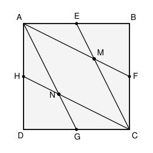

## Statement

Soit $ABCD$ un carré de côté $1$. On note $E$, $F$, $G$, $H$ les milieux respectifs des côtés
$[AB]$, $[BC]$, $[CD]$ et $[DA]$.

Les droites $(AF)$ et $(EC)$ se coupent en $M$, les droites $(AG)$ et $(CH)$ se coupent en $N$.

1. Montrer que $AMCN$ est un losange.
2. Déterminer l'aire de ce losange.

## Hints

1. Pour la première question, une seule chose est à démontrer : les quatre côtés du
   quadrilatère $AMCN$ ont la même longueur. Cherche des symétries de la figure.
2. La symétrie par rapport à la diagonale $(AC)$ échange bien des points de la figure.
   Lesquels ? Et celle par rapport à $(BD)$ ?
3. Pour l'aire, ne cherche pas à calculer $AM$ : découpe le carré en morceaux et compte-les.
4. Les triangles $AME$ et $EMB$ ont la même base et la même hauteur.

## Solution

**1. $AMCN$ est un losange.**

*La symétrie par rapport à la diagonale $(AC)$.* Elle fixe $A$ et $C$, et échange $B$ et $D$.
Elle échange donc $E$ (milieu de $[AB]$) et $H$ (milieu de $[AD]$), ainsi que $F$ (milieu de
$[BC]$) et $G$ (milieu de $[CD]$).

Par conséquent elle échange la droite $(AF)$ et la droite $(AG)$, ainsi que la droite $(EC)$
et la droite $(HC)$. Elle échange donc leurs points d'intersection : $M$ et $N$.

Une symétrie conserve les longueurs, donc
$$AM = AN \qquad \text{et} \qquad CM = CN .$$

*La symétrie par rapport à la diagonale $(BD)$.* Elle fixe $B$ et $D$, et échange $A$ et $C$.
Elle échange donc $E$ et $F$ (milieux de $[AB]$ et $[BC]$), ainsi que $G$ et $H$.

Elle échange alors la droite $(AF)$ et la droite $(CE)$ : ces deux droites se coupant en $M$,
le point $M$ est **fixe**. De même $N$ est fixe. Comme la symétrie échange $A$ et $C$, on en
déduit
$$MA = MC \qquad \text{et} \qquad NA = NC .$$

En rassemblant : $AM = AN = CN = CM$. Les quatre côtés de $AMCN$ ont la même longueur, c'est
un **losange**.

**2. L'aire du losange.**

Notons $\mathcal{A}$ l'aire du losange $AMCN$.

*Quatre petits triangles identiques.* Les triangles $AEM$, $CFM$, $AHN$ et $CGN$ se déduisent
les uns des autres par les symétries ci-dessus : ils ont tous la même aire, que l'on note
$\mathcal{B}$.

*Première relation.* Considérons le parallélogramme $AECG$ : ses côtés $[AE]$ et $[GC]$ sont
parallèles, de même longueur $\tfrac12$, donc $AECG$ est bien un parallélogramme. Sa base
$AE$ mesure $\tfrac12$ et sa hauteur est celle du carré, soit $1$ : son aire vaut $\tfrac12$.

Or $AECG$ se découpe exactement en le losange $AMCN$ et les deux triangles $AEM$ et $CGN$ :
$$\mathcal{A} + 2\mathcal{B} = \frac12 . \qquad (1)$$

*Deuxième relation.* Les triangles $AME$ et $EMB$ ont la même base ($AE = EB$, puisque $E$ est
le milieu de $[AB]$) et le même sommet $M$, donc la même hauteur : ils ont la même aire
$\mathcal{B}$. Le même argument vaut pour les trois autres coins.

Le carré tout entier se découpe alors en : le losange, les quatre triangles de type $AME$, et
les quatre triangles de type $EMB$, soit
$$\mathcal{A} + 8\mathcal{B} = 1 . \qquad (2)$$

*Résolution.* En retranchant $(1)$ à $(2)$ :
$$6\mathcal{B} = \frac12, \qquad \text{donc} \qquad \mathcal{B} = \frac{1}{12} .$$
Puis, avec $(1)$ :
$$\mathcal{A} = \frac12 - \frac{2}{12} = \frac12 - \frac16 = \frac13 .$$

**Conclusion.** $AMCN$ est un losange, et son aire vaut $\boxed{\dfrac13}$.

## Going further

Un carré découpé en trois parts d'aire $\tfrac13$ : le losange central, et les deux régions
restantes. Y a-t-il une découpe qui le montre d'un coup d'œil ?

On peut aussi retrouver le résultat par le calcul, en posant $A(0;1)$, $B(1;1)$, $C(1;0)$ et
$D(0;0)$. On trouve alors
$$M\left(\tfrac23 ; \tfrac23\right) \qquad \text{et} \qquad N\left(\tfrac13 ; \tfrac13\right) .$$
Les diagonales du losange mesurent $AC = \sqrt2$ et $MN = \tfrac{\sqrt2}{3}$, et l'aire d'un
losange vaut la moitié du produit de ses diagonales :
$$\mathcal{A} = \frac12 \times \sqrt2 \times \frac{\sqrt2}{3} = \frac13 . \checkmark$$
