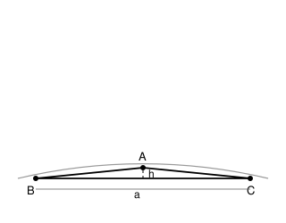

## Statement

Existe-t-il un triangle dont le **périmètre est inférieur à $1$ centimètre** et dont le **rayon du cercle circonscrit dépasse $1$ kilomètre** ?

*(Un kilomètre vaut $100\,000$ centimètres.)*

## Hints

1. Un petit triangle peut-il quand même passer par un très grand cercle ? Pense à ce que l'on voit d'un immense cercle quand on se place tout près : un arc presque droit.
2. Cherche donc un triangle **très plat** : trois points presque alignés.
3. Prends un triangle isocèle : base $[BC]$ de longueur $a$, sommet $A$ au-dessus du milieu de $[BC]$, à une hauteur $h$ toute petite.
4. Où se trouve le centre du cercle circonscrit ? Sur quelle droite ?
5. Écris que le centre est à égale distance de $B$ et de $A$, avec le théorème de Pythagore. Tu obtiendras le rayon en fonction de $a$ et de $h$.
6. Fais tendre $h$ vers $0$ en gardant $a$ fixé : que devient le rayon ?

## Solution

La réponse est **oui**. Il suffit de prendre un triangle très plat.

### La construction

Prenons un triangle isocèle $ABC$ :

- la base $[BC]$ a pour longueur $a$ ;
- le sommet $A$ est au-dessus du milieu $M$ de $[BC]$, à la hauteur $h$.

Son périmètre vaut
$$\mathcal{P} = a + 2 \, AB = a + 2\sqrt{\frac{a^2}{4} + h^2} ,$$
par le théorème de Pythagore dans le triangle rectangle $AMB$.

### Le rayon du cercle circonscrit

Le centre $O$ du cercle circonscrit est sur la médiatrice de $[BC]$, c'est-à-dire sur la droite $(AM)$. Plaçons un repère avec $M$ à l'origine, $[BC]$ sur l'axe horizontal et $A = (0, h)$. Alors
$$B = \left(-\frac{a}{2}, 0\right), \qquad C = \left(\frac{a}{2}, 0\right), \qquad O = (0, y) .$$

Écrivons $OB = OA = R$ :
$$OB^2 = \frac{a^2}{4} + y^2 \qquad \text{et} \qquad OA^2 = (h - y)^2 .$$

En égalant :
$$\frac{a^2}{4} + y^2 = h^2 - 2hy + y^2 ,$$
d'où $\dfrac{a^2}{4} = h^2 - 2hy$, donc
$$y = \frac{h^2 - \frac{a^2}{4}}{2h} .$$

Le rayon vaut alors
$$R = |h - y| = \left| h - \frac{h^2 - \frac{a^2}{4}}{2h} \right| = \frac{h^2 + \frac{a^2}{4}}{2h} .$$

**C'est l'essentiel :** quand $h$ devient petit, le numérateur reste proche de $\frac{a^2}{4}$ alors que le dénominateur tend vers $0$. Le rayon devient donc aussi grand qu'on veut. En particulier
$$R \geqslant \frac{a^2}{8h} .$$

### Des nombres concrets

Choisissons
$$a = \text{0,4} \text{ cm} \qquad \text{et} \qquad h = 10^{-7} \text{ cm} .$$

**Le rayon.**
$$R \geqslant \frac{a^2}{8h} = \frac{\text{0,16}}{8 \times 10^{-7}} = 2 \times 10^{5} \text{ cm} = 2 \text{ km} > 1 \text{ km} . \quad \checkmark$$

**Le périmètre.** Comme $\sqrt{u + v} \leqslant \sqrt{u} + \sqrt{v}$ pour $u, v \geqslant 0$,
$$\sqrt{\frac{a^2}{4} + h^2} \leqslant \frac{a}{2} + h = \text{0,2} + 10^{-7} ,$$
donc
$$\mathcal{P} \leqslant \text{0,4} + 2\left(\text{0,2} + 10^{-7}\right) = \text{0,8} + 2 \times 10^{-7} < 1 \text{ cm} . \quad \checkmark$$

### Conclusion

$$\boxed{\text{Oui. Le triangle isocèle de base } \text{0,4} \text{ cm et de hauteur } 10^{-7} \text{ cm convient.}}$$

**Pourquoi cela ne choque plus, une fois qu'on l'a vu.** Le cercle circonscrit ne mesure pas la taille du triangle, il mesure sa **platitude**. Trois points parfaitement alignés n'ont pas de cercle circonscrit du tout — ou, si l'on veut, un cercle de rayon infini. Plus on s'approche de l'alignement, plus le rayon explose, et cela n'empêche nullement le triangle d'être minuscule.

## Going further

1. Quelle hauteur $h$ faut-il, avec la même base $a = \text{0,4}$ cm, pour que le rayon dépasse la distance Terre–Lune (environ $384\,000$ km) ?
2. Inversement : un triangle de périmètre inférieur à $1$ cm peut-il avoir un cercle circonscrit de rayon inférieur à $1$ millimètre ? Cherche le plus petit rayon possible à périmètre fixé.
3. La loi des sinus dit que $\dfrac{BC}{\sin \widehat{A}} = 2R$. Retrouve le résultat de l'exercice avec cette formule, en faisant tendre l'angle $\widehat{A}$ vers $180°$.
4. Que se passe-t-il pour le rayon du cercle **inscrit** dans ce même triangle très plat ?
