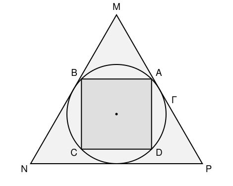

## Statement

Un carré $ABCD$ a une aire égale à $4\sqrt{3}$. Ses quatre sommets sont situés sur un cercle
$\Gamma$.

Ce cercle $\Gamma$ est tangent aux trois côtés $[MN]$, $[NP]$ et $[PM]$ d'un triangle
équilatéral $MNP$ : autrement dit, $\Gamma$ est le cercle inscrit dans $MNP$.

Déterminer l'aire du triangle $MNP$.

## Hints

1. Tout passe par le rayon $r$ du cercle $\Gamma$. Mais attention : tu n'auras pas besoin de
   $r$ lui-même, seulement de $r^2$. Ne calcule jamais de racine carrée dans cet exercice.
2. Pour un carré, le cercle qui passe par les quatre sommets a pour diamètre la diagonale du
   carré. Si le côté vaut $c$, la diagonale vaut $c\sqrt2$. Exprime $r^2$ en fonction de l'aire
   du carré.
3. Pour un triangle équilatéral de côté $a$, le centre du cercle inscrit est aussi le centre de
   gravité, et il est situé au tiers de chaque hauteur en partant du côté. La hauteur vaut
   $\dfrac{a\sqrt3}{2}$ : exprime $r$ en fonction de $a$.
4. Reste à écrire l'aire de $MNP$ en fonction de $a$, puis de $r^2$.

## Solution

Notons $r$ le rayon de $\Gamma$, $c$ le côté du carré et $a$ le côté du triangle équilatéral.

**Étape 1 : le rayon du cercle en fonction de l'aire du carré.**

Le cercle passant par les quatre sommets du carré a pour centre le centre du carré et pour
diamètre la diagonale du carré. Cette diagonale vaut $c\sqrt2$, donc
$$2r = c\sqrt2, \qquad \text{d'où} \qquad r = \frac{c\sqrt2}{2}.$$

En élevant au carré :
$$r^2 = \frac{c^2 \times 2}{4} = \frac{c^2}{2}.$$

Or $c^2$ est précisément l'aire du carré, qui vaut $4\sqrt3$. Donc
$$r^2 = \frac{4\sqrt3}{2} = 2\sqrt3 .$$

*On n'a pas besoin de calculer $c$ ni $r$ : seul $r^2$ servira.*

**Étape 2 : le côté du triangle en fonction du rayon.**

Dans le triangle équilatéral $MNP$ de côté $a$, le centre du cercle inscrit est aussi le centre
de gravité. Il se trouve donc au tiers de chaque hauteur en partant du côté, et le rayon du
cercle inscrit est cette distance :
$$r = \frac{1}{3} \times h, \qquad \text{où } h = \frac{a\sqrt3}{2} \text{ est la hauteur}.$$

Donc
$$r = \frac{a\sqrt3}{6}, \qquad \text{c'est-à-dire} \qquad a = \frac{6r}{\sqrt3} = 2\sqrt3\,r .$$

**Étape 3 : l'aire du triangle.**

L'aire d'un triangle équilatéral de côté $a$ vaut
$$\mathcal{A} = \frac{a \times h}{2} = \frac{a}{2} \times \frac{a\sqrt3}{2}
 = \frac{a^2\sqrt3}{4}.$$

Avec $a = 2\sqrt3\,r$, on a $a^2 = 4 \times 3 \times r^2 = 12r^2$, donc
$$\mathcal{A} = \frac{12 r^2 \sqrt3}{4} = 3\sqrt3\,r^2 .$$

**Étape 4 : on remplace.**

$$\mathcal{A} = 3\sqrt3 \times 2\sqrt3 = 6 \times 3 = \boxed{18}.$$

L'aire du triangle $MNP$ vaut $18$.

*Remarque.* L'énoncé donne une aire de carré étrange, $4\sqrt3$, précisément pour que le $\sqrt3$
du triangle équilatéral se simplifie avec lui à la fin et que la réponse soit un entier.
