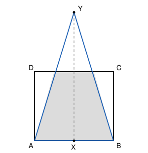

## Statement

Soit $ABCD$ un carré de côté $10$ cm. On note $X$ le milieu de $[AB]$.

On place un point $Y$, du même côté de $(AB)$ que le carré, tel que le triangle $ABY$ soit isocèle en $Y$ et que la zone qui est à la fois à l'intérieur du triangle $ABY$ et à l'intérieur du carré $ABCD$ ait une aire de $99$ cm$^2$.

Combien vaut $XY$ ?

## Hints

1. Le triangle $ABY$ est isocèle en $Y$, donc $Y$ est sur la médiatrice de $[AB]$, qui passe par $X$. La hauteur du triangle issue de $Y$ est donc $XY$. Pose $x = XY$.
2. L'aire du carré vaut $100$ cm$^2$ et la zone commune vaut $99$ cm$^2$ : le triangle ne recouvre donc pas tout le carré. Le point $Y$ est-il au-dessus ou au-dessous de $(DC)$ ?
3. La zone commune, c'est le triangle $ABY$ **privé** du petit triangle qui dépasse au-dessus de la droite $(DC)$. Ces deux triangles sont semblables : quel est leur rapport ?
4. Écris l'aire de la zone commune en fonction de $x$, et résous l'équation.

## Solution

**La réponse : $XY = 500$ cm.**

**Étape 1 : on pose l'inconnue.**

Le triangle $ABY$ est isocèle en $Y$, donc $Y$ appartient à la médiatrice de $[AB]$. Cette médiatrice passe par le milieu $X$ de $[AB]$ et lui est perpendiculaire : le segment $[XY]$ est donc la hauteur du triangle $ABY$ issue de $Y$.

Posons $x = XY$.

**Étape 2 : $Y$ est au-dessus de la droite $(DC)$.**

Si $Y$ était dans le carré ou sur son bord, le triangle $ABY$ serait entièrement contenu dans le carré et son aire, $\dfrac{10 \times x}{2} = 5x$, vaudrait $99$, donc $x = 19{,}8 > 10$ : le point $Y$ serait alors en dehors du carré. C'est contradictoire.

Donc $x > 10$ et $Y$ est strictement au-dessus de la droite $(DC)$. Le triangle dépasse du carré par le haut.

**Étape 3 : les deux triangles.**

Notons $E$ et $F$ les points où les côtés $[AY]$ et $[BY]$ coupent la droite $(DC)$. Le petit triangle $EFY$ est la partie du triangle $ABY$ qui dépasse du carré, et la zone commune est exactement le triangle $ABY$ privé du triangle $EFY$ :

$$\text{aire commune} = \text{aire}(ABY) - \text{aire}(EFY) .$$

Comme $(EF)$ est parallèle à $(AB)$, les triangles $EFY$ et $ABY$ sont semblables, de sommet commun $Y$. Le rapport de réduction est le rapport des hauteurs issues de $Y$ :

$$k = \frac{x - 10}{x} .$$

Les aires sont alors dans le rapport $k^2$.

**Étape 4 : l'équation.**

$$\text{aire}(ABY) = \frac{10 \times x}{2} = 5x , \qquad \text{aire}(EFY) = 5x \times \left(\frac{x-10}{x}\right)^2 = \frac{5(x-10)^2}{x} .$$

La condition s'écrit donc

$$5x - \frac{5(x-10)^2}{x} = 99 .$$

Multiplions par $x$ (qui n'est pas nul) :

$$5x^2 - 5(x-10)^2 = 99x .$$

Développons le carré : $5x^2 - 5\left(x^2 - 20x + 100\right) = 100x - 500$. L'équation devient

$$100x - 500 = 99x , \qquad \text{donc} \qquad x = 500 .$$

**Étape 5 : vérification.**

Avec $x = 500$ : l'aire du grand triangle vaut $2500$, le rapport vaut $\frac{490}{500} = 0{,}98$, l'aire du petit triangle vaut $2500 \times 0{,}98^2 = 2401$, et la différence vaut $2500 - 2401 = 99$. ✓

**Conclusion.** $XY = \boxed{500}$ cm.

## Going further

Que se passe-t-il si l'on remplace $99$ par une autre aire $S$ avec $S < 100$ ? Le même calcul donne $100x - 500 = Sx$, donc $x = \dfrac{500}{100 - S}$. Plus l'aire demandée s'approche de $100$, plus le point $Y$ s'éloigne : c'est logique, car un triangle ne peut jamais recouvrir tout le carré.
