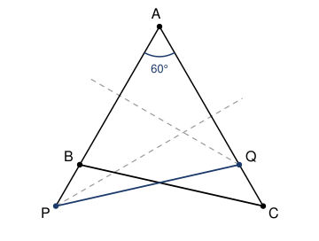

## Statement

Soit $ABC$ un triangle tel que $\widehat{BAC} = 60^\circ$.

La médiatrice de $[AC]$ coupe la droite $(AB)$ en $P$, et la médiatrice de $[AB]$ coupe la
droite $(AC)$ en $Q$.

Montrer que $PQ = BC$.

## Hints

1. Que dit la médiatrice de $[AC]$ sur le point $P$ ? Quelle est la nature du triangle $APC$ ?
2. Ce triangle isocèle a un angle de $60^\circ$ au sommet $A$. Que peut-on en dire de plus ?
3. Fais le même travail avec $Q$ et le triangle $ABQ$.
4. Compare alors les triangles $APQ$ et $ACB$ : ils ont un angle en commun.

## Solution

**Le triangle $APC$ est équilatéral.** Le point $P$ est sur la médiatrice de $[AC]$, donc il
est à égale distance de $A$ et de $C$ :

$$PA = PC .$$

Le triangle $APC$ est donc isocèle en $P$, et ses deux angles à la base sont égaux :
$\widehat{PAC} = \widehat{PCA}$.

Or $P$ est sur la droite $(AB)$, du même côté de $A$ que $B$, donc l'angle $\widehat{PAC}$ est
le même que l'angle $\widehat{BAC}$, qui vaut $60^\circ$. Un triangle isocèle dont un angle
vaut $60^\circ$ est équilatéral : les deux angles à la base valent $60^\circ$, donc le
troisième aussi.

En particulier

$$AP = AC .$$

**Le triangle $ABQ$ est équilatéral, pour la même raison.** Le point $Q$ est sur la médiatrice
de $[AB]$, donc $QA = QB$, le triangle $ABQ$ est isocèle en $Q$, et son angle en $A$ vaut
$\widehat{QAB} = \widehat{CAB} = 60^\circ$. Donc $ABQ$ est équilatéral, et

$$AQ = AB .$$

**On compare deux triangles.** Regardons les triangles $APQ$ et $ACB$. Ils ont :

- $AP = AC$ (premier point) ;
- $AQ = AB$ (deuxième point) ;
- $\widehat{PAQ} = \widehat{CAB}$, car $P$ est sur la demi-droite $[AB)$ et $Q$ sur la
  demi-droite $[AC)$, donc c'est le même angle des deux côtés, à savoir $60^\circ$.

Deux triangles qui ont deux côtés de même longueur et le **même angle entre ces deux côtés**
sont superposables. Donc les triangles $APQ$ et $ACB$ sont égaux, et leurs troisièmes côtés
ont la même longueur :

$$PQ = CB .$$

**On a bien $PQ = BC$.**

## Going further

Autre façon de dire la même chose : notons $s$ la symétrie d'axe la bissectrice de l'angle
$\widehat{BAC}$. Elle échange les demi-droites $[AB)$ et $[AC)$ et conserve les longueurs, donc
elle envoie $C$ sur le point de $[AB)$ situé à la distance $AC$ de $A$, c'est-à-dire $P$, et de
même elle envoie $B$ sur $Q$. Le segment $[PQ]$ est donc le symétrique de $[CB]$, d'où
l'égalité des longueurs.

L'angle de $60^\circ$ est vraiment nécessaire : c'est lui qui rend les deux triangles isocèles
équilatéraux et donc qui donne $AP = AC$ et $AQ = AB$.
