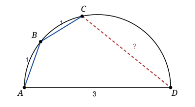

## Statement

Sur un demi-cercle de diamètre $[AD]$, on place deux points $B$ et $C$ tels que

$$AB = BC = 1 \qquad \text{et} \qquad AD = 3.$$

Les quatre points se suivent dans l'ordre $A$, $B$, $C$, $D$ le long du demi-cercle.

Calculer la longueur $CD$.

## Hints

1. Un point du cercle voit le diamètre sous un angle droit. Cela te donne deux triangles rectangles : lesquels ?
2. Dans le triangle rectangle $ABD$, tu peux calculer $BD$ tout de suite.
3. Dans le triangle rectangle $ACD$, il ne te manque que $AC$. Cherche donc $AC$.
4. Le triangle $ABC$ est isocèle en $B$. Appelle $H$ le pied de la hauteur issue de $B$ : c'est le milieu de $[AC]$, donc $AC = 2AH$.
5. Dans un cercle, deux cordes de même longueur sont vues sous le même angle inscrit. Compare l'angle $\widehat{BAC}$ (qui regarde la corde $[BC]$) et l'angle $\widehat{BDA}$ (qui regarde la corde $[AB]$).
6. Tu tiens alors deux triangles rectangles qui ont un angle aigu commun : ils sont semblables.

## Solution

**Étape 1 : deux angles droits.**

Les points $B$ et $C$ sont sur le cercle de diamètre $[AD]$, donc

$$\widehat{ABD} = 90^\circ \qquad \text{et} \qquad \widehat{ACD} = 90^\circ.$$

Le théorème de Pythagore dans le triangle $ABD$ donne

$$BD^2 = AD^2 - AB^2 = 9 - 1 = 8, \qquad \text{donc} \qquad BD = 2\sqrt{2}.$$

Et dans le triangle $ACD$,

$$CD^2 = AD^2 - AC^2 = 9 - AC^2.$$

Il ne reste donc qu'à calculer $AC$.

**Étape 2 : la moitié de $AC$.**

Le triangle $ABC$ est isocèle en $B$, puisque $AB = BC = 1$. Notons $H$ le pied de la hauteur issue de $B$ dans ce triangle. Dans un triangle isocèle, cette hauteur est aussi la médiatrice de la base, donc

$$H \text{ est le milieu de } [AC], \qquad AC = 2\,AH, \qquad \widehat{AHB} = 90^\circ.$$

**Étape 3 : deux triangles semblables.**

Les cordes $[AB]$ et $[BC]$ ont la même longueur. Dans un même cercle, deux cordes de même longueur sont vues sous le même angle inscrit. Or :

- l'angle $\widehat{BDA}$, de sommet $D$, regarde la corde $[AB]$ ;
- l'angle $\widehat{BAC}$, de sommet $A$, regarde la corde $[BC]$.

Donc $\widehat{BDA} = \widehat{BAC}$.

Comparons alors les deux triangles rectangles

$$AHB \quad (\text{rectangle en } H) \qquad \text{et} \qquad DBA \quad (\text{rectangle en } B).$$

Le premier a un angle aigu $\widehat{HAB} = \widehat{BAC}$ en $A$ ; le second a un angle aigu $\widehat{BDA}$ en $D$. Ces deux angles sont égaux, et les deux triangles ont chacun un angle droit : ils ont donc les mêmes angles, ils sont semblables. Les sommets se correspondent ainsi :

$$A \leftrightarrow D, \qquad H \leftrightarrow B, \qquad B \leftrightarrow A.$$

Les rapports des côtés correspondants sont égaux :

$$\frac{AH}{DB} = \frac{AB}{DA}.$$

**Étape 4 : le calcul.**

$$AH = \frac{DB \times AB}{DA} = \frac{2\sqrt{2} \times 1}{3} = \frac{2\sqrt{2}}{3},$$

donc

$$AC = 2\,AH = \frac{4\sqrt{2}}{3}, \qquad AC^2 = \frac{16 \times 2}{9} = \frac{32}{9}.$$

Enfin

$$CD^2 = 9 - \frac{32}{9} = \frac{81 - 32}{9} = \frac{49}{9}.$$

**Conclusion : $CD = \dfrac{7}{3}$.**
