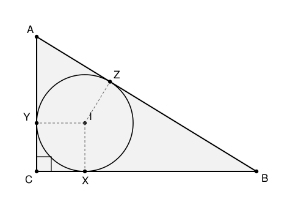

## Statement

$ABC$ est un triangle rectangle en $C$. On note $r$ le rayon de son cercle inscrit, c'est-à-dire du cercle intérieur au triangle et tangent à ses trois côtés.

Exprimer $r$ en fonction des trois longueurs $AB$, $BC$ et $CA$.

*Rappel utile : si d'un point $P$ extérieur à un cercle on mène les deux tangentes au cercle, les deux segments qui joignent $P$ aux points de contact ont la même longueur.*

## Hints

1. Note $X$, $Y$, $Z$ les points où le cercle touche $[BC]$, $[CA]$ et $[AB]$. Le rappel te donne trois égalités de longueurs : lesquelles ?
2. Ces égalités ne laissent que **trois** longueurs inconnues au lieu de six. Donne-leur des noms, par exemple $x = AY = AZ$ et $y = BX = BZ$.
3. Il reste $CX$ et $CY$. Le sommet $C$ est particulier : l'angle y est droit. Que peux-tu dire du quadrilatère formé par $C$, $X$, le centre du cercle, et $Y$ ?
4. Tu devrais trouver que $CX = CY = r$. Exprime maintenant $AC$, $CB$ et $AB$ en fonction de $x$, $y$ et $r$.
5. Cherche une combinaison de ces trois longueurs où $x$ et $y$ disparaissent.

## Solution

**Les points de contact.**

Notons $I$ le centre du cercle inscrit et $X$, $Y$, $Z$ les points où il touche respectivement $[BC]$, $[CA]$ et $[AB]$.

Par la propriété des deux tangentes issues d'un même point :

$$AY = AZ, \qquad BX = BZ, \qquad CX = CY .$$

Posons

$$x = AY = AZ, \qquad y = BX = BZ, \qquad z = CX = CY .$$

**Le sommet droit donne $z = r$.**

Regardons le quadrilatère $CXIY$. Il a trois angles droits :

- en $C$, car le triangle est rectangle en $C$ ;
- en $X$, car un rayon est perpendiculaire à la tangente au point de contact ;
- en $Y$, pour la même raison.

Un quadrilatère à trois angles droits a son quatrième angle droit aussi (la somme des angles d'un quadrilatère vaut $360°$) : c'est donc un rectangle. Et comme deux de ses côtés consécutifs sont des rayons, $IX = IY = r$, ce rectangle est un **carré** de côté $r$. Donc

$$z = CX = CY = r .$$

**Écrire les trois côtés.**

Les points de contact sont sur les côtés, donc chaque côté se coupe en deux morceaux :

$$AC = AY + YC = x + r,$$
$$CB = CX + XB = r + y,$$
$$AB = AZ + ZB = x + y .$$

**Faire disparaître $x$ et $y$.**

La bonne combinaison est celle qui additionne les deux côtés de l'angle droit et retranche l'hypoténuse :

$$AC + CB - AB = (x + r) + (r + y) - (x + y) = 2r .$$

**Conclusion.**

$$\boxed{r = \frac{AC + CB - AB}{2} .}$$

Autrement dit : **dans un triangle rectangle, le rayon du cercle inscrit est la demi-somme des deux côtés de l'angle droit, diminuée de la moitié de l'hypoténuse.**

**Vérification sur le triangle $3$, $4$, $5$.** Ici les côtés de l'angle droit valent $3$ et $4$, l'hypoténuse $5$, donc

$$r = \frac{3 + 4 - 5}{2} = 1 .$$

On peut le recouper par les aires : l'aire du triangle vaut $\tfrac12 \times 3 \times 4 = 6$, et vaut aussi $r \times p$ où $p = \tfrac{3+4+5}{2} = 6$ est le demi-périmètre. D'où $r = 1$. ✓

## Going further

Montrer que dans **n'importe quel** triangle, le rayon du cercle inscrit vaut $\dfrac{\mathcal{A}}{p}$, où $\mathcal A$ est l'aire et $p$ le demi-périmètre. *Indication : relier $I$ aux trois sommets et additionner les aires des trois petits triangles obtenus.* Retrouver ensuite la formule ci-dessus dans le cas rectangle.
