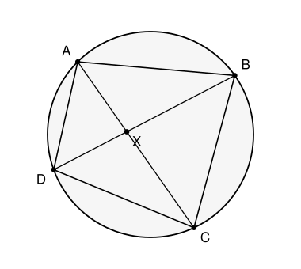

## Statement

$ABCD$ est un quadrilatère **inscrit dans un cercle** (ses quatre sommets sont sur un même cercle), les sommets étant dans cet ordre sur le cercle.

Les deux diagonales $[AC]$ et $[BD]$ se coupent en un point $X$.

Montrer que

$$AX \times CX = BX \times DX .$$

## Hints

1. Une égalité « produit $=$ produit » se transforme en égalité de rapports : $\dfrac{AX}{DX} = \dfrac{BX}{CX}$. Cherche maintenant deux triangles semblables.
2. Les quatre longueurs $AX$, $BX$, $CX$, $DX$ sont des côtés des triangles $AXB$ et $DXC$. Compare ces deux triangles.
3. Un premier angle est gratuit : les angles en $X$ sont opposés par le sommet.
4. Pour le second, utilise le théorème de l'angle inscrit. Les angles $\widehat{BAC}$ et $\widehat{BDC}$ interceptent le même arc : lequel ?

## Solution

**Reformuler.**

L'égalité à démontrer s'écrit aussi

$$\frac{AX}{DX} = \frac{BX}{CX} .$$

Les quatre longueurs qui y figurent sont les côtés issus de $X$ dans les triangles $AXB$ et $DXC$. Montrons que ces deux triangles sont semblables.

**Premier angle : opposés par le sommet.**

Les points $A$, $X$, $C$ sont alignés (sur la diagonale $[AC]$) et $B$, $X$, $D$ aussi (sur $[BD]$). Les angles $\widehat{AXB}$ et $\widehat{DXC}$ sont donc opposés par le sommet $X$ :

$$\widehat{AXB} = \widehat{DXC} .$$

**Second angle : le théorème de l'angle inscrit.**

Considérons les angles $\widehat{XAB}$ et $\widehat{XDC}$.

- Comme $X$ est sur $[AC]$, l'angle $\widehat{XAB}$ est l'angle $\widehat{CAB}$.
- Comme $X$ est sur $[BD]$, l'angle $\widehat{XDC}$ est l'angle $\widehat{BDC}$.

Or $\widehat{CAB}$ et $\widehat{BDC}$ sont deux **angles inscrits** dans le cercle qui interceptent le même arc $BC$ (celui qui ne contient ni $A$ ni $D$, puisque les points sont dans l'ordre $A$, $B$, $C$, $D$ sur le cercle, et que $A$ et $D$ sont du même côté de la corde $[BC]$). Le théorème de l'angle inscrit donne donc

$$\widehat{CAB} = \widehat{BDC}, \qquad \text{c'est-à-dire} \qquad \widehat{XAB} = \widehat{XDC} .$$

**Conclusion.**

Les triangles $AXB$ et $DXC$ ont deux angles égaux deux à deux : ils sont semblables, avec la correspondance

$$A \leftrightarrow D, \qquad X \leftrightarrow X, \qquad B \leftrightarrow C .$$

Les rapports des côtés correspondants sont donc égaux :

$$\frac{AX}{DX} = \frac{BX}{CX} = \frac{AB}{DC} .$$

De la première égalité, en multipliant en croix :

$$\boxed{AX \times CX = BX \times DX .}$$

**Ce que ce résultat signifie.** La quantité $AX \times CX$ ne dépend pas de la corde choisie : si on fait passer par $X$ n'importe quelle corde du cercle, le produit des deux morceaux est toujours le même. Ce nombre s'appelle la **puissance du point $X$** par rapport au cercle. On peut la calculer une fois pour toutes en prenant la corde qui passe par le centre : si $R$ est le rayon et $d = OX$ la distance de $X$ au centre, les deux morceaux valent $R + d$ et $R - d$, donc

$$AX \times CX = R^2 - d^2 .$$

## Going further

Reprendre le même résultat lorsque $X$ est à l'**extérieur** du cercle et que les deux droites issues de $X$ coupent chacune le cercle en deux points. L'égalité des produits reste-t-elle vraie ? Quels triangles faut-il comparer cette fois ?
