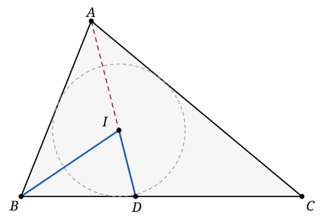

## Statement

Soit $ABC$ un vrai triangle, c'est-à-dire un triangle dont les trois sommets ne sont pas alignés.

Soit $I$ le centre de son cercle inscrit, et soit $D$ le point où la bissectrice issue de $A$ coupe le côté $[BC]$.

Montrer que l'angle $\widehat{BID}$ ne vaut jamais $90^\circ$.

## Hints

1. Le centre du cercle inscrit est le point de rencontre des trois bissectrices. Que sais-tu donc des angles $\widehat{IAB}$ et $\widehat{IBA}$ ?
2. Les points $A$, $I$ et $D$ sont alignés, et $I$ est situé **entre** $A$ et $D$. L'angle $\widehat{BID}$ est donc le supplémentaire de l'angle $\widehat{BIA}$.
3. Écris la somme des angles du triangle $ABI$.
4. N'essaie pas seulement de montrer que l'angle est différent de $90^\circ$ : calcule-le. Tu trouveras une formule qui donne bien plus que la question posée.

## Solution

Notons, comme d'habitude, $\widehat{A}$, $\widehat{B}$ et $\widehat{C}$ les trois angles du triangle $ABC$. On sait que

$$\widehat{A} + \widehat{B} + \widehat{C} = 180^\circ ,$$

et, comme le triangle est un vrai triangle, ces trois angles sont **strictement** positifs.

**Ce que dit le point $I$.**

Le point $I$ est le centre du cercle inscrit, donc il est sur les trois bissectrices. En particulier :

$$\widehat{IAB} = \frac{\widehat{A}}{2} \qquad \text{et} \qquad \widehat{IBA} = \frac{\widehat{B}}{2} .$$

**Ce que dit le point $D$.**

Le point $D$ est sur la bissectrice issue de $A$, comme $I$. Les points $A$, $I$ et $D$ sont donc alignés, et $I$ se trouve entre $A$ et $D$ (le centre du cercle inscrit est à l'intérieur du triangle, et $D$ est sur le côté opposé).

Les angles $\widehat{BIA}$ et $\widehat{BID}$ sont donc supplémentaires :

$$\widehat{BID} = 180^\circ - \widehat{BIA} .$$

**On calcule $\widehat{BIA}$.**

Dans le triangle $ABI$, la somme des angles vaut $180^\circ$ :

$$\widehat{BIA} = 180^\circ - \widehat{IAB} - \widehat{IBA} = 180^\circ - \frac{\widehat{A}}{2} - \frac{\widehat{B}}{2} .$$

**On en déduit $\widehat{BID}$.**

$$\widehat{BID} = 180^\circ - \widehat{BIA} = \frac{\widehat{A}}{2} + \frac{\widehat{B}}{2} = \frac{\widehat{A} + \widehat{B}}{2} .$$

Or $\widehat{A} + \widehat{B} = 180^\circ - \widehat{C}$. Donc

$$\boxed{\ \widehat{BID} = 90^\circ - \frac{\widehat{C}}{2}\ } .$$

**Conclusion.**

Le triangle n'est pas aplati, donc $\widehat{C} > 0^\circ$, donc $\dfrac{\widehat{C}}{2} > 0^\circ$, et par conséquent

$$\widehat{BID} < 90^\circ .$$

L'angle $\widehat{BID}$ est donc toujours strictement aigu : il ne peut pas valoir $90^\circ$. C'est bien ce qu'il fallait démontrer.

*Remarque.* On a démontré beaucoup plus que ce qui était demandé. Non seulement $\widehat{BID} \neq 90^\circ$, mais on sait exactement combien il vaut, et on voit qu'il est toujours **plus petit** que $90^\circ$, jamais plus grand. Quand on peut calculer au lieu de raisonner par l'absurde, c'est en général plus court et plus instructif.

## Going further

1. Avec la même méthode, montre la formule très utile

   $$\widehat{BIC} = 90^\circ + \frac{\widehat{A}}{2} .$$

   L'angle sous lequel on voit un côté depuis le centre du cercle inscrit est donc toujours **obtus**.

2. Que devient $\widehat{BID}$ quand le triangle s'aplatit, c'est-à-dire quand $\widehat{C}$ tend vers $0^\circ$ ? Et quand $\widehat{C}$ tend vers $180^\circ$ ?

3. Soit $J$ le centre du cercle exinscrit dans l'angle $\widehat{A}$ (le cercle tangent au côté $[BC]$ et aux prolongements des deux autres côtés). Calcule $\widehat{BJC}$ en fonction de $\widehat{A}$.
