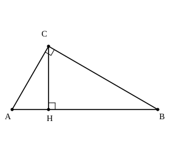

## Statement

Pour deux nombres positifs $a$ et $b$, on appelle **moyenne arithmétique** le nombre $\dfrac{a+b}{2}$ et **moyenne géométrique** le nombre $\sqrt{ab}$.

Le triangle $ABC$ est rectangle en $C$, et $H$ est le pied de la hauteur issue de $C$.

1. Montrer que les triangles $AHC$ et $CHB$ sont semblables, puis en déduire que
   $$CH = \sqrt{AH \times HB}.$$
   Autrement dit, la hauteur issue de l'angle droit est la moyenne géométrique des deux morceaux qu'elle découpe sur l'hypoténuse.
2. En utilisant la question 1, démontrer que pour tous nombres $a > 0$ et $b > 0$,
   $$\frac{a+b}{2} \geqslant \sqrt{ab},$$
   et préciser dans quel cas les deux membres sont égaux.

## Hints

1. Les triangles $AHC$ et $CHB$ ont chacun un angle droit en $H$. Cherchez une deuxième paire d'angles égaux : que vaut la somme des angles aigus du triangle $ABC$ ?
2. Une fois la similitude établie, écrivez l'égalité des rapports de côtés correspondants, en faisant bien attention à l'ordre des sommets, puis multipliez en croix.
3. Pour la question 2, il faut fabriquer une figure sur mesure : tracez un segment $[AB]$ de longueur $a+b$ et placez sur lui le point $H$ tel que $AH = a$ et $HB = b$. Comment obtenir un point $C$ tel que le triangle $ABC$ soit rectangle en $C$ et que $H$ soit le pied de sa hauteur ?
4. Appelez $M$ le milieu de $[AB]$ et comparez les longueurs $CM$ et $CH$. L'une des deux est la plus courte distance du point $C$ à la droite $(AB)$ ; l'autre est un rayon du cercle.

## Solution

### 1. La hauteur est la moyenne géométrique

**Les deux triangles sont semblables.**

Notons $\widehat{A}$ et $\widehat{B}$ les deux angles aigus du triangle $ABC$. Comme la somme des angles d'un triangle vaut $180^\circ$ et que l'angle en $C$ est droit,
$$\widehat{A} + \widehat{B} = 90^\circ.$$

Le triangle $CHB$ est rectangle en $H$, donc ses deux angles aigus sont complémentaires :
$$\widehat{HCB} = 90^\circ - \widehat{B} = \widehat{A}.$$

Les triangles $AHC$ et $CHB$ ont donc deux angles égaux deux à deux :
$$\widehat{HAC} = \widehat{HCB} \qquad \text{et} \qquad \widehat{AHC} = \widehat{CHB} = 90^\circ.$$

Ils sont semblables, avec la correspondance $A \leftrightarrow C$, $H \leftrightarrow H$, $C \leftrightarrow B$.

**On en déduit la longueur de la hauteur.**

Dans deux triangles semblables, les rapports des côtés correspondants sont égaux. En respectant la correspondance ci-dessus :
$$\frac{AH}{CH} = \frac{HC}{HB}.$$

En multipliant en croix :
$$CH \times HC = AH \times HB, \qquad \text{c'est-à-dire} \qquad CH^2 = AH \times HB.$$

Les longueurs étant positives, on obtient
$$CH = \sqrt{AH \times HB}.$$

### 2. L'inégalité des moyennes

**On construit une figure adaptée aux nombres $a$ et $b$.**

Soient $a > 0$ et $b > 0$. Traçons un segment $[AB]$ de longueur $a + b$ et plaçons sur ce segment le point $H$ tel que
$$AH = a \qquad \text{et} \qquad HB = b.$$

Traçons ensuite le cercle de diamètre $[AB]$, puis la perpendiculaire à $(AB)$ passant par $H$ : elle coupe le cercle en un point $C$.

![La demi-circonférence de diamètre [AB], la hauteur CH et la médiane CM](0410-figure-2.svg)

Le triangle $ABC$ est inscrit dans un cercle dont $[AB]$ est un diamètre : il est donc rectangle en $C$. Et comme $(CH)$ est perpendiculaire à $(AB)$, le segment $[CH]$ est bien la hauteur issue de $C$.

La question 1 donne alors
$$CH = \sqrt{AH \times HB} = \sqrt{ab}.$$

**On fait apparaître la moyenne arithmétique.**

Soit $M$ le milieu de $[AB]$, c'est-à-dire le centre du cercle. Le segment $[CM]$ est un rayon, donc
$$CM = \frac{AB}{2} = \frac{a+b}{2}.$$

**On compare les deux longueurs.**

Le segment $[CH]$ est perpendiculaire à $(AB)$ : c'est le plus court chemin du point $C$ à la droite $(AB)$. Tout autre segment joignant $C$ à un point de cette droite, en particulier $[CM]$, est donc au moins aussi long :
$$CH \leqslant CM.$$

En remplaçant chacune des deux longueurs par sa valeur :
$$\sqrt{ab} \leqslant \frac{a+b}{2}.$$

**Le cas d'égalité.**

Si $H$ et $M$ sont deux points distincts, le triangle $CHM$ est rectangle en $H$ et $[CM]$ en est l'hypoténuse : elle est strictement plus longue que le côté $[CH]$. L'égalité $CH = CM$ impose donc $H = M$, c'est-à-dire $AH = HB$, autrement dit $a = b$.

Réciproquement, si $a = b$, les deux membres valent $a$ et l'égalité est vraie.

**Conclusion.** Pour tous nombres positifs $a$ et $b$, la moyenne arithmétique est supérieure ou égale à la moyenne géométrique :
$$\frac{a+b}{2} \geqslant \sqrt{ab},$$
avec égalité exactement lorsque $a = b$. La figure explique l'énoncé d'un coup d'œil : la moyenne arithmétique est le rayon du cercle, la moyenne géométrique est la hauteur, et un rayon oblique est toujours plus long qu'une perpendiculaire.

## Going further

1. Retrouvez l'inégalité par le calcul, sans figure : développez $(\sqrt{a} - \sqrt{b})^2$ et concluez.
2. Sur la même figure, que représente la longueur $AC$ ? Montrez que $AC^2 = AH \times AB$.
3. Déduisez de l'inégalité que pour tout $x > 0$, on a $x + \dfrac{1}{x} \geqslant 2$. Pour quelle valeur de $x$ y a-t-il égalité ?
