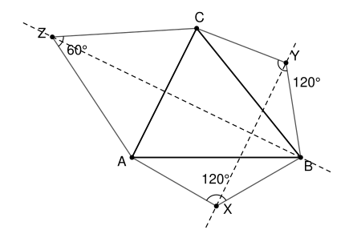

## Statement

$ABC$ est un triangle dont les trois angles sont aigus. À l'extérieur du triangle, on construit trois points $X$, $Y$ et $Z$ tels que :

- le triangle $AXB$ est isocèle en $X$ et $\widehat{AXB} = 120°$ ;
- le triangle $BYC$ est isocèle en $Y$ et $\widehat{BYC} = 120°$ ;
- le triangle $CZA$ est isocèle en $Z$ et $\widehat{CZA} = 60°$ (il est donc équilatéral).

Montrer que les droites $(XY)$ et $(BZ)$ sont perpendiculaires.

## Hints

1. On a $XA = XB$ et $YB = YC$. Trace le cercle de centre $X$ passant par $A$ et $B$, et le cercle de centre $Y$ passant par $B$ et $C$. Ils se recoupent en un second point $K$. Que représente la droite $(XY)$ pour le segment $[BK]$ ?
2. Il suffit donc de montrer que $B$, $K$ et $Z$ sont alignés. Calcule les angles $\widehat{AKB}$ et $\widehat{BKC}$ avec le théorème de l'angle inscrit, puis $\widehat{CKA}$.
3. Compare $\widehat{CKA}$ et $\widehat{CZA}$ : que peut-on dire des quatre points $A$, $K$, $C$, $Z$ ?
4. Dans ce nouveau cercle, l'angle $\widehat{AKZ}$ intercepte le même arc qu'un angle du triangle équilatéral $ACZ$. Calcule alors $\widehat{BKZ}$.

## Solution

**Rappel : l'angle inscrit.** Si $A$, $B$ et $K$ sont sur un cercle de centre $X$, l'angle $\widehat{AKB}$ vaut la moitié de l'angle au centre qui intercepte le même arc $AB$ (l'arc qui ne contient pas $K$). On le démontre avec les deux triangles isocèles $XKA$ et $XKB$. Deux conséquences : deux angles inscrits qui interceptent le même arc sont égaux, et un quadrilatère convexe dont deux angles opposés ont pour somme $180°$ est inscrit dans un cercle.

### Le point $K$

Comme $XA = XB$, il existe un cercle $\Gamma_1$ de centre $X$ passant par $A$ et $B$. De même, un cercle $\Gamma_2$ de centre $Y$ passe par $B$ et $C$. Ces deux cercles passent par $B$ ; ils se recoupent en un second point, que l'on note $K$. Comme les angles du triangle $ABC$ sont aigus, ce point $K$ est à l'intérieur du triangle (la figure le montre, on l'admet ici).

Le point $X$ est à égale distance de $B$ et de $K$ (ce sont deux points de $\Gamma_1$), donc $X$ est sur la médiatrice de $[BK]$. Pour la même raison, $Y$ est sur cette médiatrice. Ainsi **la droite $(XY)$ est la médiatrice de $[BK]$**, et elle est perpendiculaire à $(BK)$.

Il reste donc à montrer que $Z$ est sur la droite $(BK)$.

### Les angles en $K$

Le point $K$ est sur l'arc de $\Gamma_1$ situé du côté de $C$ par rapport à $(AB)$, c'est-à-dire du côté opposé au centre $X$. L'arc $AB$ qui ne contient pas $K$ est donc le grand arc, et l'angle au centre qui l'intercepte est l'angle rentrant $360° - 120° = 240°$. Par le théorème de l'angle inscrit :
$$\widehat{AKB} = \frac{240°}{2} = 120° .$$

Le même raisonnement dans $\Gamma_2$ donne $\widehat{BKC} = 120°$. Comme $K$ est à l'intérieur du triangle, les trois angles autour de $K$ font un tour complet :
$$\widehat{CKA} = 360° - 120° - 120° = 120° .$$

### Le cercle passant par $A$, $K$, $C$, $Z$

Les points $K$ et $Z$ sont de part et d'autre de la droite $(AC)$, donc $AKCZ$ est un quadrilatère convexe. Ses angles en $K$ et en $Z$ sont opposés et
$$\widehat{CKA} + \widehat{CZA} = 120° + 60° = 180° .$$
Le quadrilatère $AKCZ$ est donc inscrit dans un cercle.

Dans ce cercle, les angles $\widehat{AKZ}$ et $\widehat{ACZ}$ interceptent le même arc $AZ$, donc ils sont égaux. Or le triangle $ACZ$ est équilatéral, donc $\widehat{ACZ} = 60°$, et
$$\widehat{AKZ} = 60° .$$

### L'alignement

Autour de $K$, la demi-droite $[KA)$ est entre $[KB)$ et $[KZ)$, donc
$$\widehat{BKZ} = \widehat{BKA} + \widehat{AKZ} = 120° + 60° = 180° .$$
Les points $B$, $K$ et $Z$ sont alignés : la droite $(BZ)$ est la droite $(BK)$.

**Conclusion.** La droite $(XY)$ est la médiatrice de $[BK]$, et $(BK)$ est la droite $(BZ)$. Les droites $(XY)$ et $(BZ)$ sont donc perpendiculaires.

## Going further

Le point $K$ voit les trois côtés du triangle sous un angle de $120°$ : c'est le **point de Fermat** du triangle. Montrer de la même façon que $K$ est aussi sur la droite qui joint $A$ au sommet du triangle équilatéral construit à l'extérieur sur $[BC]$.
