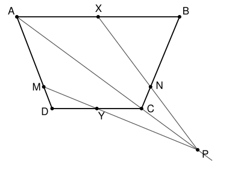

## Statement

$ABCD$ est un trapèze dont les côtés $[AB]$ et $[CD]$ sont parallèles. On note $X$ le milieu de $[AB]$ et $Y$ le milieu de $[CD]$. On choisit un point $P$ sur la droite $(AC)$, au-delà de $C$ : le point $C$ est entre $A$ et $P$.

La droite $(PX)$ coupe la droite $(BC)$ en $N$, et la droite $(PY)$ coupe la droite $(AD)$ en $M$.

Montrer que la droite $(MN)$ est parallèle à $(AB)$.

## Hints

1. Il suffit de montrer que $M$ et $N$ partagent les côtés $[AD]$ et $[BC]$ dans le même rapport : $\dfrac{MA}{MD} = \dfrac{NB}{NC}$.
2. Prolonge $(PY)$ jusqu'à la droite $(AB)$, en un point $U$. Les droites $(AU)$ et $(DY)$ sont parallèles : cherche deux configurations de Thalès, l'une de sommet $P$, l'autre de sommet $M$.
3. Tu dois trouver $\dfrac{MA}{MD} = \dfrac{PA}{PC}$. Fais pareil avec $(PX)$, que tu prolonges jusqu'à la droite $(CD)$.
4. Pour conclure, écris $\overrightarrow{AM}$ et $\overrightarrow{BN}$ en fonction de $\overrightarrow{AD}$ et $\overrightarrow{BC}$, puis calcule $\overrightarrow{MN}$.

## Solution

Notons $k = \dfrac{PA}{PC}$. On va montrer que $\dfrac{MA}{MD} = k$ et $\dfrac{NB}{NC} = k$.

### Le point $M$

La droite $(PY)$ n'est pas parallèle à $(AB)$ (sinon elle serait la droite $(CD)$, qui ne passe pas par $P$). Elle coupe donc la droite $(AB)$ en un point $U$.

- **Thalès de sommet $P$.** Les points $P$, $C$, $A$ sont alignés, les points $P$, $Y$, $U$ aussi, et $(CY)$ est parallèle à $(AU)$. Donc $\dfrac{AU}{CY} = \dfrac{PA}{PC} = k$.
- **Thalès de sommet $M$.** Les droites $(AD)$ et $(UY)$ se coupent en $M$, et $(AU)$ est parallèle à $(DY)$. Donc $\dfrac{MA}{MD} = \dfrac{AU}{DY}$.

Comme $Y$ est le milieu de $[CD]$, on a $DY = CY$, et donc
$$\frac{MA}{MD} = \frac{AU}{CY} = k .$$

### Le point $N$

De même, la droite $(PX)$ coupe la droite $(CD)$ en un point $T$.

- **Thalès de sommet $P$.** $P$, $C$, $A$ sont alignés, $P$, $T$, $X$ aussi, et $(CT)$ est parallèle à $(AX)$. Donc $\dfrac{AX}{CT} = \dfrac{PA}{PC} = k$.
- **Thalès de sommet $N$.** Les droites $(BC)$ et $(XT)$ se coupent en $N$, et $(BX)$ est parallèle à $(CT)$. Donc $\dfrac{NB}{NC} = \dfrac{BX}{CT}$.

Comme $X$ est le milieu de $[AB]$, $BX = AX$, et donc
$$\frac{NB}{NC} = \frac{AX}{CT} = k .$$

### Où sont $M$ et $N$ ?

Dans le triangle $ABC$, la droite $(PX)$ passe par un point du côté $[AB]$ et par un point du prolongement de $[AC]$. Elle entre dans le triangle par $[AB]$ et doit en ressortir par le troisième côté : $N$ est sur le segment $[BC]$. Pour la même raison, dans le triangle $ACD$, le point $M$ est sur le segment $[AD]$.

### Conclusion par les vecteurs

Comme $M$ est sur $[AD]$ avec $MA = k\,MD$, on a $\overrightarrow{AM} = \lambda\,\overrightarrow{AD}$ avec $\lambda = \dfrac{k}{k+1}$. De même, $\overrightarrow{BN} = \lambda\,\overrightarrow{BC}$ avec le **même** nombre $\lambda$. Alors
$$\overrightarrow{MN} = \overrightarrow{MA} + \overrightarrow{AB} + \overrightarrow{BN} = \overrightarrow{AB} + \lambda\left(\overrightarrow{BC} - \overrightarrow{AD}\right) .$$
Or, par la relation de Chasles, $\overrightarrow{BC} = \overrightarrow{BA} + \overrightarrow{AD} + \overrightarrow{DC}$, donc
$$\overrightarrow{BC} - \overrightarrow{AD} = \overrightarrow{BA} + \overrightarrow{DC} .$$
Les vecteurs $\overrightarrow{BA}$ et $\overrightarrow{DC}$ sont tous les deux colinéaires à $\overrightarrow{AB}$, puisque $(CD)$ est parallèle à $(AB)$. Donc $\overrightarrow{MN}$ est une somme de vecteurs colinéaires à $\overrightarrow{AB}$ : il est colinéaire à $\overrightarrow{AB}$.

**Conclusion.** La droite $(MN)$ est parallèle à la droite $(AB)$.

## Going further

Que se passe-t-il quand $P$ s'éloigne indéfiniment sur la droite $(AC)$ ? Les droites $(PX)$ et $(PY)$ deviennent presque parallèles à $(AC)$. Montrer que les parallèles à $(AC)$ passant par $X$ et $Y$ coupent $(BC)$ et $(AD)$ en leurs milieux.
