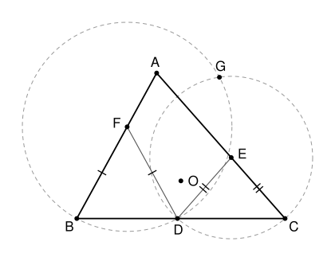

## Statement

Soit $ABC$ un triangle et $O$ le centre de son cercle circonscrit. On place des points $D$, $E$, $F$ à l'intérieur des côtés $[BC]$, $[CA]$ et $[AB]$, de sorte que
$$FB = FD \qquad \text{et} \qquad ED = EC .$$
Le cercle de centre $F$ passant par $B$ et le cercle de centre $E$ passant par $C$ se coupent en $D$ et en un deuxième point $G$.

Montrer que les cinq points $A$, $F$, $O$, $E$, $G$ sont sur un même cercle.

## Hints

1. Les triangles $FBD$ et $EDC$ sont isocèles. Calcule l'angle $\widehat{FDE}$ en fonction des angles du triangle $ABC$.
2. Les points $F$ et $E$ sont tous les deux à égale distance de $D$ et de $G$. Que représente la droite $(FE)$ pour le segment $[DG]$ ? Compare alors $\widehat{FGE}$ et $\widehat{FAE}$.
3. Calcule $\widehat{BGD}$ grâce à l'angle au centre $\widehat{BFD}$, puis $\widehat{DGC}$ de la même façon. Sur quel cercle connu se trouve $G$ ?
4. Le point $O$ et le point $F$ sont tous les deux à égale distance de $B$ et de $G$. Compare $\widehat{OGF}$ et $\widehat{OAF}$.

## Solution

On note $\widehat{A}$, $\widehat{B}$, $\widehat{C}$ les angles du triangle $ABC$, et $\Gamma$ son cercle circonscrit.

**Rappel : angle inscrit et cocyclicité.** Un angle inscrit dans un cercle vaut la moitié de l'angle au centre qui intercepte le même arc. Et deux points $X$ et $Y$ situés du même côté d'une droite $(KL)$ vérifient $\widehat{KXL} = \widehat{KYL}$ si et seulement si $K$, $L$, $X$, $Y$ sont sur un même cercle.

### Étape 1 : l'angle $\widehat{FDE}$

Le triangle $FBD$ est isocèle en $F$, donc ses angles à la base sont égaux : $\widehat{FDB} = \widehat{FBD} = \widehat{B}$. De même, $EDC$ est isocèle en $E$, donc $\widehat{EDC} = \widehat{C}$. Comme $D$ est sur le segment $[BC]$, les trois angles $\widehat{FDB}$, $\widehat{FDE}$, $\widehat{EDC}$ forment un angle plat :
$$\widehat{FDE} = 180° - \widehat{B} - \widehat{C} = \widehat{A} .$$

### Étape 2 : $A$, $F$, $G$, $E$ sont sur un même cercle

On a $FD = FG$, car ce sont deux rayons du cercle de centre $F$, et $ED = EG$ de même. Les points $F$ et $E$ sont donc sur la médiatrice de $[DG]$ : la droite $(FE)$ est cette médiatrice, et **$G$ est le symétrique de $D$ par rapport à $(FE)$**.

La symétrie d'axe $(FE)$ laisse $F$ et $E$ en place et envoie $D$ sur $G$, donc elle conserve l'angle :
$$\widehat{FGE} = \widehat{FDE} = \widehat{A} = \widehat{FAE} .$$

De quel côté de $(FE)$ se trouve $G$ ? Le point $F$ est entre $A$ et $B$, et $E$ entre $A$ et $C$, donc la droite $(FE)$ sépare $A$ des points $B$ et $C$, et aussi de tout le segment $[BC]$, en particulier de $D$. Le symétrique $G$ de $D$ est donc du même côté de $(FE)$ que $A$.

Ainsi $A$ et $G$ voient $[FE]$ sous le même angle, du même côté : **$A$, $F$, $G$, $E$ sont sur un même cercle**, que l'on note $\omega$.

### Étape 3 : $G$ est sur le cercle circonscrit $\Gamma$

Le centre $F$ est sur $[AB]$, donc du même côté de $(BC)$ que $A$. La corde $[BD]$ coupe le cercle de centre $F$ en deux arcs : le grand arc, du côté de $F$, et le petit arc, de l'autre côté de $(BC)$. Dans le triangle isocèle $FBD$, l'angle au centre vaut $\widehat{BFD} = 180° - 2\widehat{B}$. Un point du grand arc voit donc $[BD]$ sous l'angle
$$\frac{180° - 2\widehat{B}}{2} = 90° - \widehat{B},$$
et un point $M$ du petit arc sous l'angle $180° - (90° - \widehat{B}) = 90° + \widehat{B}$, car deux angles opposés d'un quadrilatère inscrit ont pour somme $180°$.

**$G$ est du même côté de $(BC)$ que $A$.** Pour un point $M$ du petit arc, l'angle $\widehat{BMD}$ est obtus. Dans le triangle $BMD$, les angles en $B$ et en $D$ sont donc aigus, et le pied de la hauteur issue de $M$ tombe strictement entre $B$ et $D$. De la même façon, un point du cercle de centre $E$ situé de l'autre côté de $(BC)$ se projette strictement entre $D$ et $C$. Aucun point ne peut faire les deux à la fois, donc $G$ n'est pas de l'autre côté de $(BC)$. Il n'est pas non plus sur $(BC)$, car le seul point commun aux deux cercles sur cette droite est $D$.

**L'angle $\widehat{BGC}$.** Le point $G$ est donc sur le grand arc, et $\widehat{BGD} = 90° - \widehat{B}$. De même, dans le cercle de centre $E$, $\widehat{DGC} = 90° - \widehat{C}$. Comme $D$ est entre $B$ et $C$, la demi-droite $[GD)$ est à l'intérieur de l'angle $\widehat{BGC}$, et
$$\widehat{BGC} = \widehat{BGD} + \widehat{DGC} = 180° - \widehat{B} - \widehat{C} = \widehat{A} = \widehat{BAC} .$$
Les points $A$ et $G$ sont du même côté de $(BC)$ et voient $[BC]$ sous le même angle : **$G$ est sur le cercle $\Gamma$**. En particulier $OG = OB$.

### Étape 4 : $O$ est sur le cercle $\omega$

Si $O = F$, il n'y a rien à démontrer. Sinon, on a $OB = OG$ et $FB = FG$, donc $(OF)$ est la médiatrice de $[BG]$ et $G$ est le symétrique de $B$ par rapport à $(OF)$. (La droite $(OF)$ n'est pas $(AB)$ : sinon la symétrie d'axe $(AB)$ laisserait $B$ en place, et l'on aurait $G = B$, ce qui est faux puisque $G$ n'est pas sur $(BC)$.)

Cette symétrie envoie le triangle $OBF$ sur le triangle $OGF$, donc $\widehat{OGF} = \widehat{OBF} = \widehat{OBA}$. Or le triangle $OAB$ est isocèle en $O$, donc $\widehat{OBA} = \widehat{OAB} = \widehat{OAF}$. Ainsi
$$\widehat{OGF} = \widehat{OAF} .$$

De quel côté de $(OF)$ sont $A$ et $G$ ? La droite $(OF)$ passe par le point $F$ situé entre $A$ et $B$, sans être la droite $(AB)$ : elle sépare donc $A$ de $B$. Le symétrique $G$ de $B$ est de l'autre côté que $B$, donc du même côté que $A$.

Les points $A$ et $G$ voient $[OF]$ sous le même angle, du même côté : $A$, $F$, $O$, $G$ sont sur un même cercle. Ce cercle passe par $A$, $F$ et $G$, c'est donc le cercle $\omega$.

**Conclusion.** Les points $A$, $F$, $G$, $E$ sont sur le cercle $\omega$ (étape 2), et $O$ aussi (étape 4) : les cinq points $A$, $F$, $O$, $E$, $G$ sont cocycliques.

## Going further

Que devient la figure quand $F$ et $E$ sont les milieux de $[AB]$ et de $[AC]$ ? Le cercle de centre $F$ passant par $B$ est alors le cercle de diamètre $[AB]$. Il recoupe $(BC)$ au pied $H$ de la hauteur issue de $A$, car $\widehat{AHB} = 90°$. Le cercle de diamètre $[AC]$ passe lui aussi par $H$. Donc $D = H$, et le deuxième point commun des deux cercles est $G = A$ : il ne reste que quatre points. Ils sont bien sur un même cercle, celui de diamètre $[AO]$, car $(OF)$ et $(OE)$ sont les médiatrices de $[AB]$ et de $[AC]$, si bien que $\widehat{AFO} = \widehat{AEO} = 90°$.
