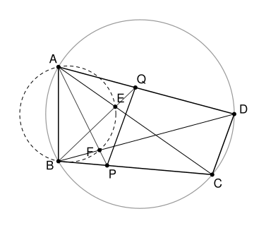

## Statement

Soit $ABCD$ un quadrilatère convexe inscrit dans un cercle. Un cercle passant par $A$ et $B$ recoupe les segments $[AC]$ et $[BD]$ en $E$ et $F$. La droite $(AF)$ coupe le segment $[BC]$ en $P$, et la droite $(BE)$ coupe le segment $[AD]$ en $Q$.

Montrer que la droite $(PQ)$ est parallèle à la droite $(CD)$.

## Hints

1. Essaie de montrer que les quatre points $A$, $B$, $P$, $Q$ sont sur un même cercle.
2. Exprime l'angle $\widehat{AQB}$ à l'aide des angles du triangle $AQE$, puis l'angle $\widehat{APB}$ à l'aide des angles du triangle $BPF$.
3. Une fois $ABPQ$ inscrit, compare les angles $\widehat{BPQ}$ et $\widehat{BCD}$.

## Solution

**Rappel : l'angle inscrit et les quadrilatères inscrits.** Deux points situés du même côté d'une droite $(KL)$ voient le segment $[KL]$ sous le même angle si et seulement s'ils sont sur un même cercle passant par $K$ et $L$. Et un quadrilatère convexe est inscrit dans un cercle si et seulement si deux de ses angles opposés ont pour somme $180°$.

**La position des points.** Soit $X$ le point d'intersection des diagonales $[AC]$ et $[BD]$. La droite $(AF)$ coupe $[BC]$, donc $F$ est entre $B$ et $X$. De même, $E$ est entre $A$ et $X$. Ainsi $E$ est entre $B$ et $Q$ sur la droite $(BQ)$, et $F$ est entre $A$ et $P$ sur la droite $(AP)$.

### Étape 1 : $A$, $B$, $P$, $Q$ sont cocycliques

Dans le triangle $AQE$, la somme des angles vaut $180°$, donc
$$\widehat{AQE} = 180° - \widehat{QEA} - \widehat{EAQ} .$$
Le point $E$ est entre $B$ et $Q$, donc $\widehat{QEA} = 180° - \widehat{AEB}$. Le point $E$ est sur $[AC]$ et $Q$ sur $[AD]$, donc $\widehat{EAQ} = \widehat{CAD}$. On obtient
$$\widehat{AQB} = \widehat{AQE} = \widehat{AEB} - \widehat{CAD} .$$
De la même façon, dans le triangle $BPF$,
$$\widehat{APB} = \widehat{BPF} = \widehat{AFB} - \widehat{DBC} .$$

Comparons les deux résultats.

- Les points $E$ et $F$ sont sur le cercle qui passe par $A$ et $B$, du même côté de $(AB)$ que $C$ et $D$. Donc $\widehat{AEB} = \widehat{AFB}$.
- Les points $A$ et $B$ sont sur le cercle circonscrit à $ABCD$, du même côté de $(CD)$. Donc $\widehat{CAD} = \widehat{DBC}$.

Ainsi $\widehat{AQB} = \widehat{APB}$. Les points $P$ et $Q$ sont du même côté de $(AB)$ et voient le segment $[AB]$ sous le même angle : les quatre points $A$, $B$, $P$, $Q$ sont sur un même cercle.

### Étape 2 : la parallèle

Le quadrilatère $ABPQ$ est convexe, car $P$ est sur le côté $[BC]$ et $Q$ sur le côté $[AD]$ du quadrilatère convexe $ABCD$. Il est inscrit, donc ses angles opposés en $P$ et en $A$ ont pour somme $180°$ :
$$\widehat{BPQ} = 180° - \widehat{QAB} = 180° - \widehat{DAB} .$$
Le quadrilatère $ABCD$ est inscrit, donc de même $\widehat{BCD} = 180° - \widehat{DAB}$. Ainsi
$$\widehat{BPQ} = \widehat{BCD} .$$
Le point $P$ est entre $B$ et $C$, et les points $Q$ et $D$ sont du même côté de $(BC)$. Les angles $\widehat{BPQ}$ et $\widehat{BCD}$ sont donc des angles correspondants pour les droites $(PQ)$ et $(CD)$ coupées par la sécante $(BC)$. Ils sont égaux, donc les droites sont parallèles.

**Conclusion.** La droite $(PQ)$ est parallèle à la droite $(CD)$.

## Going further

- Le corrigé fait les mêmes calculs avec des angles orientés de droites. Cela évite d'avoir à discuter de la position des points, mais demande un outil de plus.
- L'étape 2 est un résultat utile en lui-même. Si une droite coupe les côtés $[AD]$ et $[BC]$ d'un quadrilatère inscrit $ABCD$ en $Q$ et $P$, alors $ABPQ$ est inscrit si et seulement si $(PQ)$ est parallèle à $(CD)$.
