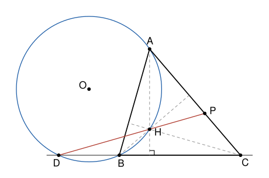

## Statement

Soit $ABC$ un triangle sans angle droit, tel que $AB \neq AC$, et soit $H$ son orthocentre, c'est-à-dire le point d'intersection de ses hauteurs. Le cercle circonscrit au triangle $ABH$, de centre $O$, recoupe la droite $(BC)$ en un point $D$. On suppose que les droites $(DH)$ et $(AC)$ se coupent, et on note $P$ leur point d'intersection.

Montrer que le centre du cercle circonscrit au triangle $APD$ est sur le cercle circonscrit au triangle $ODB$.

## Hints

1. Prends un repère orthonormé dont l'origine est le pied de la hauteur issue de $A$, avec $A(0\,;\,h)$, $B(b\,;\,0)$ et $C(c\,;\,0)$. Montre que $H$ a pour coordonnées $\left(0\,;\,-\tfrac{bc}{h}\right)$.
2. Calcule les coordonnées de $O$. Montre ensuite que $D$ est le symétrique de $C$ par rapport à la hauteur issue de $A$.
3. Sur une figure soignée, le centre du cercle $APD$ semble être sur la droite $(AB)$. Cherche-le sous la forme $O_1$ avec $\overrightarrow{AO_1} = \lambda\,\overrightarrow{AB}$, en écrivant $O_1A = O_1D$.
4. Le centre $W$ du cercle $ODB$ est sur la médiatrice de $[DB]$, donc son abscisse est connue. Écris $WM^2 - WB^2$ pour un point $M(x\,;\,y)$ quelconque.

## Solution

**Rappel.** Dans un repère orthonormé, deux vecteurs non nuls $\vec{u}\,(x\,;\,y)$ et $\vec{v}\,(x'\,;\,y')$ sont orthogonaux si et seulement si $xx' + yy' = 0$.

En effet, on place $\vec{u} = \overrightarrow{EM}$ et $\vec{v} = \overrightarrow{EN}$. D'après le théorème de Pythagore et sa réciproque, l'angle $\widehat{MEN}$ est droit exactement quand $MN^2 = EM^2 + EN^2$. Or $MN^2 = (x' - x)^2 + (y' - y)^2 = EM^2 + EN^2 - 2\,(xx' + yy')$.

### Étape 1 : le repère

Soit $K$ le pied de la hauteur issue de $A$. On prend un repère orthonormé d'origine $K$, dont l'axe des abscisses est $(BC)$ et l'axe des ordonnées la hauteur $(AK)$ :
$$A(0\,;\,h), \qquad B(b\,;\,0), \qquad C(c\,;\,0),$$
avec $h > 0$ et $b \neq c$. Les hypothèses s'écrivent ainsi.

- L'angle en $B$ n'est pas droit, donc $B \neq K$ et $b \neq 0$. De même, $c \neq 0$.
- L'angle en $A$ n'est pas droit. Les vecteurs $\overrightarrow{AB}\,(b\,;\,-h)$ et $\overrightarrow{AC}\,(c\,;\,-h)$ ne sont donc pas orthogonaux : $bc + h^2 \neq 0$.
- $AB^2 = b^2 + h^2$ et $AC^2 = c^2 + h^2$. Comme $AB \neq AC$, on a $b^2 \neq c^2$, et comme $b \neq c$, cela veut dire $b \neq -c$.

On pose
$$k = h^2 - bc, \qquad u = b^2 + h^2 = AB^2, \qquad v = c^2 + h^2 = AC^2 .$$

### Étape 2 : l'orthocentre $H$

Le point $H$ est sur la hauteur issue de $A$, qui est l'axe des ordonnées, donc $H(0\,;\,y)$. Il est aussi sur la hauteur issue de $B$, donc les vecteurs $\overrightarrow{BH}\,(-b\,;\,y)$ et $\overrightarrow{AC}\,(c\,;\,-h)$ sont orthogonaux : $-bc - hy = 0$. Ainsi
$$H\left(0\,;\,-\frac{bc}{h}\right) .$$
Comme $bc + h^2 \neq 0$, on a $-\tfrac{bc}{h} \neq h$, donc $H \neq A$. Comme $bc \neq 0$, le point $H$ n'est pas sur $(BC)$.

### Étape 3 : le centre $O$ et le point $D$

Le segment $[AH]$ est sur l'axe des ordonnées. Sa médiatrice est donc la droite horizontale qui passe par son milieu, et l'ordonnée de $O$ est
$$y_O = \frac{1}{2}\left(h - \frac{bc}{h}\right) = \frac{k}{2h} .$$
On écrit ensuite $OA^2 = OB^2$ :
$$x_O^2 + (y_O - h)^2 = (x_O - b)^2 + y_O^2 \quad \Longleftrightarrow \quad 2b\,x_O = b^2 - h^2 + 2h\,y_O = b^2 - h^2 + k = b^2 - bc .$$
Comme $b \neq 0$, on obtient $x_O = \tfrac{b - c}{2}$.

Un point $M(x\,;\,0)$ de la droite $(BC)$ est sur le cercle exactement quand $OM = OB$, c'est-à-dire $(x - x_O)^2 = (b - x_O)^2$. Cela donne $x - x_O = b - x_O$ ou $x - x_O = -(b - x_O)$, soit $x = b$ ou $x = 2x_O - b = -c$. Comme $b \neq -c$, le second point est
$$D(-c\,;\,0) .$$
Le point $D$ est le symétrique de $C$ par rapport à la hauteur $(AK)$.

### Étape 4 : le point $P$

Le point $P$ est sur $(AC)$, donc $\overrightarrow{AP} = \mu\,\overrightarrow{AC}$ pour un réel $\mu$, et $P(\mu c\,;\,h - \mu h)$. Il est aussi sur $(DH)$, donc les vecteurs $\overrightarrow{DP}\,(\mu c + c\,;\,h - \mu h)$ et $\overrightarrow{DH}\,\left(c\,;\,-\tfrac{bc}{h}\right)$ sont colinéaires :
$$(\mu c + c) \times \left(-\frac{bc}{h}\right) - (h - \mu h) \times c = 0 .$$
On multiplie par $-\tfrac{h}{c}$, ce qui est permis car $c \neq 0$ : $(\mu + 1)\,bc + (1 - \mu)\,h^2 = 0$, c'est-à-dire
$$\mu\,k = h^2 + bc .$$
Comme $h^2 + bc \neq 0$, cette équation n'a de solution que si $k \neq 0$. Les droites se coupent par hypothèse, donc $k \neq 0$, et
$$\mu = \frac{h^2 + bc}{k} \neq 0 .$$
Ainsi $P \neq A$. Les points $A$, $P$, $D$ ne sont pas alignés : sinon $D$ serait sur la droite $(AP)$, qui est $(AC)$, et sur $(BC)$, donc $D = C$, ce qui est faux puisque $c \neq 0$. Le triangle $APD$ a donc bien un cercle circonscrit.

### Étape 5 : le centre du cercle $APD$

On pose
$$\lambda = \frac{v}{2k}, \qquad \text{de sorte que} \qquad 2\lambda k = v ,$$
et on note $O_1$ le point tel que $\overrightarrow{AO_1} = \lambda\,\overrightarrow{AB}$, c'est-à-dire $O_1(\lambda b\,;\,h - \lambda h)$. Alors $O_1A^2 = \lambda^2 u$, et :

- $O_1D^2 = (\lambda b + c)^2 + (h - \lambda h)^2 = \lambda^2 b^2 + 2\lambda bc + c^2 + h^2 - 2\lambda h^2 + \lambda^2 h^2 = \lambda^2 u + v - 2\lambda k = \lambda^2 u$ ;
- $O_1P^2 = (\lambda b - \mu c)^2 + h^2 (\mu - \lambda)^2 = \lambda^2 u + \mu^2 v - 2\lambda\mu\,(h^2 + bc)$. Or $2\lambda\,(h^2 + bc) = \tfrac{v}{k}\,(h^2 + bc) = v\,\mu$, donc $\mu^2 v - 2\lambda\mu\,(h^2 + bc) = \mu^2 v - \mu^2 v = 0$, et $O_1P^2 = \lambda^2 u$.

Ainsi $O_1A = O_1D = O_1P$ : **le point $O_1$ est le centre du cercle circonscrit au triangle $APD$.** Il est sur la droite $(AB)$.

### Étape 6 : le point $O_1$ est sur le cercle $ODB$

Les points $O$, $D$, $B$ ne sont pas alignés, car $y_O = \tfrac{k}{2h} \neq 0$, donc $O$ n'est pas sur $(DB)$. Soit $W(m\,;\,w)$ le centre du cercle $\Gamma$ qui passe par $O$, $D$ et $B$. Comme $WD = WB$, le point $W$ est sur la médiatrice de $[DB]$, la droite verticale qui passe par le milieu de $[DB]$ : $2m = b - c$.

Pour un point $M(x\,;\,y)$, on développe :
$$WM^2 - WB^2 = (x - m)^2 + (y - w)^2 - (b - m)^2 - w^2 = x^2 + y^2 - 2mx - 2wy - b^2 + 2mb .$$
Comme $2mb = b^2 - bc$, on obtient $WM^2 - WB^2 = g(M) - 2wy$, où l'on a posé
$$g(M) = x^2 + y^2 - (b - c)\,x - bc .$$
Ainsi, **$M$ est sur $\Gamma$ exactement quand $g(M) = 2w\,y$.**

*Le point $O$.* Avec $x_O = \tfrac{b - c}{2}$, on a $x_O^2 - (b - c)\,x_O = -\tfrac{(b - c)^2}{4}$, et $-\tfrac{(b - c)^2}{4} - bc = -\tfrac{(b + c)^2}{4}$. Donc
$$g(O) = y_O^2 - \frac{(b + c)^2}{4} = \frac{k^2 - h^2 (b + c)^2}{4h^2} .$$
Le point $O$ est sur $\Gamma$, donc $2w\,y_O = g(O)$. Avec $y_O = \tfrac{k}{2h}$, on en tire
$$2wh = \frac{k^2 - h^2 (b + c)^2}{2k} .$$

*Le point $O_1$.* Avec $x = \lambda b$ et $y = h\,(1 - \lambda)$ :
$$g(O_1) = \lambda^2 b^2 + h^2 (1 - \lambda)^2 - (b - c)\,\lambda b - bc = \lambda^2 u - \lambda\,(b^2 + 2h^2 - bc) + h^2 - bc .$$
Comme $b^2 + 2h^2 - bc = u + k$ et $h^2 - bc = k$, on peut factoriser :
$$g(O_1) = \lambda^2 u - \lambda u - \lambda k + k = (\lambda - 1)(\lambda u - k) .$$
D'autre part, $2w\,y_{O_1} = 2wh\,(1 - \lambda) = -(\lambda - 1) \times 2wh$. Donc
$$g(O_1) - 2w\,y_{O_1} = (\lambda - 1)\left(\lambda u - k + 2wh\right) .$$
On calcule la seconde parenthèse, avec $\lambda u = \tfrac{uv}{2k}$ :
$$\lambda u - k + 2wh = \frac{uv - 2k^2 + k^2 - h^2 (b + c)^2}{2k} = \frac{uv - k^2 - h^2 (b + c)^2}{2k} .$$
Or
$$k^2 + h^2 (b + c)^2 = h^4 - 2bch^2 + b^2c^2 + h^2 b^2 + 2bch^2 + h^2 c^2 = h^4 + h^2 b^2 + h^2 c^2 + b^2 c^2 = (b^2 + h^2)(c^2 + h^2) = uv .$$
La parenthèse est donc nulle, et $g(O_1) = 2w\,y_{O_1}$.

**Le centre $O_1$ du cercle circonscrit au triangle $APD$ est donc sur le cercle circonscrit au triangle $ODB$.**

## Going further

- Montre que $AD = AC$ et que $HD = HC$.
- Montre que $O$, $O_1$ et le milieu de $[AD]$ sont sur une même droite : laquelle ? C'est le point de départ de la preuve du corrigé officiel, par les angles.
- Que se passe-t-il quand $AB = AC$ ? Montre que le cercle $ABH$ est alors tangent à $(BC)$ en $B$.
- Montre que les droites $(DH)$ et $(AC)$ sont parallèles exactement quand l'un des angles $\widehat{ABC}$ et $\widehat{ACB}$ dépasse l'autre de $90°$.
