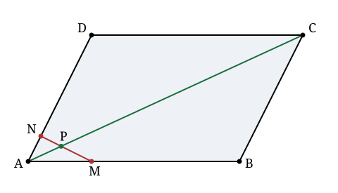

## Statement

$ABCD$ est un parallélogramme.

Le point $M$ est sur le segment $[AB]$ avec
$$\frac{AM}{AB} = \frac{17}{1000},$$
et le point $N$ est sur le segment $[AD]$ avec
$$\frac{AN}{AD} = \frac{17}{2009}.$$

La droite $(MN)$ coupe la diagonale $(AC)$ en un point $P$.

Calculer le rapport $\dfrac{AC}{AP}$.

## Hints

1. Posez $\vec{u} = \vec{AB}$ et $\vec{v} = \vec{AD}$. Ces deux vecteurs ne sont pas colinéaires, donc tout vecteur du plan s'écrit d'**une seule** façon sous la forme $x\vec u + y \vec v$.
2. Dans un parallélogramme $ABCD$, que vaut $\vec{AC}$ en fonction de $\vec u$ et $\vec v$ ?
3. Écrivez $\vec{AP}$ de deux façons : une fois parce que $P$ est sur la droite $(AC)$, une fois parce que $P$ est sur la droite $(MN)$.
4. Identifiez les coefficients devant $\vec u$ et devant $\vec v$. Vous obtenez deux équations à deux inconnues.
5. Ne développez pas les fractions trop tôt : gardez $\frac{17}{1000}$ et $\frac{17}{2009}$ tels quels et regardez ce qui se simplifie à la fin.

## Solution

Posons $\vec{u} = \vec{AB}$ et $\vec{v} = \vec{AD}$, et notons
$$\alpha = \frac{17}{1000}, \qquad \beta = \frac{17}{2009}.$$

Comme $ABCD$ est un parallélogramme, $\vec{AC} = \vec{AB} + \vec{AD} = \vec u + \vec v$. Par ailleurs
$$\vec{AM} = \alpha\,\vec u, \qquad \vec{AN} = \beta\,\vec v.$$

Les vecteurs $\vec u$ et $\vec v$ ne sont pas colinéaires : ils forment une base du plan, donc **tout vecteur s'écrit d'une seule façon** $x\vec u + y\vec v$. C'est cette unicité qui va fournir les équations.

### Première écriture de $\vec{AP}$ : le point $P$ est sur $(AC)$

Il existe un réel $t$ tel que
$$\vec{AP} = t\,\vec{AC} = t\,\vec u + t\,\vec v. \qquad (1)$$

Noter au passage que $t = \dfrac{AP}{AC}$, donc c'est $\dfrac1t$ que l'on cherche.

### Seconde écriture : le point $P$ est sur $(MN)$

Il existe un réel $s$ tel que $\vec{MP} = s\,\vec{MN}$, c'est-à-dire
$$\vec{AP} = \vec{AM} + s\left(\vec{AN} - \vec{AM}\right) = (1-s)\,\vec{AM} + s\,\vec{AN} = (1-s)\alpha\,\vec u + s\beta\,\vec v. \qquad (2)$$

### Identifier les coefficients

Les écritures $(1)$ et $(2)$ donnent le même vecteur, donc leurs coefficients dans la base $(\vec u, \vec v)$ sont égaux :
$$t = (1-s)\,\alpha \qquad \text{et} \qquad t = s\,\beta.$$

De la première, $1 - s = \dfrac{t}{\alpha}$ ; de la seconde, $s = \dfrac{t}{\beta}$. En additionnant :
$$\frac{t}{\alpha} + \frac{t}{\beta} = (1-s) + s = 1,$$
donc
$$t\left(\frac{1}{\alpha} + \frac{1}{\beta}\right) = 1, \qquad \text{d'où} \qquad \frac{1}{t} = \frac{1}{\alpha} + \frac{1}{\beta}.$$

### Le calcul final

$$\frac{AC}{AP} = \frac1t = \frac{1}{\alpha} + \frac{1}{\beta} = \frac{1000}{17} + \frac{2009}{17} = \frac{1000 + 2009}{17} = \frac{3009}{17}.$$

Et $3009 = 17 \times 177$, donc

$$\boxed{\dfrac{AC}{AP} = 177.}$$

**Conclusion.** Le point $P$ est très proche de $A$ : il est à $\frac{1}{177}$ de la diagonale.

**La formule qui se cache derrière.** Le calcul n'a rien utilisé des valeurs particulières : pour $\frac{AM}{AB} = \alpha$ et $\frac{AN}{AD} = \beta$,
$$\frac{AC}{AP} = \frac{1}{\alpha} + \frac{1}{\beta}.$$
C'est ce qu'on appelle une relation de **moyenne harmonique**. Le choix de $1000$ et $2009$ dans l'énoncé n'avait qu'un but : faire que la somme $1000 + 2009 = 3009$ soit un multiple de $17$, pour que la réponse tombe juste.

**Un cas particulier à retenir.** Si $M$ et $N$ sont les milieux de $[AB]$ et $[AD]$, alors $\alpha = \beta = \frac12$ et $\frac{AC}{AP} = 2 + 2 = 4$ : la droite des milieux coupe la diagonale au quart. On peut le vérifier sur un dessin.

## Going further

1. Vérifier la formule $\frac{AC}{AP} = \frac1\alpha + \frac1\beta$ sur le cas $\alpha = \beta = 1$ : que deviennent $M$, $N$ et $P$ ?
2. Montrer que tant que $M$ reste sur le segment $[AB]$ et $N$ sur le segment $[AD]$, le point $P$ ne dépasse jamais le milieu de $[AC]$, et qu'il n'atteint ce milieu que dans un seul cas. Lequel ?
3. Montrer que la droite $(MN)$ coupe la droite $(AC)$ pour toutes les valeurs de $\alpha$ et $\beta$ strictement positives, et que $P$ est toujours sur le segment $[AC]$.
4. Que devient le résultat si $ABCD$ n'est plus un parallélogramme mais un quadrilatère quelconque ? Sur quel point de la démonstration cela bloque-t-il ?
