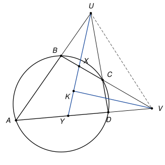

## Statement

$A$, $B$, $C$, $D$ sont quatre points d'un cercle, dans cet ordre. Les droites $(AB)$ et $(CD)$ se coupent en un point $U$, et les droites $(BC)$ et $(DA)$ se coupent en un point $V$.

- On trace la bissectrice de l'angle en $U$ du triangle $AUC$ ;
- on trace la bissectrice de l'angle en $V$ du triangle $AVC$.

Ces deux bissectrices se coupent en un point $K$. Enfin, on note $L$ le point d'intersection de la médiatrice de $[KU]$ et de la médiatrice de $[KV]$.

Montrer que les points $U$, $V$ et $L$ sont alignés.

## Hints

1. Que représente le point $L$ pour le triangle $UKV$ ? Quand le centre du cercle circonscrit à un triangle est-il sur l'un de ses côtés ?
2. Il suffit donc de montrer que les deux bissectrices sont perpendiculaires. Appelez $X$ et $Y$ les points où la bissectrice issue de $U$ coupe $(BC)$ et $(AD)$.
3. Montrez que le triangle $VXY$ est isocèle en $V$, en calculant ses angles en $X$ et en $Y$ à l'aide des angles du quadrilatère.
4. Dans un quadrilatère inscrit dans un cercle, deux angles opposés ont une somme de $180^\circ$.

## Solution

*Rappel.* Dans un quadrilatère dont les quatre sommets sont sur un cercle, deux angles opposés ont une somme de $180^\circ$. (On le voit avec le théorème de l'angle inscrit : les deux angles interceptent à eux deux le cercle entier, donc leurs angles au centre font $360^\circ$.)

Plaçons-nous dans la situation de la figure : $B$ est entre $A$ et $U$, $C$ est entre $D$ et $U$, $C$ est entre $B$ et $V$, $D$ est entre $A$ et $V$. Notons $u$ l'angle $\widehat{AUD}$ en $U$ (c'est l'angle en $U$ du triangle $AUC$).

**Étape 1 : il suffit de montrer que $\widehat{UKV} = 90^\circ$.**

Le point $L$ est sur la médiatrice de $[KU]$, donc $LK = LU$, et sur la médiatrice de $[KV]$, donc $LK = LV$. C'est donc le centre du cercle circonscrit au triangle $UKV$.

Si l'angle $\widehat{UKV}$ est droit, le triangle $UKV$ est rectangle en $K$, et le centre de son cercle circonscrit est le milieu de l'hypoténuse $[UV]$. Le point $L$ est alors sur la droite $(UV)$, ce que l'on veut.

**Étape 2 : deux points sur la bissectrice issue de $U$.**

La bissectrice issue de $U$ coupe le segment $[BC]$ en un point $X$, puis le segment $[AD]$ en un point $Y$ (dans cet ordre : $U$, $X$, $Y$). Elle fait l'angle $\frac{u}{2}$ avec chacune des droites $(UA)$ et $(UD)$.

**Étape 3 : l'angle en $Y$ du triangle $VXY$.**

Le point $D$ est entre $Y$ et $V$, et $X$ est entre $Y$ et $U$, donc $\widehat{VYX} = \widehat{DYU}$. Cet angle est l'angle extérieur en $Y$ du triangle $AUY$ ; il est égal à la somme des deux autres angles de ce triangle :

$$\widehat{VYX} = \widehat{YAU} + \widehat{AUY} = \widehat{DAB} + \frac{u}{2}.$$

**Étape 4 : l'angle en $X$ du triangle $VXY$.**

Le point $C$ est entre $X$ et $V$, donc $\widehat{VXY} = \widehat{CXY} = 180^\circ - \widehat{CXU}$.

Dans le triangle $UXC$, l'angle en $U$ vaut $\frac{u}{2}$ et l'angle en $C$ vaut $\widehat{UCB} = 180^\circ - \widehat{BCD}$ (car $C$ est entre $D$ et $U$). Donc

$$\widehat{CXU} = 180^\circ - \frac{u}{2} - (180^\circ - \widehat{BCD}) = \widehat{BCD} - \frac{u}{2},$$

et

$$\widehat{VXY} = 180^\circ - \widehat{BCD} + \frac{u}{2}.$$

Le quadrilatère $ABCD$ est inscrit dans un cercle, donc $\widehat{BCD} + \widehat{DAB} = 180^\circ$, c'est-à-dire $180^\circ - \widehat{BCD} = \widehat{DAB}$. Finalement

$$\widehat{VXY} = \widehat{DAB} + \frac{u}{2} = \widehat{VYX}.$$

**Étape 5 : les bissectrices sont perpendiculaires.**

Le triangle $VXY$ a deux angles égaux : il est isocèle en $V$. Son angle en $V$ est l'angle entre les demi-droites $[VC)$ et $[VD)$, c'est-à-dire l'angle en $V$ du triangle $AVC$. La bissectrice issue de $V$ est donc la bissectrice de l'angle au sommet d'un triangle isocèle : elle est aussi sa hauteur, donc elle est perpendiculaire à la base $(XY)$.

La droite $(XY)$ est la bissectrice issue de $U$. Les deux bissectrices sont perpendiculaires, et elles se coupent en $K$ :

$$\widehat{UKV} = 90^\circ.$$

**Conclusion.**

D'après l'étape 1, le point $L$ est le milieu de $[UV]$. En particulier, les points $U$, $V$ et $L$ sont alignés.

## Going further

1. On a en fait montré plus : le point $L$ est le milieu de $[UV]$.
2. Réciproquement, soit $ABCD$ un quadrilatère convexe quelconque, avec les mêmes points $U$, $V$ et les mêmes bissectrices. Montrer que si les deux bissectrices sont perpendiculaires, alors $A$, $B$, $C$, $D$ sont sur un même cercle. (Refaites le calcul des étapes 3 et 4 sans utiliser le cercle.)
