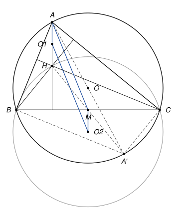

## Statement

Soit $ABC$ un triangle dont les trois angles sont aigus, et qui n'est pas isocèle en $A$. On note :

- $M$ le milieu du segment $[BC]$ ;
- $H$ l'orthocentre du triangle $ABC$, c'est-à-dire le point où se coupent ses trois hauteurs ;
- $O_1$ le milieu du segment $[AH]$ ;
- $O_2$ le centre du cercle circonscrit au triangle $BHC$.

Montrer que le quadrilatère $O_1AMO_2$ est un parallélogramme.

## Hints

1. Les droites $(O_1A)$ et $(MO_2)$ sont toutes les deux perpendiculaires à $(BC)$. Pourquoi ? Il reste à comparer les longueurs $AO_1$ et $MO_2$.
2. Appelez $O$ le centre du cercle circonscrit à $ABC$, et $A'$ le point de ce cercle diamétralement opposé à $A$. Montrez que $BHCA'$ est un parallélogramme.
3. La symétrie de centre $M$ échange $B$ et $C$, et envoie $H$ sur $A'$. Sur quel cercle envoie-t-elle le cercle circonscrit à $BHC$ ?
4. Dans le triangle $AA'H$, les points $O$ et $M$ sont des milieux de côtés.

## Solution

Notons $O$ le centre du cercle $\Gamma$ circonscrit au triangle $ABC$, et $A'$ le point de $\Gamma$ diamétralement opposé à $A$.

**Étape 1 : $BHCA'$ est un parallélogramme.**

Le segment $[AA']$ est un diamètre de $\Gamma$ et $B$ est sur $\Gamma$, donc le triangle $ABA'$ est rectangle en $B$ : la droite $(A'B)$ est perpendiculaire à $(AB)$. La hauteur $(CH)$ est elle aussi perpendiculaire à $(AB)$. Donc $(A'B)$ et $(CH)$ sont parallèles.

De la même façon, le triangle $ACA'$ est rectangle en $C$, donc $(A'C)$ et $(BH)$, toutes les deux perpendiculaires à $(AC)$, sont parallèles.

Le quadrilatère $BHCA'$ a ses côtés opposés parallèles : c'est un parallélogramme. Ses diagonales $[BC]$ et $[HA']$ se coupent en leur milieu, et le milieu de $[BC]$ est $M$. Donc $M$ est aussi le milieu de $[HA']$.

**Étape 2 : $M$ est le milieu de $[OO_2]$.**

La symétrie de centre $M$ envoie $B$ sur $C$, $C$ sur $B$, et (d'après l'étape 1) $H$ sur $A'$. Une symétrie centrale envoie un cercle sur un cercle de même rayon, et le centre sur le centre. Elle envoie donc le cercle passant par $B$, $H$, $C$ sur le cercle passant par $C$, $A'$, $B$, qui est $\Gamma$, et le centre $O_2$ du premier sur le centre $O$ du second.

Ainsi $M$ est le milieu de $[OO_2]$ : en vecteurs, $\overrightarrow{O_2M} = \overrightarrow{MO}$.

**Étape 3 : $\overrightarrow{MO} = \dfrac{1}{2}\overrightarrow{HA}$.**

Dans le triangle $A'HA$, le point $M$ est le milieu de $[A'H]$ (étape 1) et le point $O$ est le milieu de $[A'A]$ (c'est un diamètre). D'après le théorème des milieux, la droite $(MO)$ est parallèle à $(HA)$ et $MO = \dfrac{HA}{2}$. Les deux vecteurs vont dans le même sens (de $H$ vers $A$ comme de $M$ vers $O$), donc

$$\overrightarrow{MO} = \frac{1}{2}\overrightarrow{HA}.$$

**Étape 4 : conclusion.**

Le point $O_1$ est le milieu de $[AH]$, donc $\overrightarrow{O_1A} = \dfrac{1}{2}\overrightarrow{HA}$. Avec les étapes 2 et 3 :

$$\overrightarrow{O_1A} = \frac{1}{2}\overrightarrow{HA} = \overrightarrow{MO} = \overrightarrow{O_2M}.$$

L'égalité $\overrightarrow{O_1A} = \overrightarrow{O_2M}$ dit exactement que $O_1AMO_2$ est un parallélogramme. Il n'est pas aplati : si ses quatre sommets étaient alignés, le point $M$ serait sur la hauteur issue de $A$, la médiane et la hauteur issues de $A$ seraient confondues, et le triangle serait isocèle en $A$, ce qui est exclu.

## Going further

1. On a montré au passage que $AH = 2\,OM$. Retrouvez ce résultat en plaçant l'origine en $O$ et en vérifiant que le point $H$ défini par $\overrightarrow{OH} = \overrightarrow{OA} + \overrightarrow{OB} + \overrightarrow{OC}$ est bien l'orthocentre.
2. Montrer que le cercle circonscrit à $BHC$ a le même rayon que le cercle circonscrit à $ABC$.
