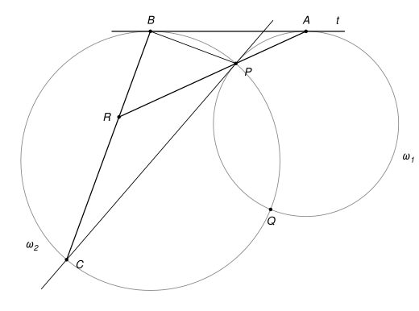
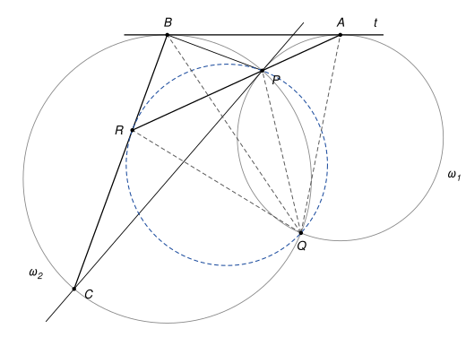

## Statement

Deux cercles $\omega_1$ et $\omega_2$ se coupent en deux points $P$ et $Q$. Une droite $t$ est tangente aux deux cercles : elle touche $\omega_1$ au point $A$ et $\omega_2$ au point $B$. On suppose que le point $P$ est plus proche de la droite $t$ que le point $Q$.

La tangente au cercle $\omega_1$ au point $P$ recoupe le cercle $\omega_2$ en un point $C$. Les droites $(AP)$ et $(BC)$ se coupent en un point $R$.

Montrer que le cercle qui passe par $P$, $R$ et $Q$ est tangent à la droite $(BP)$ et à la droite $(BC)$.

## Hints

1. Commencez par montrer que les quatre points $A$, $B$, $Q$, $R$ sont sur un même cercle. Pour cela, comparez les angles $\widehat{RAQ}$ et $\widehat{RBQ}$ en passant par l'angle $\widehat{CPQ}$ : la droite $(PC)$ est tangente à $\omega_1$, et $B$, $P$, $Q$, $C$ sont sur $\omega_2$.
2. La droite $t$ est tangente aux deux cercles. Elle donne $\widehat{BAP} = \widehat{AQP}$ dans $\omega_1$ et $\widehat{ABP} = \widehat{BQP}$ dans $\omega_2$. Exprimez l'angle $\widehat{BPR}$ à l'aide de l'angle $\widehat{AQB}$.
3. Pour montrer qu'une droite passant par $P$ est tangente en $P$ au cercle $PRQ$, il suffit de montrer que l'angle entre cette droite et la corde $[PR]$ est égal à l'angle inscrit $\widehat{PQR}$. Montrez que $\widehat{BPR}$, $\widehat{BRP}$ et $\widehat{PQR}$ sont tous égaux à $\widehat{AQB}$.

## Solution

*Rappels.*

- *Angle inscrit.* Si $X$ et $Y$ sont deux points d'un cercle, tous les angles $\widehat{XMY}$, où $M$ parcourt le cercle d'un même côté de la droite $(XY)$, sont égaux.
- *Quatre points sur un cercle.* Réciproquement, si $M$ et $N$ sont du même côté de la droite $(XY)$ et si $\widehat{XMY} = \widehat{XNY}$, alors les quatre points $X$, $Y$, $M$, $N$ sont sur un même cercle.
- *Angle entre une tangente et une corde.* Si une droite $d$ est tangente en $X$ à un cercle et si $[XY]$ est une corde, l'angle entre $d$ et la corde est égal à l'angle inscrit $\widehat{XMY}$, pour tout point $M$ du cercle situé de l'autre côté de la corde. Réciproquement, si une droite $d$ passant par un point $X$ du cercle fait avec la corde $[XY]$ un angle égal à l'angle inscrit $\widehat{XMY}$, le point $M$ étant de l'autre côté de $(XY)$, alors $d$ est tangente au cercle en $X$.

On raisonne dans la disposition de la figure : la droite $t$ est au-dessus des deux cercles, $P$ est entre $A$ et $R$ sur la droite $(AP)$, et $R$ est entre $B$ et $C$.

**Étape 1 : les points $A$, $B$, $Q$, $R$ sont sur un même cercle.** Le point $R$ est sur la demi-droite $[AP)$, donc $\widehat{RAQ} = \widehat{PAQ}$.

La droite $(PC)$ est tangente à $\omega_1$ en $P$ et $[PQ]$ est une corde de $\omega_1$. Le point $A$ est sur $\omega_1$, de l'autre côté de $(PQ)$ que $C$. D'après le rappel sur la tangente :

$$\widehat{CPQ} = \widehat{PAQ}.$$

Les points $B$, $P$, $Q$, $C$ sont sur $\omega_2$, et $P$ et $B$ sont du même côté de la corde $[CQ]$. Les angles inscrits qui interceptent cette corde sont égaux : $\widehat{CPQ} = \widehat{CBQ}$. Enfin $R$ est sur $[BC]$, donc $\widehat{CBQ} = \widehat{RBQ}$. En mettant tout bout à bout :

$$\widehat{RAQ} = \widehat{PAQ} = \widehat{CPQ} = \widehat{CBQ} = \widehat{RBQ}.$$

Les points $A$ et $B$ sont du même côté de la droite $(RQ)$, donc $A$, $B$, $Q$, $R$ sont sur un même cercle. Appelons-le $\Gamma$.

**Étape 2 : l'angle $\widehat{BPR}$.** Notons $\theta = \widehat{AQB}$. La droite $t$ est tangente à $\omega_1$ en $A$, et $[AP]$ est une corde de $\omega_1$. Le point $Q$ est de l'autre côté de $(AP)$ que $B$, donc

$$\widehat{BAP} = \widehat{AQP}.$$

De même, $t$ est tangente à $\omega_2$ en $B$ et $[BP]$ est une corde de $\omega_2$, donc

$$\widehat{ABP} = \widehat{BQP}.$$

Les points $A$, $P$, $R$ sont alignés dans cet ordre, donc $\widehat{BPR} = 180° - \widehat{APB}$. Dans le triangle $ABP$, la somme des angles vaut $180°$, donc $180° - \widehat{APB} = \widehat{BAP} + \widehat{ABP}$. Ainsi

$$\widehat{BPR} = \widehat{BAP} + \widehat{ABP} = \widehat{AQP} + \widehat{PQB} = \widehat{AQB} = \theta,$$

car la demi-droite $[QP)$ est à l'intérieur de l'angle $\widehat{AQB}$.

**Étape 3 : l'angle $\widehat{BRP}$.** Les points $R$ et $Q$ sont sur le cercle $\Gamma$, du même côté de la corde $[AB]$. Donc $\widehat{ARB} = \widehat{AQB} = \theta$. Comme $P$ est sur $[RA]$, l'angle $\widehat{BRP}$ est le même que $\widehat{BRA}$ :

$$\widehat{BRP} = \theta.$$

**Étape 4 : l'angle $\widehat{PQR}$.** Dans le cercle $\Gamma$, les points $Q$ et $A$ sont du même côté de la corde $[BR]$, donc $\widehat{BQR} = \widehat{BAR}$. Or $\widehat{BAR} = \widehat{BAP}$, car $R$ est sur $[AP)$, et $\widehat{BAP} = \widehat{AQP}$ d'après l'étape 2. Donc $\widehat{BQR} = \widehat{AQP}$. La demi-droite $[QB)$ est à l'intérieur de l'angle $\widehat{PQR}$, donc

$$\widehat{PQR} = \widehat{PQB} + \widehat{BQR} = \widehat{PQB} + \widehat{AQP} = \widehat{AQB} = \theta.$$

**Étape 5 : conclusion.** Notons $\gamma$ le cercle qui passe par $P$, $R$ et $Q$.

- La droite $(BP)$ passe par le point $P$ de $\gamma$ et fait avec la corde $[PR]$ l'angle $\widehat{BPR} = \theta$. Le point $Q$ de $\gamma$ est de l'autre côté de $(PR)$ que $B$, et l'angle inscrit $\widehat{PQR}$ vaut aussi $\theta$. D'après la réciproque du rappel sur la tangente, la droite $(BP)$ est tangente à $\gamma$ en $P$.
- De même, la droite $(BC)$ passe par le point $R$ de $\gamma$ et fait avec la corde $[RP]$ l'angle $\widehat{BRP} = \theta$, égal à l'angle inscrit $\widehat{RQP}$. Donc $(BC)$ est tangente à $\gamma$ en $R$.

Le cercle qui passe par $P$, $R$ et $Q$ est donc tangent à $(BP)$ en $P$ et à $(BC)$ en $R$.

*Remarque.* Les étapes 2 et 3 montrent aussi que le triangle $BPR$ a deux angles égaux, donc $BP = BR$ : c'est bien ce qu'on attend de deux segments tangents à un même cercle issus du même point $B$. Dans une autre disposition des points, certains angles ci-dessus sont remplacés par leurs suppléments, mais le raisonnement est le même. L'hypothèse « $P$ plus proche de $t$ que $Q$ » fixe la disposition de la figure.

## Going further

1. Le centre du cercle $PRQ$ est sur la bissectrice de l'angle $\widehat{PBR}$. Pourquoi ?
2. La droite $(PQ)$ coupe la tangente commune $t$ en un point $M$. Montrer que $M$ est le milieu de $[AB]$. (Piste : si $O_1$ et $r_1$ sont le centre et le rayon de $\omega_1$, le théorème de Pythagore donne $MA^2 = MO_1^2 - r_1^2$. Utilisez aussi le fait que $(PQ)$ est perpendiculaire à $(O_1O_2)$, et que $P$ est sur les deux cercles.)
