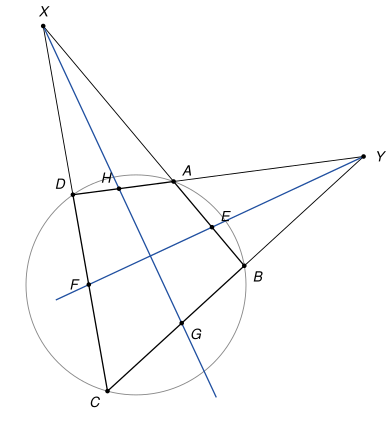

## Statement

Soit $ABCD$ un quadrilatère dont les quatre sommets sont sur un même cercle, et dont les côtés opposés ne sont pas parallèles. Les droites $(AB)$ et $(CD)$ se coupent en un point $X$, et les droites $(AD)$ et $(BC)$ se coupent en un point $Y$.

- La bissectrice de l'angle $\widehat{DYC}$ coupe la droite $(AB)$ en $E$ et la droite $(CD)$ en $F$.
- La bissectrice de l'angle $\widehat{BXC}$ coupe la droite $(BC)$ en $G$ et la droite $(AD)$ en $H$.

Montrer que $GF = EH$.

## Hints

1. Faites une figure soignée. Que remarquez-vous sur les deux bissectrices ?
2. Notez $a$ et $b$ les angles du quadrilatère $ABCD$ en $A$ et en $B$. Calculez les angles en $X$ du triangle $XBC$ et en $Y$ du triangle $YAB$. Dans un quadrilatère inscrit, deux angles opposés ont une somme de $180°$.
3. Appelez $Z$ le point de rencontre des deux bissectrices, et calculez les angles du triangle $ZGY$.
4. Dans le triangle $XEF$, la droite $(XZ)$ est à la fois une bissectrice et une hauteur. Que peut-on en déduire pour le point $Z$ ?

## Solution

*Rappel.* Dans un quadrilatère dont les quatre sommets sont sur un cercle, deux angles opposés ont une somme de $180°$. (Avec le théorème de l'angle inscrit : les deux angles interceptent à eux deux le cercle entier, donc leurs angles au centre font $360°$.)

On raisonne dans la disposition de la figure : $A$ est entre $X$ et $B$, $D$ est entre $X$ et $C$, $A$ est entre $Y$ et $D$, et $B$ est entre $Y$ et $C$. On note $a = \widehat{DAB}$ et $b = \widehat{ABC}$ les angles du quadrilatère en $A$ et en $B$. D'après le rappel, l'angle en $C$ vaut $\widehat{BCD} = 180° - a$.

**Étape 1 : les angles en $X$ et en $Y$.** Dans le triangle $XBC$, l'angle en $B$ est $\widehat{XBC} = \widehat{ABC} = b$, car $A$ est sur $[XB]$. L'angle en $C$ est $\widehat{XCB} = \widehat{DCB} = 180° - a$, car $D$ est sur $[XC]$. Donc

$$\widehat{BXC} = 180° - b - (180° - a) = a - b.$$

Dans le triangle $YAB$, l'angle en $A$ est le supplément de $\widehat{DAB}$, car $Y$, $A$, $D$ sont alignés : $\widehat{YAB} = 180° - a$. De même $\widehat{YBA} = 180° - b$. Donc

$$\widehat{AYB} = 180° - (180° - a) - (180° - b) = a + b - 180°.$$

L'angle $\widehat{DYC}$ de l'énoncé est le même angle que $\widehat{AYB}$, puisque $A$ est sur $[YD]$ et $B$ sur $[YC]$.

**Étape 2 : les deux bissectrices sont perpendiculaires.** La bissectrice issue de $X$ coupe le segment $[BC]$ en $G$, et $\widehat{GXC} = \frac{a - b}{2}$. Dans le triangle $XGC$ :

$$\widehat{XGC} = 180° - \frac{a - b}{2} - (180° - a) = \frac{a + b}{2}, \qquad \text{donc} \qquad \widehat{XGB} = 180° - \frac{a + b}{2}.$$

Soit $Z$ le point de rencontre des deux bissectrices. Il est sur le segment $[XG]$, et $G$ est sur la demi-droite $[YB)$. Dans le triangle $ZGY$, l'angle en $G$ est $\widehat{ZGY} = \widehat{XGB} = 180° - \frac{a+b}{2}$, et l'angle en $Y$ est la moitié de $\widehat{AYB}$ :

$$\widehat{GYZ} = \frac{a + b - 180°}{2} = \frac{a+b}{2} - 90°.$$

Le troisième angle vaut donc

$$\widehat{GZY} = 180° - \left(180° - \frac{a+b}{2}\right) - \left(\frac{a+b}{2} - 90°\right) = 90°.$$

Les deux bissectrices sont perpendiculaires en $Z$.

**Étape 3 : $Z$ est le milieu de $[EF]$ et de $[GH]$.** Dans le triangle $XEF$, la droite $(XZ)$ coupe l'angle en $X$ en deux, et elle est perpendiculaire à $(EF)$ d'après l'étape 2. Les triangles $XZE$ et $XZF$ ont le côté $[XZ]$ en commun, le même angle en $X$ et un angle droit en $Z$. Ils sont donc égaux (un côté et les deux angles adjacents), et $ZE = ZF$.

De la même façon, dans le triangle $YGH$, la droite $(YZ)$ est la bissectrice de l'angle en $Y$ et elle est perpendiculaire à $(GH)$. Les triangles $YZG$ et $YZH$ sont égaux, et $ZG = ZH$.

**Étape 4 : conclusion.** Les triangles $ZGF$ et $ZHE$ ont $ZG = ZH$, $ZF = ZE$, et un angle droit en $Z$. Ils sont égaux (un angle et les deux côtés qui l'encadrent), donc

$$GF = EH.$$

![Les deux bissectrices se coupent à angle droit en Z, milieu de [EF] et de [GH] : le quadrilatère GEHF est un losange](10219-figure-2.svg)

*Remarque.* On a même mieux : les diagonales $[EF]$ et $[GH]$ du quadrilatère $GEHF$ se coupent en leur milieu et à angle droit, donc $GEHF$ est un losange, et ses quatre côtés sont égaux. Si les points sont placés autrement, par exemple si $X$ est du côté de $B$ et $C$ au lieu de $A$ et $D$, on renomme les points et le même calcul s'applique.

## Going further

1. Montrer que les droites $(EG)$ et $(FH)$ sont parallèles à la diagonale $(AC)$ du quadrilatère.
2. On ne suppose plus que $ABCD$ est inscrit dans un cercle. Refaire le calcul de l'étape 2 avec les angles $a$, $b$, $c$ du quadrilatère en $A$, $B$, $C$, et exprimer l'angle $\widehat{GZY}$. Quand vaut-il $90°$ ?
