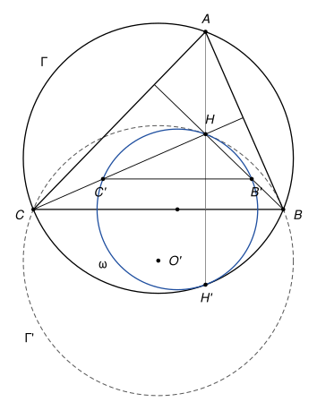

## Statement

Soit $ABC$ un triangle qui n'a d'angle droit ni en $B$ ni en $C$, et soit $H$ son orthocentre (le point commun des trois hauteurs). On note $\Gamma$ le cercle circonscrit au triangle $ABC$.

On place un point $B'$ sur la droite $(HB)$ et un point $C'$ sur la droite $(HC)$, tous deux distincts de $H$, de sorte que la droite $(B'C')$ soit parallèle à $(BC)$. Soit $\omega$ le cercle circonscrit au triangle $B'HC'$.

On suppose que le centre du cercle $\omega$ est sur le segment $[BC]$. Montrer que les cercles $\omega$ et $\Gamma$ sont tangents.

![Le triangle ABC, son cercle circonscrit Γ, l'orthocentre H, les points B' et C' et le cercle ω, dont le centre est sur le segment [BC]](10224-figure-1.svg)

## Hints

1. Le centre de $\omega$ est sur la droite $(BC)$. Que fait la symétrie d'axe $(BC)$ au cercle $\omega$ ? Et au cercle $\Gamma$ ?
2. Soit $O$ le centre de $\Gamma$. Montrez l'égalité de vecteurs $\overrightarrow{OH} = \overrightarrow{OA} + \overrightarrow{OB} + \overrightarrow{OC}$, puis déduisez-en que le symétrique de $\Gamma$ par rapport à $(BC)$ passe par $H$.
3. Une homothétie de centre $H$ envoie $B'$ sur $B$ et $C'$ sur $C$. Sur quel cercle envoie-t-elle $\omega$ ? Que dire de deux cercles échangés par une homothétie dont le centre est un point commun aux deux cercles ?

## Solution

*Rappels.*

- *Milieu et vecteurs.* Si $V$ est le milieu de $[XY]$, alors pour tout point $Z$, $\overrightarrow{ZX} + \overrightarrow{ZY} = 2\,\overrightarrow{ZV}$.
- *Homothétie.* L'homothétie de centre $Z$ et de rapport $k \neq 0$ envoie chaque point $X$ sur le point $X'$ tel que $\overrightarrow{ZX'} = k\,\overrightarrow{ZX}$. Elle envoie une droite sur une droite parallèle (sur elle-même si la droite passe par $Z$), et un cercle de centre $W$ et de rayon $r$ sur le cercle dont le centre est l'image de $W$ et dont le rayon est $|k|\,r$.
- *Cercles tangents.* Deux cercles qui ont un point commun $T$ et la même tangente en $T$ sont tangents en $T$. La tangente à un cercle de centre $W$ en un point $T$ est la perpendiculaire à $(WT)$ en $T$.

On note $O$ le centre de $\Gamma$, $R$ son rayon, $M$ le milieu de $[BC]$ et $s$ la symétrie d'axe $(BC)$. Soit $O' = s(O)$ et soit $\Gamma' = s(\Gamma)$, le cercle de centre $O'$ et de rayon $R$.

**Étape 1 : le cercle $\Gamma'$ passe par $B$, $C$ et $H$.** Les points $B$ et $C$ sont sur $\Gamma$ et sur l'axe de la symétrie, donc ils sont aussi sur $\Gamma'$. Reste le point $H$.

Soit $K$ le point défini par $\overrightarrow{OK} = \overrightarrow{OA} + \overrightarrow{OB} + \overrightarrow{OC}$. Alors

$$\overrightarrow{AK} = \overrightarrow{OK} - \overrightarrow{OA} = \overrightarrow{OB} + \overrightarrow{OC} = 2\,\overrightarrow{OM}.$$

Le point $O$ est sur la médiatrice de $[BC]$, qui passe par $M$. Si $O \neq M$, la droite $(OM)$ est donc perpendiculaire à $(BC)$, et la droite $(AK)$, parallèle à $(OM)$, aussi. Si $O = M$, alors $K = A$. Dans les deux cas, $K$ est sur la hauteur issue de $A$. Le même calcul avec les milieux de $[CA]$ et de $[AB]$ montre que $K$ est aussi sur les hauteurs issues de $B$ et de $C$. Donc $K = H$ :

$$\overrightarrow{OH} = \overrightarrow{OA} + \overrightarrow{OB} + \overrightarrow{OC}.$$

Le pied de la perpendiculaire à $(BC)$ issue de $O$ est $M$, donc $M$ est le milieu de $[OO']$ et $\overrightarrow{OO'} = 2\,\overrightarrow{OM} = \overrightarrow{OB} + \overrightarrow{OC}$. En soustrayant :

$$\overrightarrow{O'H} = \overrightarrow{OH} - \overrightarrow{OO'} = \overrightarrow{OA}.$$

Ainsi $O'H = OA = R$, et $H$ est sur $\Gamma'$. Le cercle $\Gamma'$ est donc le cercle circonscrit au triangle $BHC$. Ce triangle n'est pas aplati : $H$ n'est pas sur $(BC)$ puisque le triangle n'a pas d'angle droit en $B$ ni en $C$.

**Étape 2 : le cercle $\omega$ est tangent à $\Gamma'$ en $H$.** Soit $h$ l'homothétie de centre $H$ qui envoie $B'$ sur $B$ (elle existe, car $B'$ est sur $(HB)$ et distinct de $H$).

- La droite $(B'C')$ est envoyée sur la parallèle à $(B'C')$ qui passe par $B$, c'est-à-dire sur la droite $(BC)$.
- La droite $(HC')$ passe par le centre $H$, elle est envoyée sur elle-même : c'est la droite $(HC)$.

Le point $h(C')$ est donc sur $(BC)$ et sur $(HC)$. Ces deux droites sont distinctes et se coupent en $C$, donc $h(C') = C$.

L'homothétie $h$ envoie ainsi $H$, $B'$, $C'$ sur $H$, $B$, $C$, et le cercle $\omega$ sur le cercle qui passe par $H$, $B$, $C$, c'est-à-dire sur $\Gamma'$. Elle envoie le centre $W$ de $\omega$ sur le centre $O'$ de $\Gamma'$, donc $\overrightarrow{HO'} = k\,\overrightarrow{HW}$ pour un nombre $k$, et les points $H$, $W$, $O'$ sont alignés. La tangente à $\omega$ en $H$ est la perpendiculaire à $(HW)$ en $H$, la tangente à $\Gamma'$ en $H$ est la perpendiculaire à $(HO')$ en $H$ : c'est la même droite. Les cercles $\omega$ et $\Gamma'$ sont tangents en $H$.

**Étape 3 : on revient à $\Gamma$ par la symétrie.** On utilise enfin l'hypothèse : le centre $W$ de $\omega$ est sur $(BC)$, donc $s(W) = W$, et comme $s$ conserve les distances, $s(\omega) = \omega$. Par ailleurs $s(\Gamma') = \Gamma$. Notons $H' = s(H)$.

Les cercles $\omega$ et $\Gamma'$ ont en commun le point $H$ et la tangente en $H$. Leurs images $\omega$ et $\Gamma$ ont donc en commun le point $H'$ et l'image de cette tangente, qui est une droite passant par $H'$ et perpendiculaire à $(WH')$, donc la tangente à $\omega$ en $H'$, et aussi perpendiculaire à $(OH')$, donc la tangente à $\Gamma$ en $H'$.

**Conclusion.** Les cercles $\omega$ et $\Gamma$ sont tangents, au point $H'$ symétrique de l'orthocentre par rapport à $(BC)$.

*Remarque.* La preuve n'utilise que le fait que le centre de $\omega$ est sur la **droite** $(BC)$, pas forcément sur le segment. L'étape 1 contient un résultat classique : le symétrique $H'$ de l'orthocentre par rapport à un côté est sur le cercle circonscrit. Le corrigé officiel l'admet. On l'a démontré ici avec des vecteurs, ce qui évite de séparer les cas selon que le triangle a ou non un angle obtus. L'égalité $\overrightarrow{OH} = \overrightarrow{OA} + \overrightarrow{OB} + \overrightarrow{OC}$ s'appelle la relation d'Euler.

## Going further

1. Démontrer autrement que le symétrique $H'$ de $H$ par rapport à $(BC)$ est sur $\Gamma$, dans le cas d'un triangle dont les trois angles sont aigus : montrer que $\widehat{BHC} = 180° - \widehat{BAC}$, puis que le quadrilatère $ABH'C$ est inscrit.
2. Sans l'hypothèse sur le centre de $\omega$, montrer que $\omega$ est toujours tangent au cercle circonscrit au triangle $BHC$.
