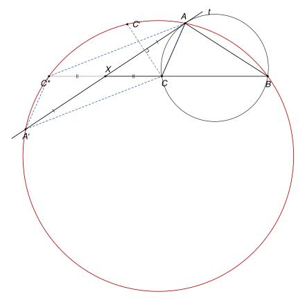

## Statement

Soit $ABC$ un triangle avec $AB \neq AC$, et $\Gamma$ son cercle circonscrit. Soit $t$ la tangente au cercle $\Gamma$ au point $A$.

On note $A'$ le point de $t$ tel que la droite $(BC)$ coupe le segment $[AA']$ en son milieu, et $C'$ le symétrique du point $C$ par rapport à la droite $t$.

Montrer que les points $B$, $A$, $C'$ et $A'$ sont sur un même cercle.

![Le triangle ABC, son cercle circonscrit, la tangente t en A, le point A' de t tel que (BC) coupe [AA'] en son milieu X, et le symétrique C' de C par rapport à t](10253-figure-1.svg)

## Hints

1. Une chasse aux angles directe ne suffit pas. Notez $X$ le milieu de $[AA']$ : il est à la fois sur $t$ et sur $(BC)$. Quelle relation entre les longueurs $XA$, $XB$ et $XC$ la tangente donne-t-elle ? Comparez les triangles $XAB$ et $XCA$.
2. Introduisez le point $C^*$, symétrique de $C$ par rapport au point $X$. Quelle est la nature du quadrilatère $ACA'C^*$ ? Montrez que $XA \times XA' = XB \times XC^*$.
3. Déduisez-en que $B$, $A$, $C^*$ et $A'$ sont sur un même cercle, en comparant les triangles $XAB$ et $XC^*A'$. Montrez ensuite que $C'$ est aussi sur ce cercle, en comparant les angles $\widehat{AC'A'}$ et $\widehat{AC^*A'}$.

## Solution

*Rappels.*

- *Angle inscrit.* Si $U$ et $V$ sont deux points d'un cercle, tous les angles $\widehat{UMV}$, où $M$ parcourt le cercle d'un même côté de la droite $(UV)$, sont égaux. *Réciproque* : si $M$ et $N$ sont du même côté de $(UV)$ et si $\widehat{UMV} = \widehat{UNV}$, alors $U$, $V$, $M$, $N$ sont sur un même cercle.
- *Angle entre une tangente et une corde.* Si une droite est tangente en $U$ à un cercle et si $[UV]$ est une corde, l'angle entre la tangente et la corde est égal à l'angle inscrit $\widehat{UWV}$, pour tout point $W$ du cercle situé de l'autre côté de la corde.
- *Triangles semblables.* Deux triangles qui ont deux angles égaux sont semblables, et alors leurs côtés correspondants sont proportionnels. Deux triangles qui ont un angle égal compris entre deux côtés proportionnels sont aussi semblables, et alors leurs autres angles sont égaux.

Par définition de $A'$, la droite $(BC)$ coupe le segment $[AA']$ en son milieu. On note $X$ ce milieu. Il est sur $t$ et sur $(BC)$.

**Étape 1 : $XA^2 = XB \times XC$.** Le point $X$ est sur la tangente $t$ et il est différent de $A$, puisque $A$ n'est pas sur $(BC)$. Tous les points d'une tangente sauf le point de contact sont à l'extérieur du cercle, donc $X$ est à l'extérieur de $\Gamma$. Or les points du segment $[BC]$ sont tous dans le disque limité par $\Gamma$, donc $X$ n'est pas entre $B$ et $C$ : les points $B$ et $C$ sont sur une même demi-droite d'origine $X$.

L'un des deux points $B$, $C$ est donc entre $X$ et l'autre. Comme ce que l'on veut montrer à cette étape ne change pas quand on échange $B$ et $C$, on peut supposer que $B$ est entre $X$ et $C$.

Comparons les triangles $XAB$ et $XCA$.

- Ils ont le même angle en $X$, car $B$ et $C$ sont sur la même demi-droite d'origine $X$.
- Le segment $[XC]$ coupe la droite $(AB)$ en $B$, donc $X$ et $C$ sont de part et d'autre de la corde $[AB]$. D'après le rappel sur la tangente, l'angle $\widehat{XAB}$ entre la tangente et la corde $[AB]$ est égal à l'angle inscrit $\widehat{ACB}$, qui est aussi $\widehat{ACX}$.

Les deux triangles ont deux angles égaux, donc ils sont semblables, avec $X \leftrightarrow X$, $A \leftrightarrow C$, $B \leftrightarrow A$. On en tire

$$\frac{XA}{XC} = \frac{XB}{XA}, \qquad \text{donc} \qquad XA^2 = XB \times XC.$$

**Étape 2 : un nouveau point $C^*$.** Soit $C^*$ le symétrique de $C$ par rapport au point $X$. Le point $X$ est le milieu des deux segments $[AA']$ et $[CC^*]$. Un quadrilatère dont les diagonales ont le même milieu est un parallélogramme, donc $ACA'C^*$ est un parallélogramme. Il n'est pas aplati, car $C$ n'est pas sur $t$ : la tangente ne touche $\Gamma$ qu'en $A$.

Comme $XA' = XA$ et $XC^* = XC$, l'étape 1 donne

$$XA \times XA' = XA^2 = XB \times XC = XB \times XC^*.$$

**Étape 3 : les points $B$, $A$, $C^*$, $A'$ sont sur un même cercle.** Les points $B$ et $C$ sont sur une même demi-droite d'origine $X$, et $C^*$ est sur la demi-droite opposée. Donc $X$ est entre $B$ et $C^*$. Il est aussi entre $A$ et $A'$.

L'égalité de l'étape 2 s'écrit $\dfrac{XA}{XC^*} = \dfrac{XB}{XA'}$. De plus les angles $\widehat{AXB}$ et $\widehat{C^*XA'}$ sont opposés par le sommet, donc égaux. Les triangles $XAB$ et $XC^*A'$ ont donc un angle égal compris entre deux côtés proportionnels : ils sont semblables, avec $A \leftrightarrow C^*$ et $B \leftrightarrow A'$. En particulier $\widehat{XBA} = \widehat{XA'C^*}$.

Comme $X$ est sur $[BC^*]$ et sur $[A'A]$, cela s'écrit

$$\widehat{C^*BA} = \widehat{C^*A'A}.$$

Les points $B$ et $A'$ voient donc le segment $[AC^*]$ sous le même angle. Vérifions qu'ils sont du même côté de la droite $(AC^*)$.

- La droite $(BC^*)$ coupe $(AC^*)$ seulement en $C^*$, qui n'est pas sur le segment $[BX]$. Donc $[BX]$ ne coupe pas $(AC^*)$, et $B$ est du même côté que $X$.
- La droite $(AA')$ coupe $(AC^*)$ seulement en $A$, qui n'est pas sur le segment $[XA']$. Donc $A'$ est aussi du même côté que $X$.

D'après la réciproque de l'angle inscrit, les quatre points $A$, $C^*$, $B$, $A'$ sont sur un même cercle. On le note $\omega$.

**Étape 4 : le point $C'$ est sur $\omega$.** La symétrie par rapport à la droite $t$ laisse fixes $A$ et $A'$, qui sont sur $t$, et envoie $C$ sur $C'$. Elle envoie donc le triangle $ACA'$ sur le triangle $AC'A'$, et

$$\widehat{AC'A'} = \widehat{ACA'}.$$

Dans le parallélogramme $ACA'C^*$, les angles opposés en $C$ et en $C^*$ sont égaux : $\widehat{ACA'} = \widehat{AC^*A'}$. Donc

$$\widehat{AC'A'} = \widehat{AC^*A'}.$$

Le point $C'$ est de l'autre côté de $t$ que $C$, puisque c'est son symétrique. Le point $C^*$ aussi, puisque le segment $[CC^*]$ coupe $t$ en son milieu $X$. Ainsi $C'$ et $C^*$ sont du même côté de la droite $(AA')$ et voient le segment $[AA']$ sous le même angle. D'après la réciproque de l'angle inscrit, $C'$ est sur le cercle qui passe par $A$, $A'$ et $C^*$, c'est-à-dire sur $\omega$. (Si $C'$ et $C^*$ sont confondus, il n'y a rien à montrer.)

**Conclusion.** Les points $B$, $A$, $A'$ et $C^*$ sont sur le cercle $\omega$ (étape 3), et $C'$ aussi (étape 4). **Les points $B$, $A$, $C'$ et $A'$ sont donc sur un même cercle.**

*Remarques.*

- L'hypothèse $AB \neq AC$ est nécessaire. Si $AB = AC$, la droite qui joint $A$ au centre de $\Gamma$ est la médiatrice de $[BC]$, donc la tangente $t$, qui lui est perpendiculaire, est parallèle à $(BC)$. La droite $(BC)$ ne coupe alors jamais $[AA']$, et le point $A'$ n'existe pas. L'énoncé d'origine ne le dit pas.
- L'étape 3 est la réciproque d'un résultat connu sous le nom de *puissance d'un point* : si deux segments $[AA']$ et $[BC^*]$ se coupent en $X$ et si $XA \times XA' = XB \times XC^*$, leurs quatre extrémités sont sur un même cercle.
- Les correcteurs notent qu'une chasse aux angles directe ne suffisait pas : il fallait une idée en plus, ici le point $C^*$.

## Going further

1. Montrer, avec les triangles semblables de l'étape 1, que $\dfrac{XB}{XC} = \left(\dfrac{AB}{AC}\right)^2$. En déduire de quel côté du segment $[BC]$ se trouve le point $X$ selon que $AB < AC$ ou $AB > AC$.
