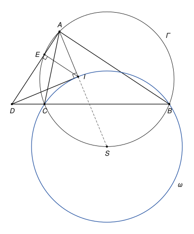

## Statement

Soit $ABC$ un triangle qui n'est pas isocèle en $A$, $\Gamma$ son cercle circonscrit et $I$ le centre de son cercle inscrit.

On note $D$ le point de la droite $(BC)$ tel que $\widehat{DIA} = 90°$, et $E$ le pied de la hauteur issue de $I$ dans le triangle $ADI$.

Montrer que le point $E$ est sur le cercle $\Gamma$.

## Hints

1. La bissectrice $(AI)$ recoupe $\Gamma$ en un point $S$. Montrez que $SB = SI = SC$.
2. Le cercle de centre $S$ qui passe par $B$, $C$ et $I$ est tangent à la droite $(DI)$. Avec le théorème de Pythagore, montrez que $DI^2 = DB \times DC$.
3. Dans le triangle rectangle $AID$, comparez les triangles $DEI$ et $DIA$ pour obtenir $DI^2 = DE \times DA$. Que vaut le produit $DE' \times DA$, si $E'$ est le second point où la droite $(DA)$ coupe $\Gamma$ ?

## Solution

*Rappels.*

- *Angle inscrit.* Si $U$ et $V$ sont deux points d'un cercle, tous les angles $\widehat{UMV}$, où $M$ parcourt le cercle d'un même côté de la droite $(UV)$, sont égaux.
- *Angle extérieur.* Dans un triangle, l'angle extérieur en un sommet est égal à la somme des deux angles intérieurs aux deux autres sommets.

On note $O$ et $R$ le centre et le rayon de $\Gamma$, et $\alpha = \widehat{BAC}$, $\beta = \widehat{ABC}$.

**Étape 1 : le point $S$.** La bissectrice $(AI)$ coupe le segment $[BC]$ en un point $L$, puis recoupe le cercle $\Gamma$ en un point $S$, de l'autre côté de $(BC)$ que $A$. Les points $A$, $I$, $L$, $S$ sont dans cet ordre sur la droite. Montrons que $SB = SI$.

- Les diagonales $[AS]$ et $[BC]$ du quadrilatère $ABSC$ se coupent en $L$, donc ce quadrilatère n'est pas croisé, et $A$ et $B$ sont du même côté de $(SC)$. Les angles inscrits $\widehat{SBC}$ et $\widehat{SAC}$ interceptent la même corde $[SC]$, donc $\widehat{SBC} = \widehat{SAC} = \dfrac{\alpha}{2}$.
- Comme $L$ est sur $[IS]$ et sur $[BC]$, la demi-droite $[BC)$ est entre $[BI)$ et $[BS)$. Donc $\widehat{IBS} = \widehat{IBC} + \widehat{CBS} = \dfrac{\beta}{2} + \dfrac{\alpha}{2}$.
- L'angle $\widehat{SIB}$ est l'angle extérieur en $I$ du triangle $ABI$, donc $\widehat{SIB} = \widehat{IAB} + \widehat{IBA} = \dfrac{\alpha}{2} + \dfrac{\beta}{2}$.

Le triangle $SBI$ a deux angles égaux en $B$ et en $I$, il est isocèle en $S$ : $SB = SI$. Le même raisonnement, en échangeant les rôles de $B$ et $C$, donne $SC = SI$. Le cercle $\omega$ de centre $S$ et de rayon $SI$ passe donc par $B$, $C$ et $I$.

**Étape 2 : la droite $(DI)$ est tangente à $\omega$.** Par définition, $(DI) \perp (AI)$, et $S$ est sur $(AI)$. Donc la droite $(DI)$ est perpendiculaire en $I$ au rayon $[SI]$ du cercle $\omega$ : c'est la tangente à $\omega$ en $I$. Le théorème de Pythagore dans le triangle $DIS$, rectangle en $I$, donne

$$DI^2 = DS^2 - SI^2.$$

En particulier $DS > SI$, car $D \neq I$ (le point $I$ n'est pas sur $(BC)$) : le point $D$ est à l'extérieur de $\omega$.

**Un lemme : la puissance d'un point.** *Soit un cercle de centre $K$ et de rayon $r$, et $M$ un point à l'extérieur de ce cercle. Si une droite qui passe par $M$ coupe le cercle en $U$ et $V$ (avec $U = V$ si elle est tangente), alors $MU \times MV = MK^2 - r^2$.*

Preuve. Soit $H$ le pied de la perpendiculaire à la droite issue de $K$. Le triangle $KUV$ est isocèle en $K$, donc $H$ est le milieu de $[UV]$ et $HU = HV$. Les points du segment $[UV]$ sont à l'intérieur du cercle ou dessus, donc $M$ n'est pas sur $[UV]$, et les deux distances $MU$, $MV$ valent $MH - HU$ et $MH + HU$. Avec le théorème de Pythagore dans les triangles $KHM$ et $KHU$, rectangles en $H$ :

$$MU \times MV = MH^2 - HU^2 = \left(MK^2 - KH^2\right) - \left(r^2 - KH^2\right) = MK^2 - r^2.$$

**Étape 3 : $DI^2 = DB \times DC$.** Le point $D$ est à l'extérieur de $\omega$, et la droite $(BC)$ coupe $\omega$ en $B$ et $C$. D'après le lemme, puis l'étape 2 et $SB = SI$ :

$$DB \times DC = DS^2 - SB^2 = DS^2 - SI^2 = DI^2.$$

**Étape 4 : $DI^2 = DE \times DA$.** Le triangle $AID$ est rectangle en $I$, et $E$ est le pied de la hauteur issue de $I$. Comme les angles en $A$ et en $D$ de ce triangle sont aigus, $E$ est strictement entre $A$ et $D$. Les triangles $DEI$ et $DIA$ ont le même angle en $D$, et chacun un angle droit, en $E$ et en $I$. Ils sont donc semblables, et

$$\frac{DE}{DI} = \frac{DI}{DA}, \qquad \text{donc} \qquad DI^2 = DE \times DA.$$

**Étape 5 : $E$ est sur $\Gamma$.** Les points du segment $[BC]$ sont à l'intérieur de $\omega$ ou dessus, et $D$ est à l'extérieur de $\omega$, donc $D$ n'est pas sur le segment $[BC]$. Or la droite $(BC)$ ne rencontre l'intérieur du cercle $\Gamma$ que le long de $[BC]$. Le point $D$ est donc à l'extérieur de $\Gamma$.

La droite $(DA)$ passe par le point $A$ de $\Gamma$. Notons $E'$ le second point où elle coupe $\Gamma$ (avec $E' = A$ si elle est tangente). Le lemme, appliqué deux fois au cercle $\Gamma$ et au point $D$, avec la droite $(DA)$ puis avec la droite $(BC)$, donne

$$DE' \times DA = DO^2 - R^2 = DB \times DC.$$

Avec les étapes 3 et 4, on obtient $DE' \times DA = DE \times DA$, donc $DE' = DE$.

Enfin, d'après la preuve du lemme, $D$ n'est pas entre $A$ et $E'$, donc $E'$ est sur la demi-droite $[DA)$. Le point $E$ y est aussi, puisqu'il est entre $D$ et $A$. Deux points de la même demi-droite à la même distance de son origine sont confondus : $E' = E$.

**Conclusion.** **Le point $E$ est le second point d'intersection de la droite $(AD)$ avec $\Gamma$, il est donc sur le cercle circonscrit au triangle $ABC$.**

*Remarques.*

- L'hypothèse « non isocèle en $A$ » sert à faire exister $D$. Si $AB = AC$, la bissectrice $(AI)$ est perpendiculaire à $(BC)$, donc la perpendiculaire à $(AI)$ en $I$ est parallèle à $(BC)$ et ne la coupe pas.
- Le point $S$ de l'étape 1 est souvent appelé le *pôle Sud* du triangle, et l'égalité $SB = SI = SC$ est un résultat très utile.
- Le corrigé officiel utilise les *axes radicaux* : $D$ est le point commun aux trois droites qui jouent ce rôle pour les cercles $\omega$, $\Gamma$ et le cercle de diamètre $[AI]$. La preuve ci-dessus fait le même calcul avec des longueurs seulement. La quantité $MK^2 - r^2$ du lemme s'appelle la *puissance* du point $M$ par rapport au cercle.

## Going further

1. Montrer que le point $E$ est aussi sur le cercle de diamètre $[AI]$. En déduire que la droite $(EI)$ recoupe $\Gamma$ au point diamétralement opposé à $A$.
