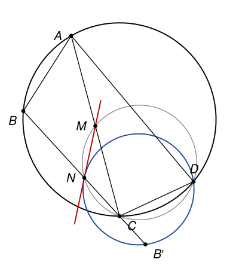
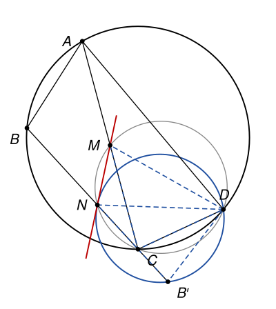

## Statement

Soit $ABCD$ un quadrilatère convexe inscrit dans un cercle, et $M$ le milieu de $[AC]$. Le cercle circonscrit au triangle $CDM$ recoupe la droite $(BC)$ en un point $N$ autre que $C$. Soit $B'$ le symétrique de $B$ par rapport à $N$.

Montrer que la droite $(MN)$ est tangente au cercle circonscrit au triangle $B'DN$.

## Hints

1. Sur la figure, cherchez deux triangles semblables qui ont le sommet $D$ en commun, l'un avec les points $A$ et $M$, l'autre avec les points $B$ et $N$.
2. Comme $M$ est le milieu de $[AC]$ et $N$ celui de $[BB']$, la similitude passe des triangles $DAM$ et $DBN$ aux triangles $DMC$ et $DNB'$.
3. Pour la tangence, utilisez l'angle entre une tangente et une corde, avec la corde $[NB']$.
4. Le point $N$ peut être entre $B$ et $C$, ou au-delà de $C$. Vérifiez que chaque égalité d'angles reste vraie dans les deux cas.

## Solution

*Rappels.*

- *Angles inscrits.* Si $X$, $Y$, $U$, $V$ sont sur un même cercle, les angles $\widehat{XUY}$ et $\widehat{XVY}$ sont égaux si $U$ et $V$ sont du même côté de la droite $(XY)$, et supplémentaires s'ils sont de part et d'autre.
- *Angle entre une tangente et une corde.* Si $t$ est la tangente en $X$ à un cercle, $[XY]$ une corde, et $Z$ un point de $t$, alors $\widehat{ZXY}$ est égal à l'angle inscrit $\widehat{XUY}$ pour tout point $U$ du cercle situé de l'autre côté de $(XY)$ que $Z$.
- *Un point hors du disque.* Soit $[XY]$ une corde d'un cercle, $V$ un point du cercle et $P$ un point du même côté de $(XY)$ que $V$. Si $\widehat{XPY} < \widehat{XVY}$, alors $P$ est à l'extérieur du disque. *Preuve.* Si $P$ est sur le cercle, les deux angles sont égaux. Si $P$ est à l'intérieur, la demi-droite $[XP)$ ressort du disque en un point $P'$ du cercle, situé au-delà de $P$, et du même côté de $(XY)$. L'angle $\widehat{XPY}$ est un angle extérieur du triangle $PP'Y$, donc $\widehat{XPY} = \widehat{PP'Y} + \widehat{PYP'} > \widehat{XP'Y} = \widehat{XVY}$.

On note $\Gamma$ le cercle qui passe par $A$, $B$, $C$, $D$, et $\omega$ le cercle qui passe par $C$, $D$, $M$, $N$.

**Étape 0 : où sont les points.** Comme $ABCD$ est convexe, chaque côté laisse les deux autres sommets du même côté, et chaque diagonale sépare les deux autres sommets. Ainsi $A$ et $B$ sont du même côté de $(CD)$, $A$ et $D$ sont du même côté de $(BC)$, et $B$ et $D$ sont de part et d'autre de $(AC)$. Le point $M$ est sur le segment $]AC[$, donc du même côté de $(CD)$ que $A$, et du même côté de $(BC)$ que $A$ et $D$.

*Le point $N$ est sur la demi-droite $[BC)$, et $N \neq B$.* L'angle $\widehat{CMD}$ est un angle extérieur du triangle $AMD$, donc $\widehat{CMD} > \widehat{MAD} = \widehat{CAD}$. D'autre part $\widehat{CBD} = \widehat{CAD}$ (angles inscrits dans $\Gamma$, et $A$, $B$ du même côté de $(CD)$). Donc $\widehat{CBD} < \widehat{CMD}$, avec $B$ et $M$ du même côté de $(CD)$ : d'après le troisième rappel, appliqué au cercle $\omega$ et à sa corde $[CD]$, le point $B$ est à l'extérieur du disque limité par $\omega$. Or les points de la droite $(BC)$ qui sont dans ce disque forment le segment $[CN]$. Le point $B$ n'est donc pas entre $C$ et $N$ : les points $C$ et $N$ sont du même côté de $B$.

Il reste deux cas, car $N \neq C$ :

- **cas 1** : $N$ est entre $B$ et $C$. Alors $N$ est du même côté de $(CD)$ que $B$, donc que $M$, et du même côté de $(AC)$ que $B$, donc de l'autre côté que $D$ ;
- **cas 2** : $C$ est entre $B$ et $N$. Alors $N$ est de l'autre côté de $(CD)$ que $B$, donc que $M$, et de l'autre côté de $(AC)$ que $B$, donc du même côté que $D$.

Enfin $B'$ est sur la demi-droite $[BN)$, au-delà de $N$, et $N$ est entre $B$ et $B'$.

**Étape 1 : les triangles $DAM$ et $DBN$ sont semblables.** D'abord, comme $M$ est sur $[AC]$ et $N$ sur la demi-droite $[BC)$,

$$\widehat{DAM} = \widehat{DAC} = \widehat{DBC} = \widehat{DBN},$$

l'égalité du milieu venant des angles inscrits dans $\Gamma$. Ensuite, $\widehat{DMA} = 180° - \widehat{DMC}$ car $M$ est entre $A$ et $C$. Comparons avec $\widehat{DNB}$ dans le cercle $\omega$ :

- cas 1 : $M$ et $N$ sont du même côté de $(CD)$, donc $\widehat{DNC} = \widehat{DMC}$, et $\widehat{DNB} = 180° - \widehat{DNC}$ car $N$ est entre $B$ et $C$ ;
- cas 2 : $M$ et $N$ sont de part et d'autre de $(CD)$, donc $\widehat{DNC} = 180° - \widehat{DMC}$, et $\widehat{DNB} = \widehat{DNC}$ car les demi-droites $[NB)$ et $[NC)$ sont les mêmes.

Dans les deux cas, $\widehat{DNB} = 180° - \widehat{DMC} = \widehat{DMA}$. Les triangles $DAM$ et $DBN$ ont deux angles égaux, ils sont semblables, avec $D$, $A$, $M$ qui correspondent à $D$, $B$, $N$. En particulier

$$\frac{DM}{DN} = \frac{AM}{BN}.$$

**Étape 2 : les triangles $DMC$ et $DNB'$ sont semblables.** Comme $M$ est entre $A$ et $C$, et $N$ entre $B$ et $B'$,

$$\widehat{DMC} = 180° - \widehat{DMA} = 180° - \widehat{DNB} = \widehat{DNB'}.$$

De plus $MC = AM$ et $NB' = BN$, donc $\dfrac{MC}{NB'} = \dfrac{AM}{BN} = \dfrac{DM}{DN}$. Les triangles $DMC$ et $DNB'$ ont un angle égal compris entre des côtés proportionnels : ils sont semblables, avec $D$, $M$, $C$ qui correspondent à $D$, $N$, $B'$. En particulier

$$\widehat{MDC} = \widehat{NDB'}.$$

**Étape 3 : $\widehat{MNB} = \widehat{MDC}$.** On regarde la corde $[MC]$ du cercle $\omega$, portée par la droite $(AC)$.

- Cas 1 : $N$ et $D$ sont de part et d'autre de $(AC)$, donc $\widehat{MNC} = 180° - \widehat{MDC}$. Comme $N$ est entre $B$ et $C$, $\widehat{MNB} = 180° - \widehat{MNC} = \widehat{MDC}$.
- Cas 2 : $N$ et $D$ sont du même côté de $(AC)$, donc $\widehat{MNC} = \widehat{MDC}$. Comme les demi-droites $[NB)$ et $[NC)$ sont les mêmes, $\widehat{MNB} = \widehat{MNC} = \widehat{MDC}$.

Avec l'étape 2, on obtient dans les deux cas

$$\widehat{MNB} = \widehat{NDB'}.$$

**Étape 4 : la tangence.** Soit $\omega'$ le cercle circonscrit au triangle $B'DN$ et $t$ sa tangente en $N$. Prenons sur $t$ un point $Z$ du même côté de $(BC)$ que $D$. D'après le deuxième rappel avec la corde $[NB']$, l'angle $\widehat{ZNB'}$ est égal aux angles inscrits pris de l'autre côté de $(NB')$ que $Z$. Le point $D$ est du même côté que $Z$, donc, d'après le premier rappel, $\widehat{ZNB'} = 180° - \widehat{NDB'}$. Comme $N$ est entre $B$ et $B'$,

$$\widehat{ZNB} = 180° - \widehat{ZNB'} = \widehat{NDB'} = \widehat{MNB}.$$

Les demi-droites $[NZ)$ et $[NM)$ sont du même côté de la droite $(BC)$, celui de $D$ (étape 0), et font le même angle avec la demi-droite $[NB)$. Elles sont donc confondues, et la droite $(MN)$ est la droite $t$ :

**la droite $(MN)$ est tangente en $N$ au cercle circonscrit au triangle $B'DN$.**

*Remarques.*

- Le corrigé officiel suit un chemin voisin, avec les triangles semblables $ADC$ et $BDB'$ au lieu de $DMC$ et $DNB'$, et sur la seule figure où $N$ est entre $B$ et $C$. Les deux cas existent vraiment : sur des figures tirées au hasard, $N$ tombe entre $B$ et $C$ environ deux fois sur trois, et au-delà de $C$ le reste du temps. Il ne tombe jamais au-delà de $B$, c'est ce que montre l'étape 0.
- Les correcteurs signalent que la plupart des élèves ont raisonné avec la « similitude de centre $D$ » qui envoie $A$ sur $B$ et $M$ sur $N$. Elle envoie aussi $C$ sur $B'$, puisqu'elle conserve les milieux, et le cercle $\omega$ sur le cercle $\omega'$. Cette transformation, composée d'une rotation et d'une homothétie de même centre $D$, explique d'un coup les deux paires de triangles semblables.
