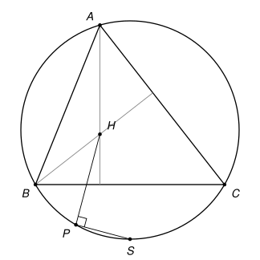

## Statement

Soit $ABC$ un triangle tel que $\widehat{BAC} = 60°$, et $\Gamma$ son cercle circonscrit. Soit $H$ l'orthocentre du triangle $ABC$, et $S$ le milieu de l'arc $BC$ de $\Gamma$ qui ne contient pas $A$. Soit $P$ le point de $\Gamma$ tel que $\widehat{SPH} = 90°$.

Montrer qu'il existe un cercle qui passe par $P$ et $S$ et qui est tangent aux droites $(AB)$ et $(AC)$.

## Hints

1. Soit $N$ le point de $\Gamma$ diamétralement opposé à $S$. Que peut-on dire des trois points $P$, $H$ et $N$ ?
2. Notez $O$ le centre de $\Gamma$ et $D$ le milieu de $[BC]$. Grâce à l'angle de $60°$, montrez que $D$ est le milieu de $[OS]$.
3. Un résultat classique, valable dans tout triangle : $\overrightarrow{AH} = 2\,\overrightarrow{OD}$. Pour le démontrer, faites intervenir le point de $\Gamma$ diamétralement opposé à $A$. Ici, cela donne $\overrightarrow{AH} = \overrightarrow{OS}$.
4. Le centre d'un cercle tangent à $(AB)$ et à $(AC)$ est sur une bissectrice de l'angle en $A$. Cherchez un cercle dont un diamètre est porté par la droite $(AS)$, et regardez le point de $[AS]$ situé au tiers en partant de $A$.

## Solution

*Rappels.*

- *Angle au centre.* Un angle au centre vaut le double d'un angle inscrit qui intercepte le même arc.
- *Angle droit et diamètre.* Un point $X$, différent de $U$ et de $V$, est sur le cercle de diamètre $[UV]$ si et seulement si $\widehat{UXV} = 90°$.
- *Milieu.* Si $D$ est le milieu de $[XY]$, alors $\overrightarrow{OX} + \overrightarrow{OY} = 2\,\overrightarrow{OD}$, pour n'importe quel point $O$.
- *Tangente.* Une droite est tangente à un cercle si et seulement si sa distance au centre est égale au rayon.

On note $O$ le centre de $\Gamma$, $R$ son rayon, $D$ le milieu de $[BC]$, et $N$ le point de $\Gamma$ diamétralement opposé à $S$, de sorte que $\overrightarrow{ON} = -\overrightarrow{OS}$.

![La construction : le point N, le point Q au tiers de [AS] en partant de A, et le cercle de diamètre [QS] en bleu, de centre K](10270-figure-2.svg)

**Étape 1 : $D$ est le milieu de $[OS]$.** C'est ici que sert l'angle de $60°$. L'angle inscrit $\widehat{BAC}$ intercepte l'arc $BC$ qui ne contient pas $A$, celui sur lequel se trouve $S$. D'après le premier rappel, l'angle au centre qui intercepte cet arc vaut $120°$. Comme $S$ est le milieu de l'arc, les arcs $BS$ et $SC$ sont égaux, et $\widehat{BOS} = \widehat{SOC} = 60°$.

Le triangle $OBS$ est isocèle en $O$ (car $OB = OS = R$) et son angle en $O$ vaut $60°$ : il est équilatéral. D'autre part $O$ et $S$ sont tous deux à égale distance de $B$ et de $C$, donc la droite $(OS)$ est la médiatrice de $[BC]$. Elle passe par $D$ et elle est perpendiculaire à $(BD)$. Ainsi $(BD)$ est la hauteur issue de $B$ du triangle équilatéral $OBS$. Dans un triangle équilatéral, une hauteur est aussi une médiane, donc $D$ est le milieu de $[OS]$, et

$$2\,\overrightarrow{OD} = \overrightarrow{OS}.$$

**Étape 2 : $\overrightarrow{AH} = \overrightarrow{OS}$.** Soit $A'$ le point de $\Gamma$ diamétralement opposé à $A$. Montrons que $D$ est aussi le milieu de $[HA']$.

- Si le triangle a un angle droit en $C$, alors $H = C$, et $[AB]$ est un diamètre, donc $A' = B$. Le milieu de $[HA']$ est bien le milieu de $[CB]$. De même si l'angle droit est en $B$.
- Sinon, $B$ et $C$ sont différents de $A'$. Comme $B$ est sur le cercle de diamètre $[AA']$, l'angle $\widehat{ABA'}$ est droit : $(A'B) \perp (AB)$. La hauteur $(CH)$ est elle aussi perpendiculaire à $(AB)$, donc $(A'B) \parallel (CH)$. De la même façon, $(A'C) \parallel (BH)$. Le quadrilatère $BHCA'$ a ses côtés opposés parallèles, c'est un parallélogramme, et ses diagonales $[BC]$ et $[HA']$ ont le même milieu $D$.

Comme $O$ est le milieu de $[AA']$ et $D$ celui de $[A'H]$, la relation de Chasles donne

$$\overrightarrow{AH} = \overrightarrow{AA'} + \overrightarrow{A'H} = 2\,\overrightarrow{OA'} + 2\,\overrightarrow{A'D} = 2\,\overrightarrow{OD}.$$

Avec l'étape 1, $\overrightarrow{AH} = \overrightarrow{OS}$, et donc $\overrightarrow{OH} = \overrightarrow{OA} + \overrightarrow{OS}$.

**Étape 3 : $P$, $H$ et $N$ sont alignés.** L'angle $\widehat{SPH}$ existe, donc $P \neq S$. Soit $\ell$ la droite qui passe par $P$ et qui est perpendiculaire à $(PS)$. Comme $\widehat{SPH} = 90°$, le point $H$ est sur $\ell$. Le point $N$ aussi : si $P \neq N$, le point $P$ est sur le cercle $\Gamma$ de diamètre $[SN]$, donc $\widehat{SPN} = 90°$ ; et si $P = N$, c'est évident.

Enfin $H \neq N$. Sinon on aurait $\overrightarrow{OA} + \overrightarrow{OS} = \overrightarrow{ON} = -\overrightarrow{OS}$, donc $\overrightarrow{OA} = -2\,\overrightarrow{OS}$ et $OA = 2R$, ce qui est faux. La droite $\ell$ est donc la droite $(HN)$.

**Étape 4 : le cercle passe par $P$ et $S$.** Soit $Q$ le point de $[AS]$ tel que $\overrightarrow{AQ} = \tfrac13\,\overrightarrow{AS}$. On calcule, avec l'étape 2 :

$$\overrightarrow{HQ} = \overrightarrow{HA} + \overrightarrow{AQ} = -\overrightarrow{OS} + \tfrac13\left(\overrightarrow{OS} - \overrightarrow{OA}\right) = -\tfrac13\,\overrightarrow{OA} - \tfrac23\,\overrightarrow{OS},$$

$$\overrightarrow{HN} = \overrightarrow{HO} + \overrightarrow{ON} = -\overrightarrow{OA} - \overrightarrow{OS} - \overrightarrow{OS} = -\overrightarrow{OA} - 2\,\overrightarrow{OS}.$$

Donc $\overrightarrow{HQ} = \tfrac13\,\overrightarrow{HN}$, et $Q$ est sur la droite $(HN)$, c'est-à-dire sur $\ell$.

Le point $Q$ est strictement entre $A$ et $S$, deux points du cercle $\Gamma$, donc il est à l'intérieur du disque, et $Q \neq P$. Ainsi $(PQ) = \ell$ est perpendiculaire à $(PS)$, et $\widehat{QPS} = 90°$. D'après le deuxième rappel, $P$ est sur le cercle $\mathcal{C}$ de diamètre $[QS]$. Le point $S$ y est aussi, bien sûr.

**Étape 5 : le cercle $\mathcal{C}$ est tangent à $(AB)$ et à $(AC)$.** Soit $K$ le milieu de $[QS]$, centre de $\mathcal{C}$. Son rayon est $r = \tfrac12\,QS = \tfrac12 \times \tfrac23\,AS = \tfrac13\,AS$, et $AK = AQ + QK = \tfrac13\,AS + \tfrac13\,AS = \tfrac23\,AS$.

Les angles inscrits $\widehat{BAS}$ et $\widehat{SAC}$ interceptent les arcs égaux $BS$ et $SC$, donc ils sont égaux, et chacun vaut $30°$. Comme $K$ est sur $[AS]$, on a aussi $\widehat{KAC} = 30°$. Soit $T$ le pied de la perpendiculaire à $(AC)$ issue de $K$. L'angle $\widehat{KAC}$ est aigu, donc $T$ est sur la demi-droite $[AC)$, et dans le triangle $AKT$ rectangle en $T$,

$$KT = AK \times \sin 30° = \tfrac12\,AK = \tfrac13\,AS = r.$$

La distance du centre $K$ à la droite $(AC)$ est égale au rayon, donc $(AC)$ est tangente à $\mathcal{C}$ en $T$. Le même calcul avec $\widehat{KAB} = 30°$ montre que $(AB)$ est tangente à $\mathcal{C}$.

**Le cercle de diamètre $[QS]$, où $Q$ est le point de $[AS]$ tel que $AQ = \tfrac13\,AS$, passe par $P$ et par $S$, et il est tangent aux droites $(AB)$ et $(AC)$.**

*Remarques.*

- L'étape 2 est vraie dans tout triangle. L'angle de $60°$ ne sert qu'à l'étape 1, pour que $\overrightarrow{AH}$ soit exactement $\overrightarrow{OS}$.
- L'énoncé suppose que le point $P$ existe. Ce n'est pas le cas si le triangle est équilatéral : alors $H = O$, et le cercle de diamètre $[SO]$, sur lequel $P$ devrait se trouver, ne touche $\Gamma$ qu'au point $S$.
- Le corrigé officiel trouve le même cercle : il obtient $AH = OS$ par la droite des milieux, puis $QS = 2\,AQ$ par le théorème de Thalès, sur sa figure. Le calcul vectoriel ci-dessus évite d'avoir à discuter la position des points.
