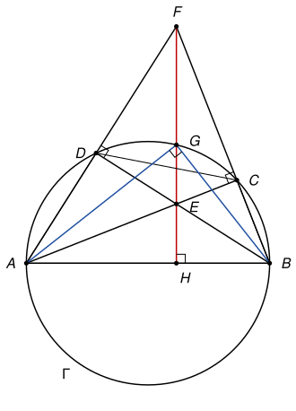

## Statement

Soit $ABCD$ un quadrilatère convexe inscrit dans un cercle $\Gamma$, tel que $[AB]$ soit un diamètre de $\Gamma$.

Les droites $(AC)$ et $(BD)$ se coupent en $E$, et les droites $(AD)$ et $(BC)$ se coupent en $F$. Le segment $[EF]$ coupe le cercle $\Gamma$ en $G$, et la droite $(EF)$ coupe la droite $(AB)$ en $H$.

On suppose que $G$ est le milieu du segment $[FH]$. Montrer que $E$ est le milieu du segment $[GH]$.

![Le quadrilatère ABCD inscrit dans le cercle de diamètre [AB], les points E et F, et la droite (EF) qui coupe le cercle en G et le diamètre en H](10283-figure-1.svg)

## Hints

1. Les angles $\widehat{ACB}$ et $\widehat{ADB}$ sont droits. Que représentent les droites $(AC)$ et $(BD)$ pour le triangle $ABF$ ? Et le point $E$ ?
2. Déduisez-en que la droite $(FH)$ est perpendiculaire à $(AB)$.
3. Dans le triangle rectangle $AGB$, montrez que $GH^2 = HA \times HB$. Montrez aussi que $HE \times HF = HA \times HB$, en comparant les triangles $HAE$ et $HFB$.
4. Utilisez enfin l'hypothèse $HF = 2\,GH$.

## Solution

*Rappels.*

- *Cercle de diamètre $[AB]$.* Un point $M$ distinct de $A$ et $B$ est sur le cercle de diamètre $[AB]$ si et seulement si $\widehat{AMB} = 90°$.
- *Orthocentre.* Les trois hauteurs d'un triangle sont concourantes, en un point appelé l'orthocentre.
- *Triangles semblables.* Deux triangles qui ont deux angles égaux sont semblables, et leurs côtés correspondants sont proportionnels.

*La figure.* Les sommets se suivent dans l'ordre $A$, $B$, $C$, $D$ sur le cercle, et $C$, $D$ sont du même côté du diamètre. Le point $F$ est au-delà de $C$ sur $[BC)$ et au-delà de $D$ sur $[AD)$, et le point $E$, où se coupent les diagonales, est à l'intérieur du quadrilatère.

**Étape 1 : $E$ est l'orthocentre du triangle $ABF$.** Comme $[AB]$ est un diamètre, $\widehat{ACB} = 90°$, donc $(AC)$ est perpendiculaire à $(BC) = (BF)$ : c'est la hauteur issue de $A$ du triangle $ABF$. De même $\widehat{ADB} = 90°$, et $(BD)$ est la hauteur issue de $B$. Leur point commun $E$ est l'orthocentre du triangle $ABF$. La troisième hauteur, issue de $F$, passe donc aussi par $E$ : c'est la droite $(FE)$, et elle coupe $(AB)$ en $H$. Ainsi

$$(FH) \perp (AB).$$

Les angles du triangle $ABF$ sont aigus : en $A$ et en $B$ parce que ce sont des angles aigus des triangles rectangles $ADB$ et $ACB$, et en $F$ parce que c'est un angle aigu du triangle $ACF$, rectangle en $C$. L'orthocentre $E$ est donc à l'intérieur du triangle, $H$ est sur le segment $[AB]$, et $E$ est entre $F$ et $H$.

**Étape 2 : une relation pour $G$.** Le point $G$ est sur le cercle de diamètre $[AB]$, donc le triangle $AGB$ est rectangle en $G$, et $[GH]$ est sa hauteur issue de $G$. Les triangles $AHG$ et $GHB$ sont rectangles en $H$, et $\widehat{HAG} = 90° - \widehat{ABG} = \widehat{HGB}$. Ils sont semblables, donc

$$\frac{HA}{HG} = \frac{HG}{HB}, \qquad \text{soit} \qquad GH^2 = HA \times HB.$$

**Étape 3 : une relation pour $E$.** Les triangles $HAE$ et $HFB$ sont rectangles en $H$. De plus $\widehat{HAE} = \widehat{BAC} = 90° - \widehat{ABC}$ dans le triangle $ABC$ rectangle en $C$, et $\widehat{HFB} = 90° - \widehat{HBF} = 90° - \widehat{ABC}$ dans le triangle $HFB$. Ces deux triangles ont donc les mêmes angles, et

$$\frac{HA}{HF} = \frac{HE}{HB}, \qquad \text{soit} \qquad HE \times HF = HA \times HB.$$

**Étape 4 : l'hypothèse.** Des étapes 2 et 3, on tire $HE \times HF = GH^2$. Comme $G$ est le milieu de $[FH]$, on a $HF = 2\,GH$, donc

$$HE \times 2\,GH = GH^2, \qquad \text{d'où} \qquad HE = \frac{GH}{2}.$$

**Conclusion.** Les points $H$, $E$, $G$ sont sur la demi-droite $[HF)$, avec $HE = \frac{GH}{2}$. Le point $E$ est donc sur le segment $[HG]$, à mi-chemin : **$E$ est le milieu de $[GH]$.**

*Remarques.*

- Sans l'hypothèse, les étapes 1 à 3 restent vraies et donnent toujours $HE \times HF = HG^2$.
- Le corrigé officiel introduit le symétrique $K$ de $G$ par rapport à $(AB)$, qui est sur $\Gamma$ et sur $(FH)$, et compare les produits $EG \times EK$ et $EF \times EH$, qui sont tous deux égaux à $EA \times EC$. C'est la même idée, écrite avec la puissance d'un point par rapport à un cercle.

## Going further

1. Réciproquement, on suppose que $E$ est le milieu de $[GH]$. Montrer que $G$ est le milieu de $[FH]$.
2. Toujours sans hypothèse sur $G$, on suppose que $HF = k \times HG$ pour un nombre $k > 1$. Montrer que $HE = \frac{HG}{k}$.
