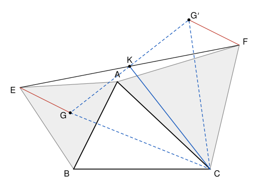

## Statement

Soit $ABC$ un triangle. À l'extérieur du triangle $ABC$, on construit le triangle équilatéral $ABE$ et le triangle équilatéral $ACF$.

On note $G$ le centre de gravité du triangle $ABE$, et $K$ le milieu du segment $[EF]$.

Déterminer les angles du triangle $KCG$.

## Hints

1. Fais une figure soignée, au compas, et mesure les angles du triangle $KCG$. Recommence avec un triangle $ABC$ d'une autre forme.
2. Place le point $G'$, symétrique de $G$ par rapport à $K$. Quelle est la nature du quadrilatère $EGFG'$ ?
3. Regarde la rotation de centre $C$ et d'angle $60°$ qui envoie $A$ sur $F$. Sur quel point envoie-t-elle $G$ ?
4. Si le triangle $GCG'$ est équilatéral, que représente la droite $(CK)$ dans ce triangle ?

## Solution

On va montrer que le triangle $KCG$ a un angle droit en $K$, un angle de $60°$ en $G$ et un angle de $30°$ en $C$.

Quitte à regarder la figure dans un miroir, on suppose que l'on parcourt $A$, puis $B$, puis $C$ dans le sens inverse des aiguilles d'une montre, comme sur la figure ci-dessous.

**Un rappel sur les rotations.** Une rotation de centre $C$ et d'angle $60°$ fait tourner toute la figure de $60°$ autour de $C$. Elle conserve les longueurs, et elle fait tourner **chaque vecteur** de $60°$, dans le même sens : si elle envoie $M$ sur $M_1$ et $N$ sur $N_1$, alors le vecteur $\overrightarrow{M_1N_1}$ s'obtient en faisant tourner le vecteur $\overrightarrow{MN}$ de $60°$ dans ce sens.

**Étape 1 : le point $G'$.** Soit $G'$ le symétrique de $G$ par rapport à $K$. Les segments $[EF]$ et $[GG']$ ont le même milieu $K$, donc $EGFG'$ est un parallélogramme. On en déduit

$$\overrightarrow{FG'} = \overrightarrow{GE}.$$

**Étape 2 : le vecteur $\overrightarrow{GE}$.** Le point $G$ est le centre du triangle équilatéral $ABE$. Il est à la même distance des trois sommets, donc $GA = GE$, et les trois angles $\widehat{AGB}$, $\widehat{BGE}$, $\widehat{EGA}$ valent $120°$.

Prolongeons la demi-droite $[AG)$ au-delà de $G$ : elle fait avec $[GE)$ un angle de $180° - 120° = 60°$. Le vecteur $\overrightarrow{GE}$ a donc la même longueur que le vecteur $\overrightarrow{AG}$, et il s'obtient en le faisant tourner de $60°$. Comme $E$ est de l'autre côté de $(AB)$ par rapport à $C$, on tourne ici dans le sens des aiguilles d'une montre (voir la figure).

**Étape 3 : la rotation.** Soit $\rho$ la rotation de centre $C$ et d'angle $60°$ dans le sens des aiguilles d'une montre. Comme $CA = CF$ et $\widehat{ACF} = 60°$, et comme $F$ est de l'autre côté de $(AC)$ par rapport à $B$, cette rotation envoie $A$ sur $F$ (voir la figure).

Notons $H$ l'image de $G$ par $\rho$. Puisque $\rho$ envoie $A$ sur $F$ et $G$ sur $H$, le vecteur $\overrightarrow{FH}$ s'obtient en faisant tourner $\overrightarrow{AG}$ de $60°$ dans le sens des aiguilles d'une montre. D'après l'étape 2, c'est exactement le vecteur $\overrightarrow{GE}$. Avec l'étape 1 :

$$\overrightarrow{FH} = \overrightarrow{GE} = \overrightarrow{FG'}, \qquad \text{donc } H = G'.$$

La rotation $\rho$ envoie donc $G$ sur $G'$. Par conséquent $CG = CG'$ et $\widehat{GCG'} = 60°$. Un triangle isocèle dont l'angle au sommet vaut $60°$ a ses deux autres angles égaux à $\frac{180° - 60°}{2} = 60°$ : le triangle $GCG'$ est **équilatéral**.

**Étape 4 : les angles de $KCG$.** Les points $G$ et $G'$ sont distincts. En effet, si $G = G'$, alors $\rho(G) = G$, et le seul point qu'une rotation ne bouge pas est son centre, donc $G = C$. C'est impossible, car $G$ est à l'intérieur du triangle $ABE$, de l'autre côté de $(AB)$ par rapport à $C$.

Le point $K$ est le milieu du côté $[GG']$ du triangle équilatéral $GCG'$. La droite $(CK)$ est donc la médiane issue de $C$. Dans un triangle équilatéral, c'est aussi la hauteur et la bissectrice. Ainsi :

- $\widehat{CKG} = 90°$, car $(CK)$ est perpendiculaire à $(GG')$ ;
- $\widehat{KGC} = \widehat{G'GC} = 60°$, angle du triangle équilatéral ;
- $\widehat{GCK} = \frac{1}{2}\widehat{GCG'} = 30°$, car $(CK)$ coupe l'angle en deux.

**Conclusion : quel que soit le triangle $ABC$, le triangle $KCG$ est rectangle en $K$, avec $\widehat{KGC} = 60°$ et $\widehat{KCG} = 30°$.**

## Going further

On obtient aussi les longueurs : dans un triangle rectangle avec un angle de $30°$, le côté opposé à cet angle vaut la moitié de l'hypoténuse. Ici $KG = \frac{1}{2}\,GC$, et par le théorème de Pythagore, $KC = \sqrt{3}\,KG$.

Avec les nombres complexes, on peut aussi tout calculer : en prenant $A$ comme origine et en notant $b$, $c$ les affixes de $B$ et $C$, on trouve $e = e^{-i\pi/3}\,b$, $f = e^{i\pi/3}\,c$, $g = \frac{b + e}{3}$, $k = \frac{e + f}{2}$, et l'on vérifie que $c - k = i\sqrt{3}\,(g - k)$.
