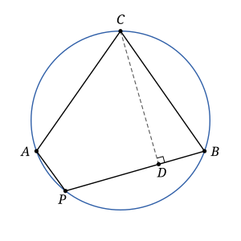

## Statement

Sur un cercle $\Gamma$, on choisit trois points $A$, $B$, $C$ tels que $AC = BC$. Soit $P$ un point de l'arc $AB$ de $\Gamma$ qui ne contient pas $C$, distinct de $A$ et de $B$. La droite qui passe par $C$ et qui est perpendiculaire à $(PB)$ coupe $(PB)$ en $D$.

Démontrer que $PA + PB = 2PD$.

## Hints

1. La somme $PA + PB$ n'apparaît nulle part sur la figure. Fabriquez-la : prolongez le segment $[PB]$ au-delà de $B$ jusqu'au point $Q$ tel que $BQ = PA$. Alors $PQ = PA + PB$.
2. Comparez les triangles $CAP$ et $CBQ$. Quels côtés sont égaux ? Et quels angles ?
3. Pour les angles, utilisez le quadrilatère $APBC$, inscrit dans le cercle : ses angles opposés sont supplémentaires.
4. Le triangle $CPQ$ est isocèle. Où se trouve le pied de la hauteur issue de $C$ ?

## Solution

**Un outil : les angles opposés d'un quadrilatère inscrit.** Si $A$, $P$, $B$, $C$ sont quatre points d'un cercle, placés dans cet ordre, alors $\widehat{PAC} + \widehat{PBC} = 180^\circ$.

C'est une conséquence du théorème de l'angle inscrit : un angle inscrit vaut la moitié de l'angle au centre qui intercepte le même arc. L'angle $\widehat{PAC}$ intercepte l'arc $PC$ qui passe par $B$, l'angle $\widehat{PBC}$ intercepte l'arc $PC$ qui passe par $A$. Ces deux arcs forment ensemble le cercle entier, de $360^\circ$, donc les deux angles inscrits ont pour somme $\dfrac{360^\circ}{2} = 180^\circ$.

**Étape 1 : fabriquer la somme $PA + PB$.** Sur la demi-droite $[PB)$, plaçons le point $Q$ au-delà de $B$ tel que $BQ = PA$. Comme $B$ est entre $P$ et $Q$,

$$PQ = PB + BQ = PB + PA .$$

**Étape 2 : deux angles égaux.** Les points $P$, $B$, $Q$ sont alignés dans cet ordre, donc $\widehat{CBQ} = 180^\circ - \widehat{CBP}$.

Le point $P$ est sur l'arc $AB$ qui ne contient pas $C$, donc les points $A$, $P$, $B$, $C$ se suivent dans cet ordre sur le cercle. D'après l'outil, $\widehat{CAP} = 180^\circ - \widehat{CBP}$. Ainsi

$$\widehat{CBQ} = \widehat{CAP} .$$

**Étape 3 : deux triangles égaux.** Les triangles $CAP$ et $CBQ$ ont :

- $CA = CB$, par hypothèse ;
- $AP = BQ$, par construction de $Q$ ;
- l'angle compris entre ces deux côtés égal : $\widehat{CAP} = \widehat{CBQ}$.

Ce sont donc deux triangles égaux (superposables), et leurs troisièmes côtés sont égaux : $CP = CQ$.

**Étape 4 : $D$ est le milieu de $[PQ]$.** Le point $D$ est sur la droite $(PB)$, qui est la droite $(PQ)$, et $(CD)$ est perpendiculaire à cette droite. Le théorème de Pythagore dans les triangles $CDP$ et $CDQ$, rectangles en $D$, donne

$$DP^2 = CP^2 - CD^2 = CQ^2 - CD^2 = DQ^2 ,$$

donc $DP = DQ$. Le point $D$ est sur la droite $(PQ)$ à égale distance de $P$ et de $Q$, qui sont distincts : c'est le milieu de $[PQ]$.

**Conclusion.** On a $PD = \dfrac{PQ}{2} = \dfrac{PA + PB}{2}$, c'est-à-dire

$$PA + PB = 2PD .$$

## Going further

La démonstration ne suppose pas que $D$ soit entre $P$ et $B$. Si $PA > PB$, le point $D$ tombe au-delà de $B$, et le résultat reste vrai.

Ce résultat est une variante du *théorème de la corde brisée*, attribué à Archimède. Notons $M$ le point du cercle diamétralement opposé à $C$ : c'est le milieu de l'arc $AB$ qui contient $P$. Supposons $PA < PB$ et notons $F$ le pied de la perpendiculaire menée de $M$ à $(PB)$. Alors $F$ est le « milieu » de la ligne brisée $APB$ :

$$AP + PF = FB .$$

Pour le déduire de l'exercice, projetez le diamètre $[CM]$ sur la droite $(PB)$ : le centre du cercle se projette au milieu de la corde $[PB]$, qui est donc aussi le milieu de $[DF]$.
