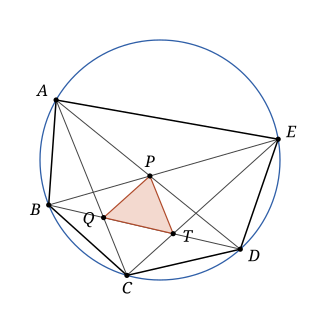

## Statement

Cinq points $A$, $B$, $C$, $D$, $E$ sont placés sur un même cercle, de sorte que le pentagone $ABCDE$ soit convexe et que

$$AB = BC \qquad \text{et} \qquad CD = DE .$$

Les droites $(AD)$ et $(BE)$ se coupent en $P$. La droite $(BD)$ coupe la droite $(CA)$ en $Q$ et la droite $(CE)$ en $T$.

Démontrer que le triangle $PQT$ est isocèle.

## Hints

1. Comme $AB = BC$, que dire des angles $\widehat{ADB}$ et $\widehat{BDC}$ ? Et comme $CD = DE$, que dire des angles $\widehat{CBD}$ et $\widehat{DBE}$ ?
2. La droite $(BD)$ est donc la bissectrice de deux angles à la fois. Que devient le point $C$ dans la symétrie d'axe $(BD)$ ?
3. Vous devez trouver le point $P$. Déduisez-en que $PQ = CQ$ et $PT = CT$.
4. Il reste à montrer que $CQ = CT$, en calculant deux angles du triangle $CQT$.

## Solution

On va montrer que $PQ = PT$.

**Un outil : le théorème de l'angle inscrit.** Notons $O$ le centre du cercle. Un angle inscrit vaut la moitié de l'angle au centre qui intercepte le même arc. Par exemple, l'angle $\widehat{ADB}$, de sommet $D$, intercepte l'arc $AB$ qui ne contient pas $D$, donc $\widehat{ADB} = \dfrac{1}{2}\widehat{AOB}$.

Deux cordes de même longueur, comme $[AB]$ et $[BC]$, donnent des triangles $AOB$ et $BOC$ superposables (leurs trois côtés sont égaux deux à deux), donc des angles au centre égaux : $\widehat{AOB} = \widehat{BOC}$. Posons

$$\alpha = \frac{1}{2}\widehat{AOB} = \frac{1}{2}\widehat{BOC}, \qquad \beta = \frac{1}{2}\widehat{COD} = \frac{1}{2}\widehat{DOE} .$$

Dans le pentagone convexe, l'arc $AB$ qui ne contient pas les trois autres sommets est intercepté par les angles $\widehat{ADB}$ et $\widehat{ACB}$, et de même pour les autres côtés. On obtient ainsi :

$$\widehat{ADB} = \widehat{BDC} = \widehat{ACB} = \alpha, \qquad \widehat{CBD} = \widehat{DBE} = \widehat{ECD} = \beta .$$

**Étape 1 : le symétrique de $C$ par rapport à $(BD)$ est $P$.** Notons $s$ la symétrie d'axe $(BD)$. Le pentagone est convexe, donc la diagonale $(BD)$ sépare le sommet $C$ des deux sommets $A$ et $E$.

- Les demi-droites $[BC)$ et $[BE)$ font le même angle $\beta$ avec $[BD)$, et sont de part et d'autre de $(BD)$. La symétrie $s$ envoie donc la demi-droite $[BC)$ sur la demi-droite $[BE)$.
- De même, $[DC)$ et $[DA)$ font le même angle $\alpha$ avec $[DB)$, et sont de part et d'autre de $(BD)$. La symétrie $s$ envoie donc $[DC)$ sur $[DA)$.

Le point $s(C)$ est donc à la fois sur la droite $(BE)$ et sur la droite $(DA)$. Ces deux droites ne se coupent qu'en $P$, donc $s(C) = P$.

**Étape 2 : $PQ = CQ$ et $PT = CT$.** Les points $Q$ et $T$ sont sur l'axe $(BD)$, donc $s(Q) = Q$ et $s(T) = T$. Une symétrie conserve les longueurs, donc

$$PQ = s(C)\,s(Q) = CQ \qquad \text{et} \qquad PT = s(C)\,s(T) = CT .$$

**Étape 3 : $CQ = CT$.** Le pentagone est convexe, donc autour du sommet $C$ les demi-droites $[CB)$, $[CA)$, $[CE)$, $[CD)$ se suivent dans cet ordre. Elles coupent le segment $[BD]$ en $B$, $Q$, $T$, $D$, qui sont donc dans cet ordre sur ce segment.

- Dans le triangle $BQC$, l'angle $\widehat{CQD}$ est un angle extérieur (car $Q$ est entre $B$ et $D$), donc il est égal à la somme des deux angles intérieurs qui ne sont pas en $Q$ :
$$\widehat{CQD} = \widehat{QBC} + \widehat{QCB} = \widehat{DBC} + \widehat{ACB} = \beta + \alpha .$$
- De même, dans le triangle $DTC$, l'angle $\widehat{CTB}$ est un angle extérieur :
$$\widehat{CTB} = \widehat{TDC} + \widehat{TCD} = \widehat{BDC} + \widehat{ECD} = \alpha + \beta .$$

Dans le triangle $CQT$, on a $\widehat{CQT} = \widehat{CQD}$ (car $T$ est sur $[QD]$) et $\widehat{CTQ} = \widehat{CTB}$ (car $Q$ est sur $[TB]$). Les deux angles à la base $[QT]$ sont égaux à $\alpha + \beta$ : le triangle $CQT$ est isocèle en $C$, et $CQ = CT$.

**Conclusion.** On a $PQ = CQ = CT = PT$ : le triangle $PQT$ est isocèle en $P$.

## Going further

La même symétrie montre un peu plus : le quadrilatère $CQPT$ est un cerf-volant, symétrique par rapport à la droite $(BD)$, et ses quatre côtés sont égaux. C'est donc un losange, et $(CP)$ est perpendiculaire à $(BD)$.
