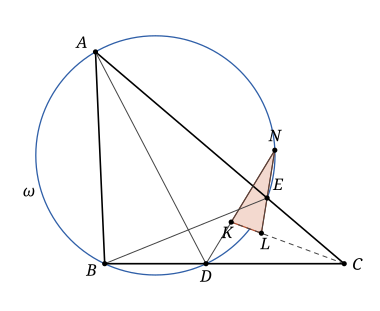

## Statement

Soit $ABC$ un triangle et $\omega$ un cercle qui passe par $A$ et $B$, et qui recoupe les côtés $[BC]$ et $[AC]$ en $D$ et $E$ respectivement. On note $K$ le centre du cercle inscrit dans le triangle $DAC$, et $L$ le centre du cercle inscrit dans le triangle $BEC$. Les droites $(DK)$ et $(EL)$ se coupent en $N$.

Démontrer que le triangle $KNL$ est isocèle.

## Hints

1. Montrez que les triangles $CAD$ et $CBE$ ont les mêmes angles. Pour cela, comparez les angles $\widehat{ADB}$ et $\widehat{AEB}$, qui sont inscrits dans le cercle $\omega$.
2. Pourquoi les points $C$, $K$ et $L$ sont-ils alignés ? Calculez l'angle $\widehat{CKD}$ dans le triangle $CKD$, puis l'angle $\widehat{CLE}$ dans le triangle $CLE$.
3. Les droites $(DK)$ et $(EL)$ coupent la droite $(KL)$ sous le même angle. Déduisez-en les angles du triangle $KNL$ en $K$ et en $L$. Attention à l'ordre des points $C$, $K$, $L$ sur leur droite : il y a deux cas.

## Solution

Notons $\gamma = \widehat{ACB}$. Si $K = L$, il n'y a pas de triangle : on suppose donc $K \neq L$.

**Un outil : l'angle inscrit.** Deux angles inscrits dans un même cercle, qui interceptent le même arc, sont égaux. Par exemple, si $M$ et $M'$ sont deux points d'un cercle passant par $A$ et $B$, situés du même côté de la droite $(AB)$, alors $\widehat{AMB} = \widehat{AM'B}$.

**Étape 1 : les triangles $CAD$ et $CBE$ ont les mêmes angles.** Les points $D$ et $E$ sont sur $\omega$, et du même côté de la droite $(AB)$ que $C$, puisque $D$ est sur $[BC]$ et $E$ sur $[AC]$. Les angles $\widehat{ADB}$ et $\widehat{AEB}$ sont donc égaux. Comme $D$ est entre $B$ et $C$, et $E$ entre $A$ et $C$, on en déduit

$$\widehat{ADC} = 180^\circ - \widehat{ADB} = 180^\circ - \widehat{AEB} = \widehat{BEC} .$$

Notons $\delta$ cet angle. Les deux triangles $CAD$ et $CBE$ ont aussi le même angle $\gamma$ en $C$. Leurs troisièmes angles sont donc égaux eux aussi :

$$\widehat{CAD} = \widehat{CBE} = 180^\circ - \gamma - \delta .$$

Notons $\alpha$ cet angle.

**Étape 2 : $C$, $K$, $L$ sont alignés, et $\widehat{CKD} = \widehat{CLE}$.** Le centre du cercle inscrit d'un triangle est le point où se coupent les bissectrices de ses trois angles.

- L'angle du triangle $DAC$ en $C$ est l'angle $\widehat{ACB}$. Le point $K$ est donc sur la bissectrice $\Delta$ de l'angle $\widehat{ACB}$. Pour la même raison, $L$ est sur $\Delta$. Les points $C$, $K$, $L$ sont donc alignés sur $\Delta$.
- Dans le triangle $CKD$, on a $\widehat{KCD} = \gamma / 2$ et $\widehat{CDK} = \delta / 2$, car $(DK)$ est la bissectrice de l'angle $\widehat{CDA}$. Donc
$$\widehat{CKD} = 180^\circ - \frac{\gamma + \delta}{2} = 180^\circ - \frac{180^\circ - \alpha}{2} = 90^\circ + \frac{\alpha}{2} .$$
- Le même calcul dans le triangle $CLE$ donne $\widehat{CLE} = 90^\circ + \dfrac{\alpha}{2}$.

Posons $\theta = 180^\circ - \left(90^\circ + \dfrac{\alpha}{2}\right) = 90^\circ - \dfrac{\alpha}{2}$. C'est un angle aigu, donc $2\theta < 180^\circ$.

**Étape 3 : de quel côté sont $D$ et $E$.** La bissectrice $\Delta$ coupe l'angle $\widehat{ACB}$ en deux. Le point $D$, qui est sur $[CB]$, est donc du côté de $B$ par rapport à $\Delta$, et le point $E$, qui est sur $[CA]$, est du côté de $A$.

**Étape 4 : les angles du triangle $KNL$.** Les droites $(DK)$ et $(EL)$ ne sont pas confondues : sinon cette droite contiendrait $K$ et $L$, ce serait $\Delta$, et elle ne passerait pas par $D$. Elles ont donc au plus un point commun, qui est $N$. Il y a deux cas.

*Premier cas : $L$ est entre $C$ et $K$.* Prolongeons $[DK]$ au-delà de $K$ par une demi-droite $[KD')$. Elle traverse $\Delta$ en $K$, donc elle est du côté de $A$.

- En $K$ : $\widehat{CKD'} = 180^\circ - \widehat{CKD} = \theta$. Comme $L$ est sur $[KC]$, cela donne $\widehat{LKD'} = \theta$.
- En $L$ : la demi-droite $[LK)$ est opposée à $[LC)$, donc $\widehat{KLE} = 180^\circ - \widehat{CLE} = \theta$. Et $E$ est du côté de $A$.

Les deux demi-droites $[KD')$ et $[LE)$ partent des extrémités du segment $[KL]$, du même côté de $\Delta$, et font chacune un angle $\theta$ avec $[KL]$. Comme $\theta + \theta < 180^\circ$, elles se coupent, en un point qui est sur $(DK)$ et sur $(EL)$, c'est-à-dire en $N$. Le triangle $KNL$ a donc deux angles égaux à $\theta$, en $K$ et en $L$.

*Deuxième cas : $K$ est entre $C$ et $L$.* C'est le même raisonnement, cette fois du côté de $B$. Prolongeons $[EL]$ au-delà de $L$ par une demi-droite $[LE')$, qui est du côté de $B$.

- En $K$ : la demi-droite $[KL)$ est opposée à $[KC)$, donc $\widehat{LKD} = 180^\circ - \widehat{CKD} = \theta$. Et $D$ est du côté de $B$.
- En $L$ : $\widehat{CLE'} = 180^\circ - \widehat{CLE} = \theta$, et comme $K$ est sur $[LC]$, $\widehat{KLE'} = \theta$.

Comme dans le premier cas, les demi-droites $[KD)$ et $[LE')$ se coupent en $N$, et le triangle $KNL$ a deux angles égaux à $\theta$, en $K$ et en $L$.

**Conclusion.** Dans les deux cas, $\widehat{NKL} = \widehat{NLK}$. Le triangle $KNL$ est donc isocèle en $N$ : $NK = NL$.

## Going further

Sur la figure, le point $N$ semble être sur le cercle $\omega$. C'est vrai. Dans le cas de la figure, l'angle du triangle $KNL$ en $N$ vaut $180^\circ - 2\theta = \alpha$, donc $\widehat{DNE} = \alpha = \widehat{DAE}$ : les points $A$ et $N$ voient le segment $[DE]$ sous le même angle, et du même côté. Ils sont donc sur un même cercle passant par $D$ et $E$, qui ne peut être que $\omega$.
