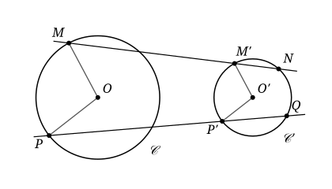

## Statement

Soient $\mathcal{C}$ et $\mathcal{C}'$ deux cercles de centres respectifs $O$ et $O'$, extérieurs l'un à l'autre : la distance $OO'$ est strictement plus grande que la somme de leurs rayons.

On trace un rayon $[OM]$ de $\mathcal{C}$ et un rayon $[O'M']$ de $\mathcal{C}'$ parallèles et de même sens, c'est-à-dire que les vecteurs $\overrightarrow{OM}$ et $\overrightarrow{O'M'}$ ont la même direction et le même sens. On trace de même deux autres rayons $[OP]$ de $\mathcal{C}$ et $[O'P']$ de $\mathcal{C}'$, parallèles et de même sens.

La droite $(MM')$ recoupe $\mathcal{C}'$ en un point $N$, et la droite $(PP')$ recoupe $\mathcal{C}'$ en un point $Q$. On suppose que les droites $(MM')$ et $(PP')$ sont distinctes.

Montrer que les quatre points $M$, $N$, $P$ et $Q$ sont sur un même cercle.

## Hints

1. Notez $r$ et $r'$ les rayons des deux cercles. Exprimez le vecteur $\overrightarrow{O'M'}$ à l'aide du vecteur $\overrightarrow{OM}$.
2. Si $r \neq r'$, montrez que toutes les droites $(MM')$ obtenues de cette façon passent par un même point $S$ de la droite $(OO')$, qui ne dépend pas de $M$.
3. Si une droite passant par un point $S$ coupe un cercle en $U$ et $V$, le produit $SU \times SV$ ne dépend que de $S$ et du cercle. Démontrez-le avec le théorème de Pythagore, puis comparez $SM \times SN$ et $SP \times SQ$.
4. N'oubliez pas le cas $r = r'$ : les droites $(MM')$ et $(PP')$ sont alors parallèles à $(OO')$. Cherchez une médiatrice commune.

## Solution

Notons $r$ et $r'$ les rayons de $\mathcal{C}$ et de $\mathcal{C}'$, $d = OO'$ la distance des centres, de sorte que $d > r + r'$, et $k = r'/r$, qui est strictement positif.

**Étape 1 : traduire l'hypothèse.** Les vecteurs $\overrightarrow{OM}$ et $\overrightarrow{O'M'}$ ont la même direction, le même sens, et des longueurs égales à $r$ et à $r'$. Donc

$$\overrightarrow{O'M'} = k\,\overrightarrow{OM} .$$

De même, $\overrightarrow{O'P'} = k\,\overrightarrow{OP}$.

**Un outil : la puissance d'un point.** Soit $\Gamma$ un cercle de centre $\Omega$ et de rayon $R$, et soit $S$ un point. Une droite passant par $S$ coupe $\Gamma$ en deux points $U$ et $V$, confondus si la droite est tangente au cercle. Soit $H$ le pied de la perpendiculaire à cette droite passant par $\Omega$. D'après le théorème de Pythagore,

$$\Omega S^2 = \Omega H^2 + HS^2 , \qquad R^2 = \Omega U^2 = \Omega H^2 + HU^2 = \Omega V^2 = \Omega H^2 + HV^2 .$$

Donc $HU = HV$ : le point $H$ est le milieu de $[UV]$. En soustrayant, on obtient $\Omega S^2 - R^2 = HS^2 - HU^2$. On en tire deux conséquences.

- (a) Si $S$ n'est pas sur le segment $[UV]$, alors $HS > HU$, et les distances de $S$ à $U$ et à $V$ valent $HS - HU$ et $HS + HU$. Donc $SU \times SV = HS^2 - HU^2 = \Omega S^2 - R^2$, et ce nombre est strictement positif : $\Omega S > R$.
- (b) Si $\Omega S > R$, alors $HS > HU$ : le point $S$ n'est pas sur le segment $[UV]$, les points $U$ et $V$ sont du même côté de $S$ sur la droite, et $SU \times SV = \Omega S^2 - R^2$.

**Une réciproque.** Soient $\ell_1$ et $\ell_2$ deux droites distinctes qui passent par un point $S$. Soient $U$ et $V$ deux points distincts de $\ell_1$, différents de $S$ et du même côté de $S$, et soient $X$ et $Y$ deux points de $\ell_2$, différents de $S$ et du même côté de $S$, tels que $SU \times SV = SX \times SY$. Alors $U$, $V$, $X$ et $Y$ sont sur un même cercle.

En effet, $X$ n'est pas sur $\ell_1$, sinon ce serait le point commun $S$ des deux droites. Les points $U$, $V$, $X$ ne sont donc pas alignés, et il existe un cercle $\Gamma$ qui passe par eux ; notons $\Omega$ son centre et $R$ son rayon. La droite $\ell_1$ coupe $\Gamma$ en $U$ et $V$, et $S$ n'est pas sur le segment $[UV]$. D'après (a), $\Omega S > R$ et $SU \times SV = \Omega S^2 - R^2$. La droite $\ell_2$ passe par le point $X$ de $\Gamma$ ; elle recoupe $\Gamma$ en un point $Y^*$, éventuellement égal à $X$. D'après (b), $Y^*$ est du même côté de $S$ que $X$, et

$$SX \times SY^* = \Omega S^2 - R^2 = SU \times SV = SX \times SY .$$

Donc $SY^* = SY$. Les points $Y$ et $Y^*$ sont sur la même demi-droite issue de $S$, à la même distance de $S$ : ils sont confondus. Ainsi $Y$ est sur $\Gamma$.

**Étape 2 : le cas $r \neq r'$.** Alors $k \neq 1$, et l'on définit un point $S$ de la droite $(OO')$ par

$$\overrightarrow{OS} = \frac{1}{1 - k}\,\overrightarrow{OO'} .$$

On calcule

$$\overrightarrow{SO'} = \overrightarrow{SO} + \overrightarrow{OO'} = \left(1 - \frac{1}{1 - k}\right)\overrightarrow{OO'} = \frac{-k}{1 - k}\,\overrightarrow{OO'} = k\,\overrightarrow{SO} ,$$

puis, avec l'étape 1,

$$\overrightarrow{SM'} = \overrightarrow{SO'} + \overrightarrow{O'M'} = k\,\overrightarrow{SO} + k\,\overrightarrow{OM} = k\,\overrightarrow{SM} .$$

Le point $S$ est à l'extérieur des deux cercles. En effet, $SO = d/|1 - k| = rd/|r - r'|$, et $d > r + r' \geqslant |r - r'|$, donc $SO > r$. De même, $SO' = k \times SO = r'd/|r - r'| > r'$.

Comme $\overrightarrow{SM'} = k\,\overrightarrow{SM}$ avec $k > 0$, le point $S$ est sur la droite $(MM')$, et $M'$ est sur la demi-droite $[SM)$, avec $SM' = k \times SM$. Le même calcul donne $\overrightarrow{SP'} = k\,\overrightarrow{SP}$ : le point $S$ est aussi sur la droite $(PP')$, et $SP' = k \times SP$.

La droite $(MM')$ passe par $S$, qui est extérieur à $\mathcal{C}'$, et elle coupe $\mathcal{C}'$ en $M'$ et $N$. D'après (b), le point $N$ est du même côté de $S$ que $M'$, donc que $M$, et

$$SM' \times SN = O'S^2 - r'^2 .$$

Comme $SM' = k \times SM$, on en déduit $SM \times SN = (O'S^2 - r'^2)/k$.

De même, $P$ et $Q$ sont du même côté de $S$, et $SP \times SQ = (O'S^2 - r'^2)/k$. Ainsi $SM \times SN = SP \times SQ$.

Appliquons la réciproque avec $\ell_1 = (MM')$ et $\ell_2 = (PP')$, qui sont distinctes par hypothèse et passent par $S$. Les points $M$ et $N$ sont distincts, car $M$ est sur $\mathcal{C}$, $N$ sur $\mathcal{C}'$, et les deux cercles n'ont aucun point commun. Ils sont différents de $S$, qui n'est sur aucun des deux cercles. Il en va de même pour $P$ et $Q$. Donc $M$, $N$, $P$ et $Q$ sont sur un même cercle.

**Étape 3 : le cas $r = r'$.** Alors $k = 1$ et $\overrightarrow{O'M'} = \overrightarrow{OM}$, donc

$$\overrightarrow{MM'} = \overrightarrow{MO} + \overrightarrow{OO'} + \overrightarrow{O'M'} = \overrightarrow{OO'} .$$

La droite $(MM')$ est donc parallèle à $(OO')$, et de même pour $(PP')$. Notons $I$ le milieu de $[OO']$ et $\Delta$ la médiatrice de $[OO']$, c'est-à-dire la perpendiculaire à $(OO')$ passant par $I$. Montrons que $\Delta$ est aussi la médiatrice de $[MN]$.

Soit $H$ le pied de la perpendiculaire à $(MM')$ passant par $O'$, et $K$ le milieu de $[MN]$. D'après l'outil, $H$ est le milieu de $[M'N]$. Alors

$$\overrightarrow{HK} = \overrightarrow{HN} + \overrightarrow{NK} = \frac{1}{2}\overrightarrow{M'N} + \frac{1}{2}\overrightarrow{NM} = \frac{1}{2}\overrightarrow{M'M} = -\frac{1}{2}\overrightarrow{OO'} = \overrightarrow{O'I} .$$

Ainsi $K$ est l'image de $H$ par la translation de vecteur $\overrightarrow{O'I}$. Or $H$ est sur la perpendiculaire à $(OO')$ passant par $O'$, puisque $(O'H)$ est perpendiculaire à $(MM')$, qui est parallèle à $(OO')$. Cette translation envoie cette perpendiculaire sur la perpendiculaire à $(OO')$ passant par $I$, qui est $\Delta$. Donc $K$ est sur $\Delta$. Comme de plus $(MN)$ est perpendiculaire à $\Delta$, la droite $\Delta$ est la médiatrice de $[MN]$. Le même raisonnement montre que $\Delta$ est aussi la médiatrice de $[PQ]$.

La médiatrice de $[MP]$ n'est pas parallèle à $\Delta$. Sinon $(MP)$ serait perpendiculaire à $\Delta$, donc parallèle à $(OO')$, et $P$ serait sur la parallèle à $(OO')$ passant par $M$, qui est $(MM')$ ; la droite $(PP')$, parallèle à $(OO')$ passant par $P$, serait alors égale à $(MM')$, ce qui est exclu. Notons $\Omega$ le point commun de $\Delta$ et de la médiatrice de $[MP]$. Alors $\Omega M = \Omega P$, et comme $\Omega$ est sur $\Delta$, on a aussi $\Omega M = \Omega N$ et $\Omega P = \Omega Q$. Les quatre points sont sur le cercle de centre $\Omega$ et de rayon $\Omega M$.

**Conclusion.** Dans les deux cas, les points $M$, $N$, $P$ et $Q$ sont sur un même cercle.

**Remarque.** L'hypothèse que les droites $(MM')$ et $(PP')$ sont distinctes est indispensable. Si $P$ est le second point où la droite $(MM')$ coupe $\mathcal{C}$, alors $P'$ est aussi sur cette droite, d'après les étapes 2 et 3. La droite coupe alors $\mathcal{C}'$ en $M'$ et $P'$, donc $N = P'$ et $Q = M'$, et les quatre points $M$, $N$, $P$, $Q$ sont alignés : ils ne peuvent pas être sur un même cercle.

## Going further

1. Dans le cas $r \neq r'$, on a vu que toutes les droites $(MM')$ passent par le point $S$. Montrer que les deux tangentes communes à $\mathcal{C}$ et $\mathcal{C}'$ qui ne passent pas entre les deux cercles passent aussi par $S$.
2. On prend maintenant des rayons $[O'M']$ et $[O'P']$ parallèles à $[OM]$ et à $[OP]$, mais de sens contraire. Montrer que les points $M$, $N$, $P$, $Q$ sont encore sur un même cercle. Où se trouve cette fois le point $S$ ?
