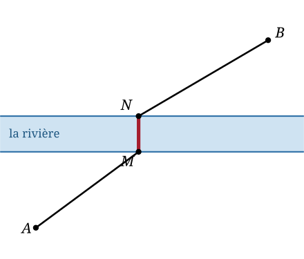

## Statement

Deux villages $A$ et $B$ sont séparés par une rivière dont les deux rives sont des droites parallèles. On veut construire une route de $A$ à $B$ qui franchit la rivière sur un pont **perpendiculaire aux rives**.

La route se compose donc de trois morceaux : un chemin droit de $A$ jusqu'à un point $M$ de la rive côté $A$, le pont $[MN]$, puis un chemin droit de $N$ jusqu'à $B$.

Où faut-il placer le pont pour que la longueur totale $AM + MN + NB$ soit la plus petite possible ?

## Hints

1. Comparer deux positions possibles du pont. Qu'est-ce qui change, qu'est-ce qui ne change pas ?
2. Le pont a toujours la même longueur (la largeur de la rivière) et toujours la même direction. Le vecteur $\vec{MN}$ ne dépend donc pas de l'endroit choisi.
3. Le problème se ramène donc à rendre $AM + NB$ minimal. La difficulté : les points $M$ et $N$ ne sont pas au même endroit.
4. Si l'on pouvait « refermer » la rivière, le problème deviendrait trivial. Faire glisser $B$ d'un bord à l'autre : appliquer à $B$ la translation de vecteur $\vec{NM}$.
5. Une fois $B$ remplacé par son image $B'$, montrer que $NB = MB'$, et reconnaître le chemin le plus court entre deux points.

## Solution

**Ce qui ne change pas.**

Les deux rives sont parallèles et le pont leur est perpendiculaire : quel que soit l'endroit choisi, le pont a la même longueur $\ell$ (la largeur de la rivière) et la même direction. Autrement dit, **le vecteur $\vec{MN}$ est le même pour tous les ponts possibles.**

Comme $MN = \ell$ est une constante, minimiser $AM + MN + NB$ revient exactement à minimiser

$$AM + NB.$$

**L'idée : faire glisser $B$ jusqu'à l'autre rive.**

Notons $\vec{u} = \vec{NM}$, le vecteur qui traverse la rivière en allant de la rive de $B$ vers celle de $A$. C'est un vecteur fixe, perpendiculaire aux rives, de longueur $\ell$.

Appelons $B'$ l'image de $B$ par la translation de vecteur $\vec{u}$, c'est-à-dire le point tel que $\vec{BB'} = \vec{u}$. Ce point $B'$ ne dépend pas du choix du pont.

Calculons :

$$\vec{MB'} = \vec{MB} + \vec{BB'} = \vec{MB} + \vec{NM} = \vec{NM} + \vec{MB} = \vec{NB}.$$

Les deux vecteurs sont égaux, donc les longueurs le sont :

$$NB = MB'.$$

*(Autrement dit, $MNBB'$ est un parallélogramme.)*

**Conclure.**

La quantité à minimiser devient

$$AM + NB = AM + MB'.$$

Or $AM + MB'$ est la longueur d'une ligne brisée reliant $A$ à $B'$ en passant par $M$. Le chemin le plus court d'un point à un autre est le segment : pour tout point $M$,

$$AM + MB' \geqslant AB',$$

avec égalité si et seulement si $M$ appartient au segment $[AB']$.

Les points $A$ et $B'$ sont de part et d'autre de la rive côté $A$ : le segment $[AB']$ coupe donc bien cette rive, en un unique point. **C'est là qu'il faut construire le pont.**

**La construction, en trois traits.**

1. Tracer le point $B'$, image de $B$ par la translation perpendiculaire aux rives, de la longueur de la rivière, dirigée vers la rive de $A$.
2. Tracer le segment $[AB']$. Il coupe la rive côté $A$ en un point : c'est $M$.
3. Tracer la perpendiculaire aux rives passant par $M$ : elle coupe l'autre rive en $N$. Le pont est $[MN]$.

**La longueur minimale** vaut alors

$$AM + MN + NB = AB' + \ell.$$

**Conclusion.** Le meilleur pont est celui qu'on obtient en rapprochant $B$ de la largeur exacte de la rivière puis en tirant un trait droit depuis $A$. La longueur de la route vaut alors $AB' + \ell$, où $\ell$ est la largeur de la rivière.

## Going further

1. Deux rivières parallèles séparent maintenant $A$ de $B$, avec deux ponts perpendiculaires à construire. Adapter la méthode.
2. Et si le pont n'était pas obligé d'être perpendiculaire aux rives, mais devait faire un angle donné avec elles ? La méthode marche-t-elle encore ?
3. Pourquoi ne peut-on pas résoudre ce problème par une symétrie, comme dans le problème du rayon lumineux qui se réfléchit sur un miroir ?
