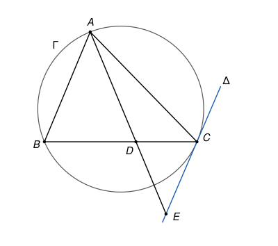

## Statement

Soit $ABC$ un triangle dont les trois angles sont aigus, avec $AC > AB$. Soit $D$ le point de la droite $(BC)$, autre que $B$, tel que $AD = AB$.

On note $\Gamma$ le cercle circonscrit au triangle $ABC$, $\Delta$ la tangente à $\Gamma$ au point $C$, et $E$ le point d'intersection des droites $(AD)$ et $\Delta$.

Montrer que

$$CD^2 = AD \times DE - BD \times DC.$$

## Hints

1. Commence par situer $D$ : en utilisant le pied $H$ de la hauteur issue de $A$, montre que $D$ est entre $B$ et $C$.
2. Le triangle $ABD$ est isocèle. Que vaut l'angle $\widehat{EDC}$ ?
3. La tangente en $C$ fait avec la corde $[CB]$ un angle égal à l'angle inscrit $\widehat{BAC}$. Démontre-le avec le centre $O$ du cercle et le théorème de l'angle inscrit.
4. Tu dois trouver deux triangles semblables. Écris l'égalité de rapports qu'ils donnent, puis remplace $AD$ par $AB$ dans l'expression à calculer.

## Solution

On note $\widehat{A}$, $\widehat{B}$, $\widehat{C}$ les angles du triangle $ABC$.

**Étape 1. Le point $D$ est entre $B$ et $C$.**

Soit $H$ le pied de la hauteur issue de $A$. Comme le triangle est acutangle, $H$ est sur le segment $[BC]$. Le triangle $ABD$ est isocèle en $A$, donc sa hauteur $(AH)$ est aussi une médiane : $H$ est le milieu de $[BD]$, et $D$ est le symétrique de $B$ par rapport à $H$.

Par le théorème de Pythagore dans les triangles rectangles $AHB$ et $AHC$ :

$$HB^2 = AB^2 - AH^2 < AC^2 - AH^2 = HC^2,$$

donc $HB < HC$. Le point $D$ est du côté de $C$ par rapport à $H$, à la distance $HD = HB < HC$ : il est donc strictement entre $H$ et $C$, et a fortiori strictement entre $B$ et $C$.

**Étape 2. Un premier angle.**

Le triangle $ABD$ est isocèle en $A$, donc ses angles à la base sont égaux : $\widehat{ADB} = \widehat{ABD} = \widehat{B}$.

**Étape 3. L'angle entre la tangente et la corde.**

Soit $O$ le centre de $\Gamma$. Le triangle est acutangle, donc $O$ est à l'intérieur du triangle, du même côté de $(BC)$ que $A$. D'après le théorème de l'angle inscrit, l'angle au centre $\widehat{BOC}$ vaut $2\widehat{A}$. Le triangle $OBC$ est isocèle en $O$, donc

$$\widehat{OCB} = \frac{180° - 2\widehat{A}}{2} = 90° - \widehat{A}.$$

La tangente $\Delta$ est perpendiculaire au rayon $(OC)$. Soit $[Cx)$ la demi-droite de $\Delta$ située de l'autre côté de $(BC)$ par rapport à $A$ (et à $O$). L'angle droit $\widehat{OCx}$ se découpe en $\widehat{OCB} + \widehat{BCx}$, donc

$$\widehat{BCx} = 90° - (90° - \widehat{A}) = \widehat{A}.$$

**Étape 4. Le triangle $CDE$.**

Plaçons-nous dans le demi-plan situé de l'autre côté de $(BC)$ par rapport à $A$.

- La demi-droite issue de $D$ qui prolonge $[AD]$ au-delà de $D$ fait avec $[DC)$ un angle égal à $\widehat{ADB} = \widehat{B}$ (angles opposés par le sommet).
- La demi-droite $[Cx)$ fait avec $[CD)$ un angle égal à $\widehat{A}$ (étape 3, car $[CD)$ et $[CB)$ sont la même demi-droite).

Comme $\widehat{A} + \widehat{B} < 180°$, ces deux demi-droites se coupent en un point de ce demi-plan. Ce point est à la fois sur $(AD)$ et sur $\Delta$ : c'est $E$. Le triangle $CDE$ a donc pour angles

$$\widehat{CDE} = \widehat{B}, \qquad \widehat{DCE} = \widehat{A}, \qquad \widehat{DEC} = 180° - \widehat{A} - \widehat{B} = \widehat{C}.$$

**Étape 5. Deux triangles semblables.**

Les triangles $ABC$ et $CDE$ ont les mêmes angles, avec la correspondance $A \leftrightarrow C$, $B \leftrightarrow D$, $C \leftrightarrow E$. Ils sont donc semblables, et leurs côtés correspondants sont proportionnels :

$$\frac{AB}{CD} = \frac{BC}{DE}, \qquad \text{d'où} \qquad AB \times DE = BC \times CD.$$

**Étape 6. Le calcul.**

Comme $AD = AB$, puis comme $D$ est entre $B$ et $C$ (donc $BC - BD = DC$) :

$$AD \times DE - BD \times DC = AB \times DE - BD \times CD = BC \times CD - BD \times CD = (BC - BD) \times CD = CD^2.$$

**Conclusion : $CD^2 = AD \times DE - BD \times DC$.**

## Going further

Le résultat de l'étape 3 s'appelle le théorème de l'angle tangentiel : l'angle entre une tangente et une corde est égal à l'angle inscrit qui intercepte la même corde, de l'autre côté.

L'hypothèse $AC > AB$ sert à placer $D$ entre $B$ et $C$. Si $AC < AB$, le point $D$ est au-delà de $C$, et la même méthode donne cette fois $CD^2 = BD \times DC - AD \times DE$.
