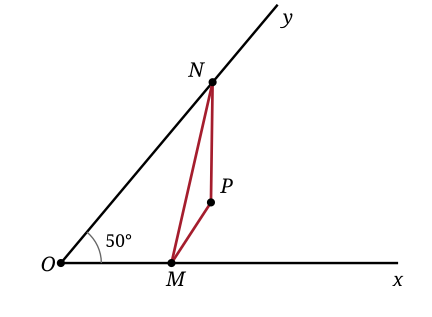

## Statement

Soit un angle $\widehat{xOy}$ de mesure $50°$, et soit $P$ un point situé à l'intérieur de cet angle, à la distance $d$ de $O$.

On cherche un point $M$ sur la demi-droite $[Ox)$ et un point $N$ sur la demi-droite $[Oy)$ tels que le périmètre du triangle $PMN$ soit **le plus petit possible**.

1. Construire $M$ et $N$.
2. Exprimer ce périmètre minimal en fonction de $d$, puis en donner une valeur approchée.

## Hints

1. Le périmètre est $PM + MN + NP$. Les deux morceaux gênants sont $PM$ et $NP$, parce qu'ils repartent en arrière vers $P$.
2. Une symétrie axiale conserve les longueurs. Si $A$ est le symétrique de $P$ par rapport à la droite $(Ox)$, que vaut $AM$ pour un point $M$ de $(Ox)$ ?
3. Faire de même de l'autre côté : appeler $B$ le symétrique de $P$ par rapport à $(Oy)$.
4. Le périmètre devient alors la longueur d'une ligne brisée allant de $A$ à $B$. Quand une ligne brisée est-elle la plus courte possible ?
5. Pour la longueur : que peut-on dire du triangle $OAB$ ? Comparer $OA$, $OB$ et $OP$, puis calculer l'angle $\widehat{AOB}$ en découpant en deux morceaux autour de $(OP)$.

## Solution

**Faire disparaître les allers-retours.**

Soit $A$ le symétrique de $P$ par rapport à la droite $(Ox)$, et $B$ le symétrique de $P$ par rapport à la droite $(Oy)$. Ces deux points ne dépendent pas de $M$ ni de $N$.

Une symétrie axiale conserve les distances, et tout point de l'axe est son propre symétrique. Donc, pour tout point $M$ de $(Ox)$ :

$$PM = AM,$$

et, pour tout point $N$ de $(Oy)$ :

$$PN = BN.$$

Le périmètre du triangle $PMN$ s'écrit alors

$$PM + MN + NP = AM + MN + NB.$$

C'est la longueur de la ligne brisée $A \to M \to N \to B$.

**La rendre minimale.**

Le plus court chemin de $A$ à $B$ est le segment $[AB]$ : pour tous points $M$ et $N$,

$$AM + MN + NB \geqslant AB,$$

avec égalité si et seulement si $M$ et $N$ sont sur le segment $[AB]$, dans cet ordre.

Il suffit donc de tracer le segment $[AB]$ et de prendre pour $M$ son point d'intersection avec $[Ox)$, et pour $N$ son point d'intersection avec $[Oy)$.

![Les symétriques A et B de P, le segment [AB], et le triangle PMN de périmètre minimal](1221-figure-2.svg)

*(Ces deux points existent bien : $A$ est de l'autre côté de $(Ox)$ par rapport à l'angle, $B$ de l'autre côté de $(Oy)$, et le segment $[AB]$ traverse donc successivement les deux demi-droites. Cela fonctionne parce que $2 \times 50° = 100° < 180°$.)*

**La construction, en quatre traits.**

1. Construire $A$, symétrique de $P$ par rapport à $(Ox)$.
2. Construire $B$, symétrique de $P$ par rapport à $(Oy)$.
3. Tracer $[AB]$.
4. $M$ est l'intersection de $[AB]$ avec $[Ox)$, et $N$ l'intersection de $[AB]$ avec $[Oy)$.

**Calculer le périmètre minimal.**

Il vaut $AB$. Regardons le triangle $OAB$.

*Les côtés.* La symétrie par rapport à $(Ox)$ fixe $O$ et envoie $P$ sur $A$, donc $OA = OP = d$. De même $OB = OP = d$. Le triangle $OAB$ est donc **isocèle en $O$**.

*L'angle au sommet.* Notons $\alpha = \widehat{xOP}$ et $\beta = \widehat{POy}$, de sorte que $\alpha + \beta = 50°$. La symétrie par rapport à $(Ox)$ envoie $P$ sur $A$ de l'autre côté de $(Ox)$, donc $\widehat{AOP} = 2\alpha$. De même $\widehat{POB} = 2\beta$. Comme $(OP)$ sépare $A$ de $B$ :

$$\widehat{AOB} = 2\alpha + 2\beta = 2(\alpha + \beta) = 2 \times 50° = 100°.$$

Cet angle ne dépend pas de la position de $P$ à l'intérieur de l'angle : seulement de l'angle $\widehat{xOy}$.

*La base.* Dans un triangle isocèle de côtés égaux $d$ et d'angle au sommet $100°$, la hauteur issue de $O$ coupe $[AB]$ en son milieu $I$ et partage l'angle en deux angles de $50°$. Dans le triangle rectangle $OIA$ :

$$\sin(50°) = \frac{IA}{OA} = \frac{AB/2}{d}, \qquad \text{donc} \qquad AB = 2\,d\,\sin(50°).$$

Numériquement, $\sin(50°) \approx \text{0,766}$, donc

$$AB \approx \text{1,53}\,d.$$

**Conclusion.** Le périmètre minimal vaut $2\,d\,\sin(50°) \approx \text{1,53}\,d$, où $d = OP$. Il ne dépend que de la distance $OP$ et de l'ouverture de l'angle, pas de la direction dans laquelle $P$ se trouve à l'intérieur de l'angle.

## Going further

1. Reprendre le calcul pour un angle d'ouverture $\theta$ quelconque : le périmètre minimal vaut $2\,d\,\sin\theta$. Pour quelles valeurs de $\theta$ la construction cesse-t-elle de fonctionner, et pourquoi ?
2. Un rayon lumineux part de $P$, se réfléchit sur $(Ox)$ puis sur $(Oy)$ et revient en $P$. Montrer que le chemin $PMNP$ trouvé ci-dessus est exactement celui que suit la lumière.
3. On fixe maintenant $M$ sur $[Ox)$ et l'on cherche seulement le meilleur $N$. Que devient le problème ?
