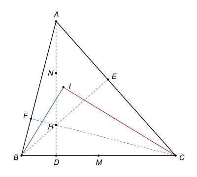

## Statement

Soit $ABC$ un triangle dont les trois angles sont aigus, et $H$ son orthocentre. Les bissectrices des angles $\widehat{ABH}$ et $\widehat{ACH}$ se coupent en un point $I$.

Montrer que $I$ est aligné avec le milieu $M$ de $[BC]$ et le milieu $N$ de $[AH]$.

## Hints

1. Note $E$ et $F$ les pieds des hauteurs issues de $B$ et de $C$. Cherche deux cercles qui passent à la fois par $E$ et par $F$ : pense aux angles droits.
2. Montre que la droite $(MN)$ est la médiatrice du segment $[EF]$.
3. Remarque que $\widehat{ABH} = \widehat{FBE}$ et $\widehat{ACH} = \widehat{ECF}$. Où ces deux angles sont-ils inscrits ?
4. Soit $P$ le milieu de l'arc $EF$ du cercle de diamètre $[BC]$. Montre que $(BP)$ et $(CP)$ sont les deux bissectrices.

## Solution

On note $D$, $E$ et $F$ les pieds des hauteurs issues de $A$, de $B$ et de $C$. Comme les trois angles du triangle sont aigus, ces pieds sont à l'intérieur des côtés, et l'orthocentre $H$ est à l'intérieur du triangle, sur les segments $[BE]$ et $[CF]$.

On utilise le fait suivant, vu au collège : un point $X$ distinct de $U$ et de $V$ est sur le cercle de diamètre $[UV]$ si et seulement si l'angle $\widehat{UXV}$ est droit.

**Étape 1. La droite $(MN)$ est la médiatrice de $[EF]$.**

- Les angles $\widehat{BEC}$ et $\widehat{BFC}$ sont droits, donc $E$ et $F$ sont sur le cercle $\Gamma$ de diamètre $[BC]$, dont le centre est $M$. Ainsi $ME = MF$.
- Les angles $\widehat{AEH}$ et $\widehat{AFH}$ sont droits, donc $E$ et $F$ sont sur le cercle de diamètre $[AH]$, dont le centre est $N$. Ainsi $NE = NF$.

Les points $E$ et $F$ sont distincts, car $E$ est sur $(AC)$, $F$ est sur $(AB)$, et aucun des deux n'est en $A$. Les points $M$ et $N$ sont distincts : $M$ est sur $(BC)$, alors que $N$ est le milieu de deux points $A$ et $H$ situés strictement du même côté de $(BC)$. Les points $M$ et $N$ sont tous deux à égale distance de $E$ et de $F$, donc la droite $(MN)$ est la médiatrice de $[EF]$.

**Étape 2. Le milieu $P$ de l'arc $EF$.**

Les points $E$ et $F$ sont sur $\Gamma$, du même côté de $(BC)$ que $A$. Ils sont donc sur le demi-cercle de $\Gamma$ qui va de $B$ à $C$ de ce côté. Sur ce demi-cercle, on appelle $P$ le milieu de l'arc qui va de $E$ à $F$. Cet arc ne contient ni $B$ ni $C$.

Les arcs $FP$ et $PE$ sont égaux, donc les cordes aussi : $PE = PF$. Le point $P$ est donc sur la médiatrice de $[EF]$, c'est-à-dire sur la droite $(MN)$ d'après l'étape 1.

**Étape 3. La bissectrice de $\widehat{ABH}$ passe par $P$.**

Comme $H$ est sur le segment $[BE]$ et $F$ sur le segment $[BA]$, les demi-droites $[BH)$ et $[BE)$ sont les mêmes, ainsi que $[BA)$ et $[BF)$. Donc $\widehat{ABH} = \widehat{FBE}$.

Les angles $\widehat{FBP}$ et $\widehat{PBE}$ sont inscrits dans $\Gamma$, et interceptent les arcs $FP$ et $PE$, qui ne contiennent pas $B$. D'après le théorème de l'angle inscrit, chacun vaut la moitié de l'angle au centre correspondant, $\widehat{FMP}$ ou $\widehat{PME}$. Ces deux angles au centre sont égaux, puisque les arcs sont égaux, donc $\widehat{FBP} = \widehat{PBE}$. Comme $P$ est sur l'arc entre $F$ et $E$, la demi-droite $[BP)$ est entre $[BF)$ et $[BE)$. C'est donc la bissectrice de l'angle $\widehat{FBE}$, c'est-à-dire de $\widehat{ABH}$.

**Étape 4. La bissectrice de $\widehat{ACH}$ passe aussi par $P$.**

Le même raisonnement, en échangeant les rôles de $B$ et de $C$, et de $E$ et de $F$, montre que $\widehat{ACH} = \widehat{ECF}$ et que $[CP)$ est la bissectrice de cet angle.

**Conclusion.** Les deux bissectrices passent par $P$. Elles ne sont pas confondues, car la droite $(BP)$ ne passe pas par $C$ : le point $P$ est sur $\Gamma$ et différent de $B$ et de $C$. Elles ont donc un seul point commun, et $I = P$. D'après l'étape 2, $P$ est sur la droite $(MN)$ : les points $I$, $M$ et $N$ sont alignés.

## Going further

La solution montre davantage : $I$ est sur le cercle de diamètre $[BC]$, et $(MN)$ est perpendiculaire à $(EF)$.

Si $O$ est le centre du cercle circonscrit à $ABC$, on peut montrer que $\overrightarrow{MN} = \overrightarrow{OA}$ : le quadrilatère $AOMN$ est un parallélogramme. Avec l'exercice, on retrouve un résultat classique : la droite $(OA)$ est perpendiculaire à $(EF)$. Essaie de démontrer directement que $\overrightarrow{AH} = 2\,\overrightarrow{OM}$, ce qui donne le parallélogramme.
